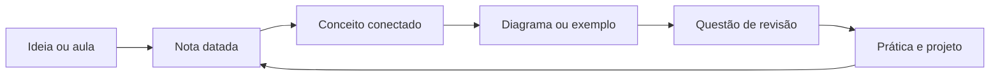
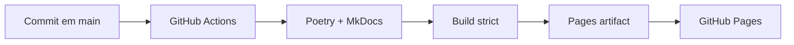

<h1 align="center">Personal Knowledge Wiki</h1>

<p align="center">
  <strong>Uma base de conhecimento pessoal para transformar estudo em entendimento reutilizável.</strong><br>
  Engenharia de dados, analytics, machine learning, certificações, idiomas e desenvolvimento profissional — organizados para leitura, busca e revisão.
</p>

<p align="center">
  <a href="#comece-aqui">Comece aqui</a> ·
  <a href="#como-o-conhecimento-está-organizado">Como está organizado</a> ·
  <a href="#trilhas-de-estudo">Trilhas de estudo</a> ·
  <a href="#site-de-documentação">Site de documentação</a>
</p>

<p align="center">
   &nbsp;
   &nbsp;
   &nbsp;
   &nbsp;
   &nbsp;
   &nbsp;
   &nbsp;
  
</p>

<p align="center">
  <a href="https://github.com/IAugustoMZ/personalWiki/actions/workflows/deploy-mkdocs.yml"></a>
  <a href="https://IAugustoMZ.github.io/personalWiki/"></a>
</p>

## O que é

Este repositório é um sistema de aprendizagem contínua: cada nota captura uma ideia, cada
diagrama torna uma relação visível e cada índice cria um caminho para voltar ao assunto depois.

O conteúdo é escrito em Markdown, versionado no Git e publicado automaticamente como um site
pesquisável. A organização favorece três movimentos:

- **Explorar:** navegar por áreas e trilhas de estudo.
- **Aprofundar:** ler notas datadas, exemplos de código e diagramas relacionados.
- **Revisar:** voltar por questões, índices, buscas e sequências numeradas.

> **Estado atual.** O wiki está ativo e publicado no GitHub Pages. A navegação é gerada a partir
> dos READMEs e das notas existentes, então uma nova entrada passa a fazer parte do site sem a
> manutenção de um menu manual.

## Comece aqui

| Você quer... | Comece por | Depois explore |
|---|---|---|
| Construir fundamentos de dados | [Cursos](courses/README.md) | [Fundamentos de Engenharia de Dados](courses/data_engineering_fundamentals/README.md) |
| Seguir uma formação completa | [Formação de Engenheiro de Dados](courses/data_engineer_formation/README.md) | módulos de cloud, lakehouse, SQL, dbt, Spark e governança |
| Estudar analytics e BI | [Power BI](courses/microsoft_power_bi_for_business_intelligence_and_data_science/README.md) | [Questões de revisão](questions/README.md) |
| Preparar uma certificação | [Certificações](certifications/README.md) | [Databricks ML Practitioner](certifications/databricks/machine_learning_practitioner_associate/README.md) |
| Consultar arquiteturas visuais | [Artefatos](artifacts/README.md) | diagramas de lakehouse, governança, ML e carreira |
| Praticar idiomas | [Idiomas](languages/README.md) | espanhol, chinês e japonês |

## Como o conhecimento está organizado



| Camada | Papel | Onde encontrar |
|---|---|---|
| **Trilhas** | Sequências de estudo com contexto e progressão | [`courses/`](courses/README.md) |
| **Notas** | Registro cronológico de aulas, leituras e sínteses | dentro de cada pasta de curso |
| **Visualizações** | Diagramas para arquitetura, processos e frameworks | [`artifacts/`](artifacts/README.md) |
| **Revisão** | Perguntas para testar recuperação ativa | [`questions/`](questions/README.md) |
| **Referência** | Preparação orientada a objetivos profissionais | [`certifications/`](certifications/README.md) |
| **Idiomas** | Vocabulário e frases em sessões curtas | [`languages/`](languages/README.md) |

## Trilhas de estudo

<div class="grid cards" markdown>

- :material-database-arrow-right:{ .lg .middle } **Engenharia de dados**

    ---

    Do armazenamento e modelagem até pipelines, Spark, Kafka, dbt, cloud e governança.

    [:octicons-arrow-right-24: Abrir cursos](courses/README.md)

- :material-chart-box-outline:{ .lg .middle } **Analytics e BI**

    ---

    Power BI, Power Query, DAX, visualização e questões para revisão de conceitos.

    [:octicons-arrow-right-24: Abrir Power BI](courses/microsoft_power_bi_for_business_intelligence_and_data_science/README.md)

- :material-brain:{ .lg .middle } **Machine learning**

    ---

    Preparação de dados, feature engineering, modelagem, avaliação e MLOps.

    [:octicons-arrow-right-24: Abrir certificações](certifications/README.md)

- :material-translate:{ .lg .middle } **Idiomas e desenvolvimento**

    ---

    Sessões de espanhol, chinês e japonês, além de comunicação, carreira e hábitos.

    [:octicons-arrow-right-24: Abrir idiomas](languages/README.md)

</div>

## Site de documentação

O site usa [MkDocs Material](https://squidfunk.github.io/mkdocs-material/) e é publicado no
GitHub Pages a cada alteração na branch `main`.

```bash
# instalar as ferramentas do site
poetry install --with docs

# iniciar o site local com live reload
poetry run mkdocs serve

# validar links, navegação e renderização antes de publicar
poetry run mkdocs build --strict
```

O site publicado está em [`IAugustoMZ.github.io/personalWiki`](https://IAugustoMZ.github.io/personalWiki/).
Se preferir Docker, use `docker compose up --build` para iniciar o ambiente do repositório.

### Como a publicação funciona



## Criando uma nova nota

Use o gerador para preservar a numeração, a pasta e o formato das entradas existentes:

```bash
make new-entry
```

O script solicita a trilha, identifica a última entrada, recebe a data em `DDMMYYYY` e cria a
nota a partir do modelo anterior. Para uma alteração manual, siga o padrão:

```text
NN_<sigla>_DDMMYYYY.md
```

Inclua exemplos executáveis quando o conceito for técnico, prefira links relativos e coloque
imagens reutilizáveis em [`artifacts/`](artifacts/README.md). O README da pasta deve explicar o
escopo da trilha e apontar para as entradas mais importantes.

## Mapa do repositório

| Caminho | Conteúdo |
|---|---|
| [`courses/`](courses/README.md) | formações, cursos e módulos de estudo |
| [`certifications/`](certifications/README.md) | preparação para certificações técnicas |
| [`languages/`](languages/README.md) | sessões de espanhol, chinês e japonês |
| [`questions/`](questions/README.md) | bancos de questões para revisão |
| [`artifacts/`](artifacts/README.md) | diagramas, imagens e fontes visuais |
| [`stylesheets/`](stylesheets/tech.css) | identidade visual do site |
| `wiki_nav.py` | gerador da navegação do MkDocs |
| `Makefile` | comandos curtos para criação e documentação |

## Princípios editoriais

- **Clareza antes de volume:** uma nota deve deixar explícita a ideia central.
- **Contexto antes do detalhe:** explique por que o conceito importa antes do comando.
- **Exemplos no meio da explicação:** código e diagramas devem aparecer próximos da decisão que ilustram.
- **Links que sobrevivem:** use caminhos relativos e mantenha os READMEs como portas de entrada.
- **Histórico como memória:** commits pequenos e mensagens semânticas preservam a evolução do estudo.

## Licença e publicação

Este wiki é público e está publicado em
[`IAugustoMZ.github.io/personalWiki`](https://IAugustoMZ.github.io/personalWiki/). Publicar o
site torna o conteúdo acessível, mas não transfere automaticamente os direitos de reutilização.

Para este tipo de material, a separação mais clara é:

- **Prosa, anotações e diagramas:** recomendação de [CC BY-NC 4.0](https://creativecommons.org/licenses/by-nc/4.0/), permitindo compartilhamento e adaptação com atribuição, mas sem uso comercial.
- **Exemplos de código:** recomendação de [MIT](https://opensource.org/license/mit), quando o trecho for suficientemente original e destinado a ser reutilizado como código.
- **Conteúdo de terceiros:** permanece sujeito à licença e aos direitos do autor original; referências não são uma autorização para redistribuição.

Enquanto uma licença formal não for adicionada ao repositório, considere o conteúdo **todos os
direitos reservados**, exceto quando uma nota indicar explicitamente outra licença. Esta é uma
orientação editorial, não aconselhamento jurídico.
