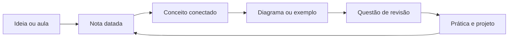
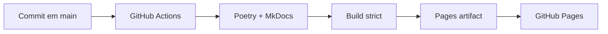

<h1 align="center">Personal Knowledge Wiki</h1>

<p align="center">
  <strong>Uma base de conhecimento pessoal para transformar estudo em entendimento reutilizável.</strong><br>
  Engenharia de dados, analytics, machine learning, certificações, idiomas e desenvolvimento profissional — organizados para leitura, busca e revisão.
</p>

<p align="center">
  <a href="#comece-aqui">Comece aqui</a> ·
  <a href="#como-o-conhecimento-está-organizado">Como está organizado</a> ·
  <a href="#trilhas-de-estudo">Trilhas de estudo</a> ·
  <a href="#site-de-documentação">Site de documentação</a>
</p>

<p align="center">
   &nbsp;
   &nbsp;
   &nbsp;
   &nbsp;
   &nbsp;
   &nbsp;
   &nbsp;
  
</p>

<p align="center">
  <a href="https://github.com/IAugustoMZ/personalWiki/actions/workflows/deploy-mkdocs.yml"></a>
  <a href="https://IAugustoMZ.github.io/personalWiki/"></a>
</p>

## O que é

Este repositório é um sistema de aprendizagem contínua: cada nota captura uma ideia, cada
diagrama torna uma relação visível e cada índice cria um caminho para voltar ao assunto depois.

O conteúdo é escrito em Markdown, versionado no Git e publicado automaticamente como um site
pesquisável. A organização favorece três movimentos:

- **Explorar:** navegar por áreas e trilhas de estudo.
- **Aprofundar:** ler notas datadas, exemplos de código e diagramas relacionados.
- **Revisar:** voltar por questões, índices, buscas e sequências numeradas.

> **Estado atual.** O wiki está ativo e publicado no GitHub Pages. A navegação é gerada a partir
> dos READMEs e das notas existentes, então uma nova entrada passa a fazer parte do site sem a
> manutenção de um menu manual.

## Comece aqui

| Você quer... | Comece por | Depois explore |
|---|---|---|
| Construir fundamentos de dados | [Cursos](courses/README.md) | [Fundamentos de Engenharia de Dados](courses/data_engineering_fundamentals/README.md) |
| Seguir uma formação completa | [Formação de Engenheiro de Dados](courses/data_engineer_formation/README.md) | módulos de cloud, lakehouse, SQL, dbt, Spark e governança |
| Estudar analytics e BI | [Power BI](courses/microsoft_power_bi_for_business_intelligence_and_data_science/README.md) | [Questões de revisão](questions/README.md) |
| Preparar uma certificação | [Certificações](certifications/README.md) | [Databricks ML Practitioner](certifications/databricks/machine_learning_practitioner_associate/README.md) |
| Consultar arquiteturas visuais | [Artefatos](artifacts/README.md) | diagramas de lakehouse, governança, ML e carreira |
| Praticar idiomas | [Idiomas](languages/README.md) | espanhol, chinês e japonês |

## Como o conhecimento está organizado



| Camada | Papel | Onde encontrar |
|---|---|---|
| **Trilhas** | Sequências de estudo com contexto e progressão | [`courses/`](courses/README.md) |
| **Notas** | Registro cronológico de aulas, leituras e sínteses | dentro de cada pasta de curso |
| **Visualizações** | Diagramas para arquitetura, processos e frameworks | [`artifacts/`](artifacts/README.md) |
| **Revisão** | Perguntas para testar recuperação ativa | [`questions/`](questions/README.md) |
| **Referência** | Preparação orientada a objetivos profissionais | [`certifications/`](certifications/README.md) |
| **Idiomas** | Vocabulário e frases em sessões curtas | [`languages/`](languages/README.md) |

## Trilhas de estudo

<div class="grid cards" markdown>

- <span class="card-icon" aria-hidden="true"><svg viewBox="0 0 24 24" focusable="false"><path d="M4 7c0-2.21 3.58-4 8-4s8 1.79 8 4-3.58 4-8 4-8-1.79-8-4m15.72 6.05c.18-.34.28-.69.28-1.05V9c0 2.21-3.58 4-8 4s-8-1.79-8-4v3c0 2.21 3.58 4 8 4 .65 0 1.28-.04 1.88-.11A5.99 5.99 0 0 1 19 13c.24 0 .5 0 .72.05m-6.62 4.91c-.36.04-.73.04-1.1.04-4.42 0-8-1.79-8-4v3c0 2.21 3.58 4 8 4 .46 0 .9 0 1.33-.06A6 6 0 0 1 13 19c0-.36.04-.7.1-1.04M23 19l-3-3v2h-4v2h4v2z"/></svg></span> **Engenharia de dados**

    ---

    Do armazenamento e modelagem até pipelines, Spark, Kafka, dbt, cloud e governança.

    [→ Abrir cursos](courses/README.md)

- <span class="card-icon" aria-hidden="true"><svg viewBox="0 0 24 24" focusable="false"><path d="M9 17H7v-7h2zm4 0h-2V7h2zm4 0h-2v-4h2zm2 2H5V5h14v14.1M19 3H5c-1.1 0-2 .9-2 2v14c0 1.1.9 2 2 2h14c1.1 0 2-.9 2-2V5c0-1.1-.9-2-2-2"/></svg></span> **Analytics e BI**

    ---

    Power BI, Power Query, DAX, visualização e questões para revisão de conceitos.

    [→ Abrir Power BI](courses/microsoft_power_bi_for_business_intelligence_and_data_science/README.md)

- <span class="card-icon" aria-hidden="true"><svg viewBox="0 0 24 24" focusable="false"><path d="M21.33 12.91c.09 1.55-.62 3.04-1.89 3.95l.77 1.49c.23.45.26.98.06 1.45-.19.47-.58.84-1.06 1l-.79.25a1.687 1.687 0 0 1-1.86-.55L14.44 18c-.89-.15-1.73-.53-2.44-1.1-.5.15-1 .23-1.5.23-.88 0-1.76-.27-2.5-.79-.53.16-1.07.23-1.62.22-.79.01-1.57-.15-2.3-.45a4.1 4.1 0 0 1-2.43-3.61c-.08-.72.04-1.45.35-2.11-.29-.75-.32-1.57-.07-2.33C2.33 7.11 3 6.32 3.87 5.82c.58-1.69 2.21-2.82 4-2.7 1.6-1.5 4.05-1.66 5.83-.37.42-.11.86-.17 1.3-.17 1.36-.03 2.65.57 3.5 1.64 2.04.53 3.5 2.35 3.58 4.47.05 1.11-.25 2.2-.86 3.13.07.36.11.72.11 1.09m-5-1.41c.57.07 1.02.5 1.02 1.07a1 1 0 0 1-1 1h-.63c-.32.9-.88 1.69-1.62 2.29.25.09.51.14.77.21 5.13-.07 4.53-3.2 4.53-3.25a2.59 2.59 0 0 0-2.69-2.49 1 1 0 0 1-1-1 1 1 0 0 1 1-1c1.23.03 2.41.49 3.33 1.3.05-.29.08-.59.08-.89-.06-1.24-.62-2.32-2.87-2.53-1.25-2.96-4.4-1.32-4.4-.4-.03.23.21.72.25.75a1 1 0 0 1 1 1c0 .55-.45 1-1 1-.53-.02-1.03-.22-1.43-.56-.48.31-1.03.5-1.6.56-.57.05-1.04-.35-1.07-.9a.97.97 0 0 1 .88-1.1c.16-.02.94-.14.94-.77 0-.66.25-1.29.68-1.79-.92-.25-1.91.08-2.91 1.29C6.75 5 6 5.25 5.45 7.2 4.5 7.67 4 8 3.78 9c1.08-.22 2.19-.13 3.22.25.5.19.78.75.59 1.29-.19.52-.77.78-1.29.59-.73-.32-1.55-.34-2.3-.06-.32.27-.32.83-.32 1.27 0 .74.37 1.43 1 1.83.53.27 1.12.41 1.71.4q-.225-.39-.39-.81a1.038 1.038 0 0 1 1.96-.68c.4 1.14 1.42 1.92 2.62 2.05 1.37-.07 2.59-.88 3.19-2.13.23-1.38 1.34-1.5 2.56-1.5m2 7.47-.62-1.3-.71.16 1 1.25zm-4.65-8.61a1 1 0 0 0-.91-1.03c-.71-.04-1.4.2-1.93.67-.57.58-.87 1.38-.84 2.19a1 1 0 0 0 1 1c.57 0 1-.45 1-1 0-.27.07-.54.23-.76.12-.1.27-.15.43-.15.55.03 1.02-.38 1.02-.92"/></svg></span> **Machine learning**

    ---

    Preparação de dados, feature engineering, modelagem, avaliação e MLOps.

    [→ Abrir certificações](certifications/README.md)

- <span class="card-icon" aria-hidden="true"><svg viewBox="0 0 24 24" focusable="false"><path d="m12.87 15.07-2.54-2.51.03-.03A17.5 17.5 0 0 0 14.07 6H17V4h-7V2H8v2H1v2h11.17C11.5 7.92 10.44 9.75 9 11.35 8.07 10.32 7.3 9.19 6.69 8h-2c.73 1.63 1.73 3.17 2.98 4.56l-5.09 5.02L4 19l5-5 3.11 3.11zM18.5 10h-2L12 22h2l1.12-3h4.75L21 22h2l-1.13-3h-4.75zm-2.62 7 1.62-4.33L19.12 17z"/></svg></span> **Idiomas e desenvolvimento**

    ---

    Sessões de espanhol, chinês e japonês, além de comunicação, carreira e hábitos.

    [→ Abrir idiomas](languages/README.md)

</div>

## Site de documentação

O site usa [MkDocs Material](https://squidfunk.github.io/mkdocs-material/) e é publicado no
GitHub Pages a cada alteração na branch `main`.

```bash
# instalar as ferramentas do site
poetry install --with docs

# iniciar o site local com live reload
poetry run mkdocs serve

# validar links, navegação e renderização antes de publicar
poetry run mkdocs build --strict
```

O site publicado está em [`IAugustoMZ.github.io/personalWiki`](https://IAugustoMZ.github.io/personalWiki/).
Se preferir Docker, use `docker compose up --build` para iniciar o ambiente do repositório.

### Como a publicação funciona



## Criando uma nova nota

Use o gerador para preservar a numeração, a pasta e o formato das entradas existentes:

```bash
make new-entry
```

O script solicita a trilha, identifica a última entrada, recebe a data em `DDMMYYYY` e cria a
nota a partir do modelo anterior. Para uma alteração manual, siga o padrão:

```text
NN_<sigla>_DDMMYYYY.md
```

Inclua exemplos executáveis quando o conceito for técnico, prefira links relativos e coloque
imagens reutilizáveis em [`artifacts/`](artifacts/README.md). O README da pasta deve explicar o
escopo da trilha e apontar para as entradas mais importantes.

## Mapa do repositório

| Caminho | Conteúdo |
|---|---|
| [`courses/`](courses/README.md) | formações, cursos e módulos de estudo |
| [`certifications/`](certifications/README.md) | preparação para certificações técnicas |
| [`languages/`](languages/README.md) | sessões de espanhol, chinês e japonês |
| [`questions/`](questions/README.md) | bancos de questões para revisão |
| [`artifacts/`](artifacts/README.md) | diagramas, imagens e fontes visuais |
| [`stylesheets/`](stylesheets/tech.css) | identidade visual do site |
| `wiki_nav.py` | gerador da navegação do MkDocs |
| `Makefile` | comandos curtos para criação e documentação |

## Princípios editoriais

- **Clareza antes de volume:** uma nota deve deixar explícita a ideia central.
- **Contexto antes do detalhe:** explique por que o conceito importa antes do comando.
- **Exemplos no meio da explicação:** código e diagramas devem aparecer próximos da decisão que ilustram.
- **Links que sobrevivem:** use caminhos relativos e mantenha os READMEs como portas de entrada.
- **Histórico como memória:** commits pequenos e mensagens semânticas preservam a evolução do estudo.

## Licença e publicação

Este wiki é público e está publicado em
[`IAugustoMZ.github.io/personalWiki`](https://IAugustoMZ.github.io/personalWiki/). Publicar o
site torna o conteúdo acessível, mas não transfere automaticamente os direitos de reutilização.

As regras formais estão em [`LICENSE.md`](LICENSE.md) e [`LICENSE-CODE.md`](LICENSE-CODE.md):

- **Prosa, anotações e diagramas:** [CC BY-NC 4.0](https://creativecommons.org/licenses/by-nc/4.0/), permitindo compartilhamento e adaptação com atribuição, mas sem uso comercial.
- **Exemplos de código originais:** [MIT](LICENSE-CODE.md), permitindo reutilização, modificação e distribuição com preservação do aviso de copyright.
- **Conteúdo de terceiros:** permanece sujeito à licença e aos direitos do autor original; referências não são uma autorização para redistribuição.

Quando uma nota, imagem ou arquivo indicar uma licença diferente, aquela indicação específica
prevalece. A licença não concede direitos sobre marcas, logos ou conteúdo de terceiros. Esta é
uma orientação editorial, não aconselhamento jurídico.
