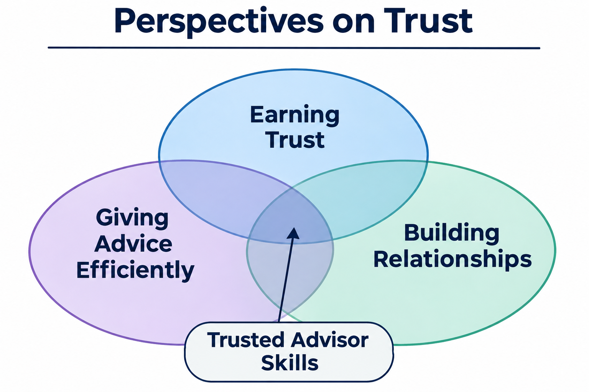

# The Trusted Advisor

## Perpectives on Trust

- is trust building a matter of technique or sincerity (both)?
- what benefits would you obtain if your clients trusted you more?
  1. reach for advice
  2. be inclined to accept the recommendations
  3. bring you in more advanced, comples and strategic issues
  4. treat you as you wish to be treated
  5. respect you
  6. shore more information $\to$ more quality of the work
  7. pay the bills without question
  8. refer you to its peers
  9. lower th level of stress of interactions
  10. benefit of the doubt
  11. forgive mistakes
  12. protect when needed
  13. warn you of dangers
  14. be confortable and allow you to be confortable
  15. involve you earlier in issues
  16. trust your instincts and judgements
- list of traits trusted advisors have in common
  1. seems to understand us, effortlessly
  2. are consistent
  3. help us to see things from fresh perspectives
  4. don't force things through
  5. help us think things trhough
  6. don't substitute their judgment for ours
  7. they stay calm
  8. help us think and separate logic and emotions
  9. criticizes and connect us, gently
  10. we can rely on them to tell the truth
  11. the relationship is more important than the issues
  12. give us reasoning not just conclusions
  13. give us options, recommendations, and let us choose
  14. challenge our assumptions
  15. make us feel confortable and casual (still takes issues seriously)
  16. act like real people
  17. reliably on our side
  18. remember what we tell them
  19. honorable
  20. help us put the problems in context
  21. sense of humor
  22. smart

- early benefits of beginning to earn trust are substantial
  - earn trust is a learnable skill

## What is a Trusted Advisor?

- fundamental advisory role $\to$ powerful database to provide expert answers to the client's questions
  - cruticality of next level rises
- next level $\to$ capabilities not directly related to our original area of expertise
  - additionally $\to$ define (and solve) more general problems

> *"The problem is rarely what the client said it was in the first meeting."*
