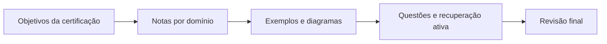

<h1 align="center">Certificações Profissionais</h1>

  <strong>Estudo orientado a prova, prática e aplicação profissional.</strong> 
  Mapas de conteúdo para transformar documentação de plataforma em revisão objetiva.

   &nbsp;
   &nbsp;
  

## Como usar esta área

As notas de certificação funcionam como um caderno de revisão: conceitos, decisões de
arquitetura, exemplos e lembretes de prova ficam organizados por domínio técnico.

| Certificação | Conteúdo | Acesso |
|---|---|---|
| **Databricks Machine Learning Practitioner Associate** | preparação de dados, features, modelos, avaliação e deployment | [Abrir notas](databricks/machine_learning_practitioner_associate/README.md) |

## Fluxo de preparação

> As notas são material pessoal de estudo e não substituem a documentação oficial da plataforma
> nem o guia de conteúdo vigente da certificação.

Voltar para a [Personal Knowledge Wiki](../README.md).
