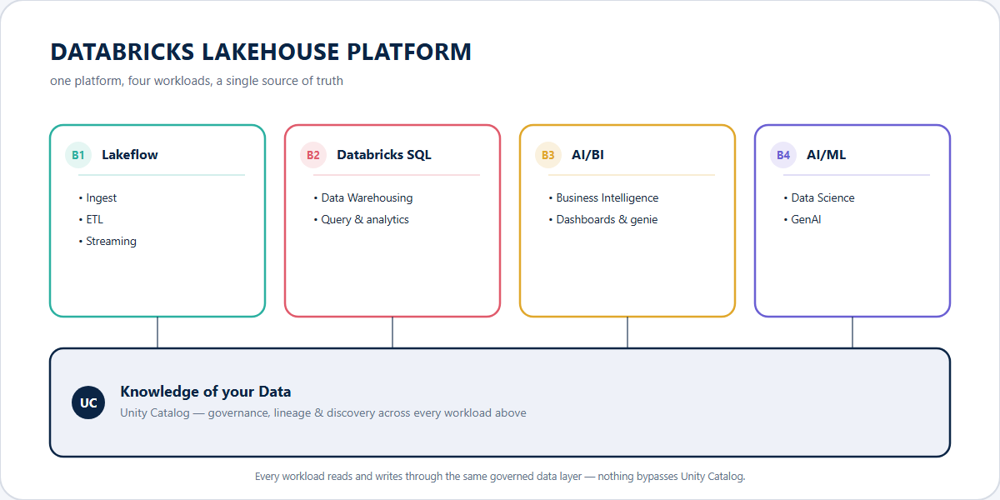
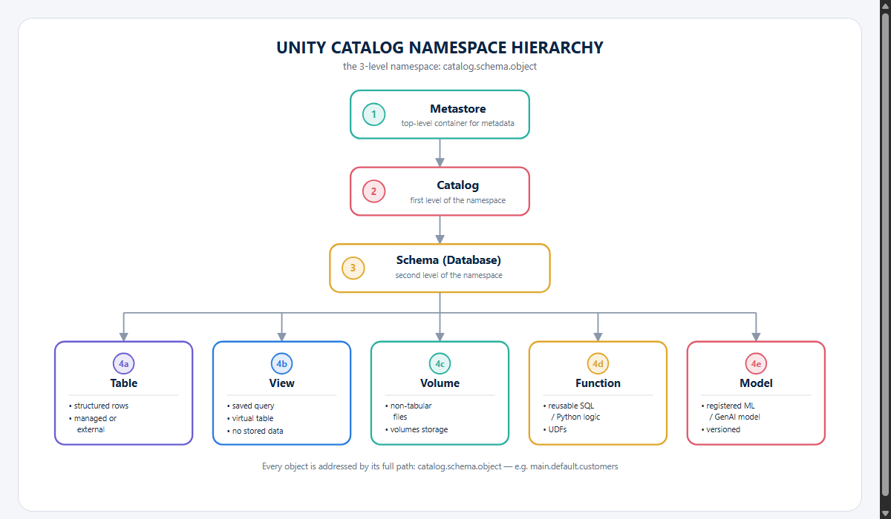
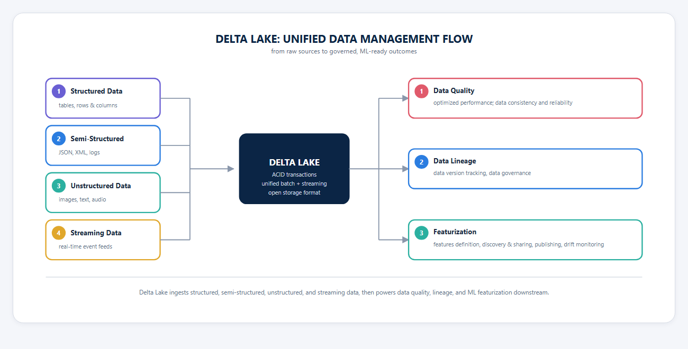

# Databricks Certified Machine Learning Practitioner Associate

## Introduction to Data Preparation for Machine Learning

### Managing and Exploring Data

- your data stored as an open, accessible Lakehouse format
- end-to-end AI
  - MLOps (MLflow)
  - model training
  - model serving
  - monitoring
  - governance
- GenAI
  - custom models
  - model serving
  - RAG
- built-in and collaborative solutions for the full ML lifecycle
- Databricks for Machine Learning
  - collaborative notebooks
    - multilanguage
    - interactive
    - visualizations
    - debug and optimize
    - reproducible
  - ML runtime
  - governance of data & models (Unity Catalog)
  - feature store
  - managed MLflow
  - model training
  - model serving
- built-in tools for visualizing and understanding data in ML workflow
  - interactive charts to visualize data in the notebooks with only two clicks
  - summarize a dataset essential properties and statistics in a data profile with the push of a button
- tools for quick ML model development
  - multi-lanague support, use standard libraries and custom models
  - mix and match languages based on use case and preferred workflow
    - Python, SQL, Scala and R
  - install Python libraries for a notebook without affecting other users with %pip
  - import local modules using arbitrary file support when working in repositories
- **Unity Catalog**
  - context aware search
  - auto describe tables and columns
  - automated lineage
  - ent-to-end observability and monitoring
  - sharing AI models
- today, data and AI governance is complex
  - where to discover the datasets, models, notebooks, and dashboards?
  - can I trust the data and ML models?
  - how to secure those assets?
  - who is accessing these assets and how?
  - are we meeting regulatory compliance?
- **Unity Catalog** $\to$ unifies governance for AI, data, code, models
  - unified visibility into data and AI
  - single permission model for data and AI
  - AI-powered monitoring and observability
  - open data sharing
- The 3-level namespace of UC
  - `SELECT * FROM catalog.schema.object`

### Delta Lake

- open source
- unified data management layer
- reliable and fast
- optimization features for storing data in the cloud
- unified data management layer that brings data reliably and fast analytics to cloud data lakes
  - optimized storage  layer that is the foundation for storing data and tables in the Databricks Data Intelligence Platform

#### Delta Lake and Its Features

- open-source, default storage format on Databricks
  - Delta Lake as a open-source project
  - default format for the tables created in Databricks
  - delta lakes optimizes performance with large datasets, with ACID transaction and scalable metadata handling
  - designed to improve data reliability, quality and performance in data lakes
  - key features
    - unified batch and streaming
    - automatic schema validation
    - support upserts using the merges operation
    - update your table schema without reutilizing data
    - track new-level changes with Change Data Feed
    - **time travel**: querying previous versions of a table based on versions number of timestamp
    - **performance optimization**: with data shipping and liquid clustering
    - support multiple programming languages like Python, Scala, and SQL
- we may let Spark infer the schema automatically or set it explicitly as a string
- `spark.read.csv` $\to$ to read from a file
- **display functions**: viewing detailed dataframes + powerful tool for visualizing the datasets according to preferences
  - insightful exploration, uncover dependendences and patterns
- can also use the visualization editor button, that allows creating visualizations quickly with clicks
- use Genie Code $\to$ natural language prompts to interact with the DataFrame, and extract insights from it
  - best practices:
    - dataframes $\to$ specify it
    - column names $\to$ explicitly mention them
    - chart type $\to$ define the visualization
    - target column $\to$ identify the label for ML focused analysis
    - objective $\to$ clearly state the question you want to answer
  - after execution, Genie can also interpret the statistics and graphs, and provide insights

##### Time Travel with Delta Lake

- allows you to access previous versions of a table
- reproduce past results
- audit changes
- recover from unintended updates
- especially valuabele in machine learning workflows
  - consistent and versioned data is critical for experimentation
- may introduce challenges in long-running ML workflows if data retention policies limit access to older versions
- `DESCRIBE HISTORY SQL` command to review the history of change and pinpoint the desired
  - descrobe to view the table schema