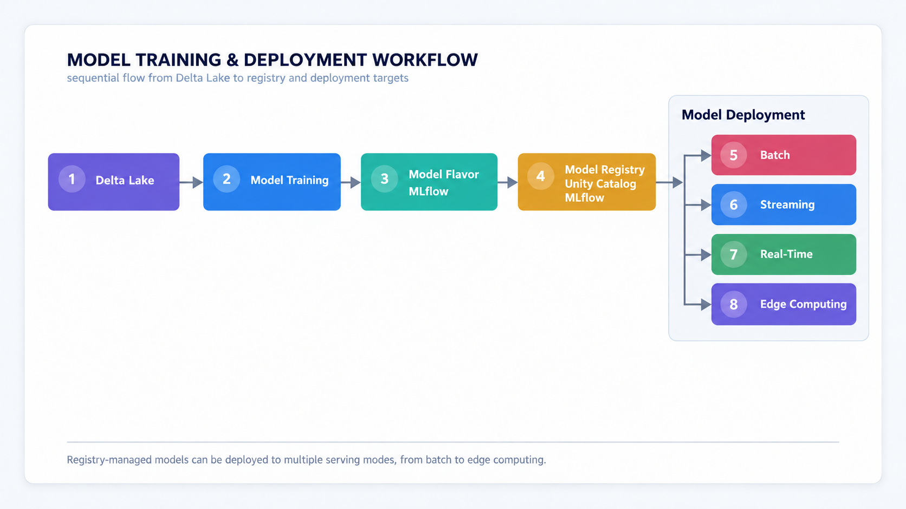
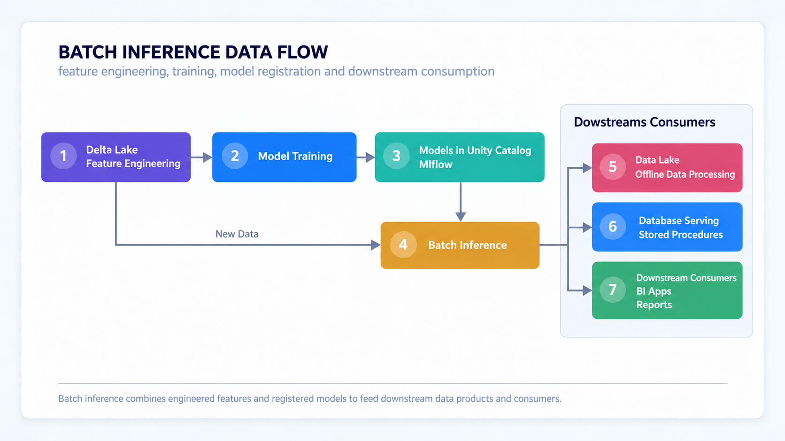

# Databricks Certified Machine Learning Practitioner Associate

## Machine Learning Model Deployment

### Model Deployment on Databricks

- **Batch**: load the desired model as a SparkUDF or call it with the `ai_query()` SQL function
  - score a Delta table on a schedule
  - predictions written back to Delta for downstream use
- **Streaming/Pipeline**: apply the same model UDF to a structured streaming DataFrame
  - or within a Lakeflow declarative pipeline
  - records are scored continuously as they arrive
- **Real-Time**: Databricks Model Serving hosts the model behind a serverless endpoint that returns predictions within miliseconds, scaling automatically with traffic
- MLflow packaging + Unity Catalog governance make it possible to select the serving path that best fits the use case

### Model Deployment with MLflow

- **Model Registry**
  - centralized, governed lifecycle with versions \& aliases (in UC)
- **Serving \& Deployment**
  - deploy registered models to batch, streaming \& real-time

- model registry managed by Models in Unity Catalog
  - unified  governance, lineage, and versioning for all registered models
  - recommended to ensure model management and deployment
- **Dependency \& Enviroment Management**
  - ensures the deployed environment matches the training environment, so their models
- **Packaging Models and Code**
  - any code and configuration are packaged with the model, so it can be deployed seamlessly without any missing components
- **Multiple Deployment Options**
  - one packaged model can target many environment
  - built-in local serving, remote containers serving (AzureML, AWS SageMaker), Kubernetes clusters, and Databricks Model Serving
- MLflow lets you packages a model once and deploy it anywhere - from local machines to cloud machines and Databricks Model Serving
  - ensures your model is ready for production regardless of the target environment

#### The MLflow Model

- standardizes format for packaging machine learning models
  - directory containing files together with an ML model file at its root
    - ML model is in the manifest $\to$ declares model's flavors plus metadata such as the signature and an input example
    - MLflow knows how to load and use the model

#### Built-in Models Flavores and `pyfunc`

- a way of viewing and loading the model
  - framework specific + generic Python function (`mlflow.pyfunc`)
    - `pyfunc` scores as the default model interface
    - any MLflow Python model is expected to be loadable as a Python function
      - single code to be deployed to many targets without framework specific serving code
    - use the same `predict()` function (consistency)

#### Models in Unity Catalog

- model registry is a centralized model store that manages a model lifecycle after training
  - three-level namespace: `catalog.schema.model`
  - inherits UC governance
- **Deploy \& Organize**: a single place to register, organize, and deploy models across the organization
- **Versioning**: every registered model gets numbered versions, so you always know exactly which artifact is in use
- **LIfecycle with Aliases**: point mutable alias such as `@champion` and `@challenger` at specific versions
  - in UC, model stages are not used - aliases and the UC namespaces express environment and promotion instead
- **Collabration \& Permissions:** access controls govern who can read, use, or promote each model
- **Lineage**: full lifecycle links a model back to the data and runs that produced it
- **Tagging \& Annotations:** attach tags and descriptions to organize and document models

##### Aliases and the UC Namespaces

- aliases are named, moavable pointers to a specific model version
  - let deployment reference a stable name
    - promote new versions without changing the code that serves the model
- `@champion` $\to$ marks the version currently serving production traffic
- `@challenger` $\to$ marks a candidate version under execution

- promoting a new model $\to$ move `@champion` alias to a different version
  - safe, seamless model updates and A/B testing

#### Serving and Exporting Models from Registry to Deployment Models

- flow is always the same
  - train $\to$ package as a flavor $\to$ register in UC $\to$ serve

- batch and streaming inference use Spark to apply models (UDFs or in pipelines)
- real-time is served by Databricks Model Serving

### Exporting Models for Edge Deployment

- some cases, specific hardware is needed, outside Databricks platform.
- characteristics that drive the export decision:
  - **Offline/ Unreliable Connectivity:** model cannot depend on a call back to a server
  - **Latency Requirements:** predictions must happen locally, close to the data
  - **Security and Compliance:** data may not be allowed to leave the device
- export the model to a portable inference runtime such as ONNX or Tensorflow Lite
  - model trained in one framework can run on a wide range of deployment targets through a single interoperable format
    1. convert the model to ONNX format
    2. save it with MLflow's ONNX flavor
    3. score it with the ONNX runtime
  - only needed for edge and embedded deployments that run off the platform
    - for other types, models can be served directly from Unity Catalog

### Batch Deployment Overview

- generates predictions on a regular schedule and writes the results out to persistent storage to be consumed downstream
  - most common deployment strategy
- ideal when:
  - immediate predictions are note necessary
  - predictions can be made in a batch fashion
  - large number / volume of (new) records
  - new records arrive relatively infrequently (minutes to hours)
    - no prediction needed at the moment of data arrival

**Advantages** | **Limitations**
--- | ---
cheapest deployment model | high latency
ease of implementation | stale data
efficient per data point | not suitable for dynamic or rapidly changing data
can handle a high volume of data | not suitable for streaming data or real-time applications

#### The end-to-end Batch Workflow

- keep operations simple and scalable
  - no real-time code or manual intervention
- centers on the generic Python function (`pyfunc`) flavor $\to$ deployment code stays simple and consistent
  - load a registered model from Unity Catalog (`catalog.schema.model`) and an alias or version
  - call `predict()` on new data (regardless of training framework)
  - for large tables, wrap the same model as a Spark UDF so scoring runs in parallel across the cluster and writes straight back to Delta

#### Batch Inference with Feature Engineering

##### Offline Feature Tables

- feature engineering in Unity Catalog $\to$ batch inference can pull them automatically at scoring time
- offline feature table is simply a Delta table with a primary key (`FeatureEngineeringClient`)
  - train and serve a model for batch inference
  - support `FeatureLookup` and `FeatureFunction` for batch model inference
  - not optimized for real-time inference due to latency
  - Offline Feature Table $\to$ Register Lookups \& Functions $\to$ Batch Inference (`fe.scorte_batch()`)
- model logged with the `FeatureEngineeringClient`
  - feature metadata packaged with the model
  - inference time: primary keys
  - `score_batch`: joins the required features from the offline feature tables automatically before scoring
- **``FeatureLookup``**: pulls pre-computed features from an offline feature table using primary keys
- **`FeatureFunction`**: computes features dynamically using a Unity Catalog governed Python UDF
- both are defined at training time:
  - automatically applied during `score_batch`
  - consistent feature logic for both training and batch inference
  - keeps batch scoring reliable and repeatable (no manual feature joins required)

#### Performance Optimization

##### Liquid Clustering

- batches reads and writes large Delta tables
  - physical layout of those tables
- liquid clustering is an alternative to table partitioning $\to$ `ZORDER` that simplifies data-layout decisions while query performance
  - replaces partitioning and `ZORDER` - you no longer choose partition columns up front & recommend for all new Delta tables
  - Databricks client manages all layout and optimization operations for data in your table
    - `CLUSTER BY` when creating Delta tables
    - clustering keys can be updated later without restructuring the table
      - data layout flexible and maintenance simple

##### Predictive Optimization

- lets Databricks decide when a table needs maintenance
  - `OPTIMIZE` $\to$ improves query performance by optimizing file sizes
  - `VACCUUM` $\to$ deletes data files no longer referenced by a table
- enabled by default for Unity Catalog managed tables
- each model logged in UC have a unique URI
  - `model://model_name/latest_version@alias`