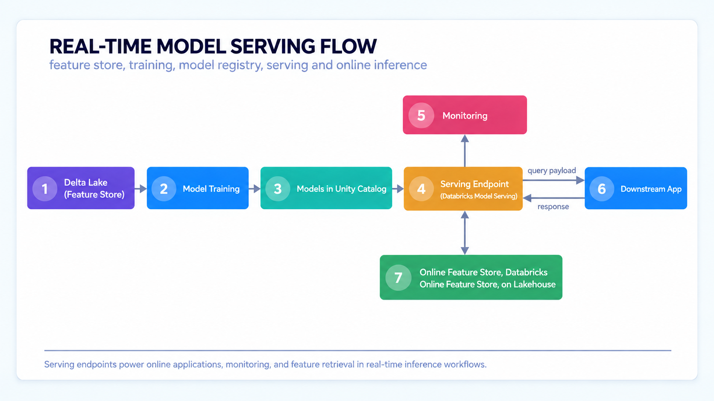

# Databricks Certified Machine Learning Practitioner Associate

## Machine Learning Model Deployment

### Introduction to Real-Time Deployment

#### Real time Deployment Fundamentals

- process of deploying and serving machine learning models in a production environment where predictions are generated instantly in response to incoming data on requests
- applications that require low-latency responses
  - more common with the emergence of GenAI applications (LLMs serving in real-time)
- low latency (milliseconds), immediate action, 24/7 uptime, continuous monitoring

- features must be available in milliseconds
  - precomputed features are published to Databricks Online Feature Stores, which are powered by Lakebase (serverless PostgreSQL)
  - serving endpoint retrieves features from the online store at request time, instead of summing offline Delta Tables

##### Challenges of Real-Time ML Systems

1. **ML infrastructure is hard**
   1. require fats and scalable serving infrastructure, which is costly to build and maintain
      1. low-latency networking and load balancing
      2. auto-scaling to handle traffic spikes
      3. high availability and fault tolerance
      4. GPU provisioning and optimization
2. **Deploying real-time models needs diparate tools**
   1. data teams use diverse tools to develop models, and customers use separate platform for data, ML, and serving - adding complexity and cost
      1. different frameworks for training vs. serving
      2. separate platforms for data engineering, ML, and deployment
      3. fragmented monitoring and governance across tools
      4. inconsistent feature computation between online and offline
3. **Operating Production ML requires expert resources**
   1. steep learning curves for deployment tools means model deployment is bottlenecked by limited engineering resources, limiting the ability to scale AI
      1. MLOps expertise is scarce and expensive
      2. each serving framework has its own learning curve
      3. debugging production issues requires cross-domain knowledge
      4. ongoing maintenance completes with new model development

- main barriers: infrastructure, tool fragmentation, specialized skills required to operate them
  - managed platform $\to$ Databricks Model Serving
    - integrate the model into websites and applications using an API
- **production grade capability:** highly available, low latency, scalable serving that works for small and large workloads
- **unified serving on Data Intelligence Platform**
  - automatic feature lookups, monitoringm and unified governance that automates deployment and reduces errors
- **simplified deploymenet**
  - simple and flexible deployment through the UI on API

- Databricks Model Serving $\to$ serverless by design, automatically scaling with traffic
  - including scale-to-zero
  - removes barriers like complex infrastructure fragmented tools, and specialized skills
    - real-time deploymnet fast and easy

#### Databricks Model Serving

- unified UI, API, and SDK for managing all types of AI models
  - **custom models:** deploy any model as a REST API with serverless compute, managed via MLflow - on CPU and GPU, with integration to Feature Engineering and Vector Search
  - **foundationa models APIs:** curates top foundation models and provides them behind simple APIs
    - start experimentation immediately without setting up serving yourself
  - **external models:** govern external models and APIs through the Unity AI Gateway, plus monitoring and payload logging for Databricks Model Serving

##### Core Features

1. **Real Time:** Model Serving is built for low-latency, high availability production workloads
   1. scalable: automatically scales up/down for bursty traffic
   2. secure: private link and IP allowlist
2. **Unified on the Data Intelligence Platform:** reply integrated with the Databricks platforms for a seamless workflows
   1. **feature store integrated:** automated feature vector
   2. **MLFlow integrated:** fast, easy model deployment
   3. **quality \& diagnostics:** built-in metrics, integrated with monitoring
   4. **unified governance:** managed data \& AI with Unity Catalog
3. **Simplified Deployment:**
   1. **simple:** endpoints via UI and API
   2. CPU and GPU support
   3. **flexible:** traffic splitting for staged rollout and A/B testing

##### Serving Infrastructure

###### Serverless Compute

- use cases that need to be 24/7, model serving provides out-of-the-box autoscaling on serverless compute $\to$ scaling up and down to handle burstry traffic 
- **GPU support**: deploy LLMs with ease
- **fast autoscaling:** compute is managed and kept warm by Databricks $\to$ rapid scaling
- **scale with workload size** $\to$ autoscale within a selected range
- **scale to zero:** save costs for use cases with predictable, non 24/7 traffic

**Workload Size** | **Concurrency Range**
--- | ---
Small | 0 - 4 concurrent requests (0 - 4 DBUs)
Medium | 0 - 16 DBUs
Large | 0 - 64 DBUs

- in the scale to zero $\to$ the first request after idle incurs a cold-start delay

###### MLflow Integration

- native integration $\to$ faster path to production
  - direct connection to model registry in Unity Catalog (REST endpoint)
  - MLflow models $\to$ MLflow Tracking $\to$ Models in Unity Catalog $\to$ Model Serving
- select the model via an alias or version and deploy to a REST endpoint (no extra packaging)