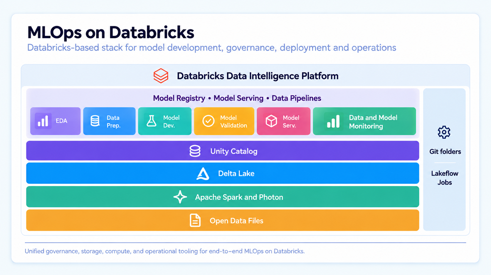

# Databricks Certified Machine Learning Practitioner Associate

## Machine Learning Operations

### MLOps unifies DataOps, DevOps and ModelOps

- each team role maps to a core MLOps component
  - DataOps (governed data)
  - DevOps (CI/CD automation)
  - ModelOps (experimental tracking and lifecycle)
- systematic cataloging of operational data enables ongoing model refreshes and retraining
- collaboration across roles ensures ML solutions are scalable, reliable, and efficient in production
- MLOps is a strategic advantage:
  - ML systems built on quality data
  - streamlining the process to taking solutions to production
  - operationalize performance and effectiveness monitoring

#### MLOps on Databricks

**DataOps** | **DevOps** | **ModelOps**
--- | --- | ---
**Apache Spark and Photon** - scalable, performant data processing | **git folders** - code management, version control, automatic testing | **Model Registry, Model Serving and Data Profiling** - storage, deployment, and monitoring of ML models on architecture
**Unity Catalog** - unified security, governance and cataloguing | **Lakeflow jobs** - DAG based orchestration and job scheduling | --- 
**Delta Lake** - reliable data storage, combining lakes and warehouses | --- | ---

##### DataOps Tasks and Tools

- good ML models depend on reliable data pipelines and infrastructure
  - single platform and uses the same toolset

**Task** | **Tool**
--- | ---
Ingest \& Transform Data | Autoloader and Apache Spark
Track data changes to include versioning and lineage | Delta Tables
Build, manage \& monitor data processing pipelines | SDP
Ensure data security \& governance | Unity Catalog
Exploratory Data Analysis, dashboards \& general coding | Databricks SQL, dashboards and Databricks notebooks
Schedule data pipelines \& automate general Lakeflow Jobs | Databricks Lakeflow jobs
Create, store, manage \& discover features | Databricks Feature Store
Data Monitoring | Data Profiling

###### Databricks SQL

- a serverless data warehouse on the Databricks
  - run all SQL and BI applications at scale delivering analytics on the freshest data with data warehouse performance and data lake economics
- built on the Lakehouse and governed by Unity Catalog
  - consistency in security and compliance while connecting to the BI tools analysts already use
  - **better price / performance** than the other cloud data warehouses
  - **simplify discovery and sharing** of new insights
  - **connect to the familiar BI tools**, like Tableau or Power BI
  - **simplified administration and governance**
- designed for large-scale ETL, real-time analytics, and machine learning workflows
- materialized views can significantly boost query speed and lower costs for data-heavy workloads
- integrates with popular BI tools and supports advanced analytics
- makes it easier to analytics to quickly visualize and share insights with a new, easy-to-use SQL query editor, rich dashboards, and automatic alerts
  - **perform ad-hoc and exploratory**
  - **automatic alerts can be triggered** for critical changes, allowing team to respond to business needs faster
- the query editor is SQL-native: analysts write queries in a familiar syntax, explore Delta Lake table schemas
  - saves frequently used code as snippets
  - cache result to keep run times short
  - organize results into dashboards (*drag-and-drop*), shareable in web-browser, auto-refreshable and configured to alert on meaningful changes
- input widgets for parametrization
  - User Defined Functions (UDFs) in SQL and Python
  - AI Functions that leverage large language models (LLMs) directly in SQL queries

###### Orchestration with Lakeflow Jobs

- fully managed, cloud-based, general-purpose task orchestration service for the entire platform
  - build reliable data, analytics and AI Lakeflow Jobson any cloud
- sits on top of Databricks platform $\to$ orchestrate any combination of tasks
  - notebooks, SQL, Spark, ML Models, and Python code
  - integrate with data governance and monitoring services
- no infrastructure or setup required
  - quality build, run, monitor, and repair data pipelines
  - orchestrate tasks like data, ingestion, transformation, and analytics
  - team focus on workflow logic and outcome, not operational overhead

###### Two Orchestration Services - Jobs and SDP

**Service** | **Description** | **Best use scenario**
--- | --- | ---
Lakeflow Jobs | Orchestrate any combination of tasks - more flexible | Orchestration of dependent jobs, Machine Learning tasks, Arbitrary code, External API calls, custom tasks (Notebooks, JARs, SDP pipelines, Python, Scala, Spark, SQL, Java)
SDP (*Spark Declarative Pipelines*) | Build batch and streaming data pipelines with built-in quality controls | Data ingestion and transformations - ETL processes, batch and streaming inputs. Enforces data quality and consistency, tracking and logging of transformations

- Lakeflow Jobs and SDP are complimentary orchestration services in Databricks
  - Lakeflow Jobs can orchestrate any task type, including running SDP pipelines as tasks
  - SDP specializes in building reliable, quality-controlled batch nad streaming pipelines
- use Lakeflow Jobs for flexible orchestration across ML, analytics, and custom workloads
- use SDP for robust ETL and data quality

###### Lakeflow Jobs - Key Features

- **simplicity:** easy creation and monitoring in the UI
- **many tasks:** many tasks types suited to workload
- **fully integrated:** built into Databricks platform, making inspection results and debugging faster
- **reliability:** proven Databricks scheduler, with built-in task retry and failover
- **observability:** easily monitor status, track performance and gain insights into job execution
- directed acyclic graphs (DAGs) in Lakeflow Jobs help the organization of complex workflows by breaking them into smaller, more manageable tasks
  - define dependencies (parallel or sequence tasks)
  - easier to monitor, troubleshoot, optimize your data and ML pipelines
    - reliability and clarity for both simple and large scale processes

###### Building Blocks of a Lakeflow Job

- unit of orchestration is called a job
  - **tasks:** jobs consist of one or more tasks
    - Databricks Notebooks
    - Python scripts
    - Python wheels
    - SQL files / queries
    - Lakehouse Dashboards
    - SDP pipelines
    - dbt
    - Java JAR files
    - Spark submit
  - **control flows:** established between tasks
    - sequential
    - parallel
    - conditional (run if)
    - jobs as a task (modular)
  - **triggers**: jobs support different triggers
    - manual
    - scheduled
    - API
    - file arrival
    - delta table update
    - continuous (streaming)

##### ModelOps Tasks and Tools

- streamlines the lifecycle management of machine learning models - from development to deployment and monitoring
  - maintenance effectively throughout their operational life

**Task** | **Tool**
--- | ---
Manage model lifecycle | Models in Unity Catalog
Track model development | MLflow model tracking
Model code version and sharing | Databricks git folders
No-code Model development | Databricks autoML
Model monitoring | Data Profiling

###### Git Folders

- visual git client and API within Databricks
  - manage code repositories, collaborate and integrate with git services
  - notebooks and directories in the remote repository sync back to the workspace
- **seamless git integration**
  - easily connect and manage repositories from popular Git providers, integrated directly within Databricks for a unified experience
- **collaborative coding environment**
  - develop code in notebooks on other files collaboratively, and use git for version control and CI/CD
- **simplified version control**
  - maintain a history of changes and use visual tools for comparing changes on managing branches