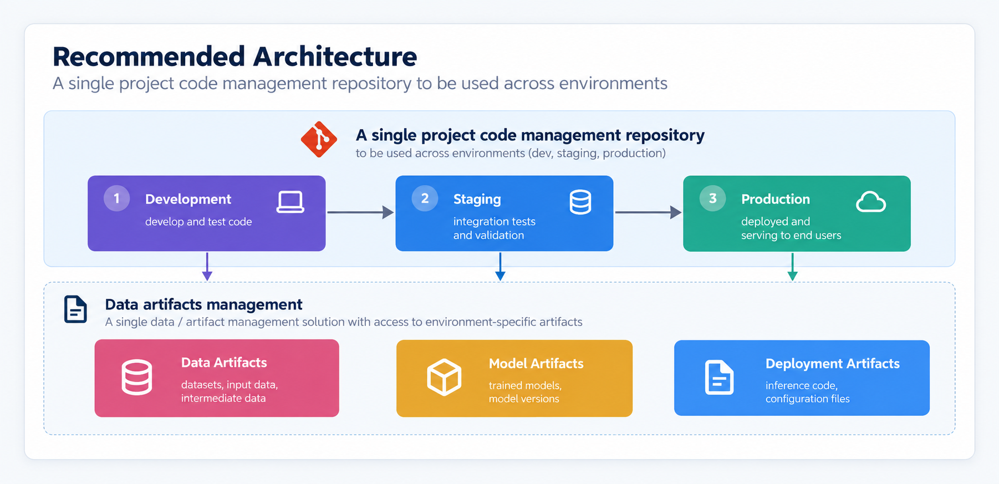

# Databricks Certified Machine Learning Practitioner Associate

## Machine Learning Operations

### Architecting MLOps Solutions

#### Recommended MLOps Architecture

##### The importance of MLOps Architecture

- ensures optimization for performance and ease of use

**Simplicity** | **Efficiency** | **Scalability** | **Collaboration**
--- | --- | --- | ---
simplified downstream management | accelerated timelines through incremental CI/CD changes | easy to adapt to changing infrastructure requirements | different users can collaborate effectively
easier maintenance and monitoring | more efficient process around the project | scale compute work without extensive work | efficient handovers
reduced operational complexity | faster iteration cycles | accomodate growing data and model complexity | clear boundaries and shared standards

- strategic approach: incorporate best practices in DataOps, DevOps, and MLOps to create a cohevsive, scalable framework
  - Apache Spark for data processing 
  - Delta Lake for data storage
  - Unity Catalog for data governance
  - Lakeflow Jobs that promote easy integration and continuous delivery

##### Two Deliveries - Infrastructure vs Workflow

**Infrastructure** | **Workflow**
--- | ---
the organization, governance, and setup of environments | processes followed within a defined architecture to achieve success on an ML project
data, compute and other resources | repetable, fluid processes specific to a project aligned to organizational best practices
set up one time (per project or per team organization) | ---
critical to downstream success of the project | ---

- develop infrastructure with scalability and flexibility in mind to accomodate future growth
  - design Lakeflow Jobs that can easily adapt to changes in project scope or data without extensive reconfiguration

##### The recommended Architecture

- **single code repository:** consistency and control over code changes and deployments
- **unified data / artifact management solution:** maintains data integrity and accessibility across all environments
  - easy transitions

##### Four Phases of MLOps Solution

1. **Infra Setup**
2. **Development**
3. **Staging**
4. **Production**

- cyclical processes $\to$ 2,3,4 repeat continuously for improvement and model refreshing

###### Infrastructure Setup

- Architect or Engineer
- set up once, manually setup or Terraform (MLOps stacks)
- Unity Catalog metastore + one or three Databricks workspaces
  - three Data Catalogs (dev, staging, prod)
  - command line environment
  - MLOpsStacks Project (per project)
  - git repository (per project)

- manual setup can be time consuming and error prone
  - Terraform
  - MLOps Stacks $\to$ specifically designed for MLOps Lakeflow Jobs on Databricks

- **Infrastructure Setup Tasks**
  - **Make infrastructure decisions**
    - determine the number of workspaces needed
    - decide whether to use existing infrastructure or create new infrastructure
    - select the CI/CD tooling to be used