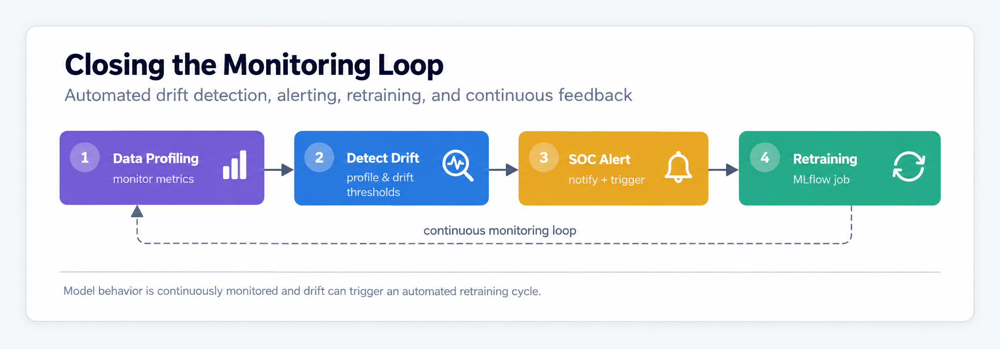
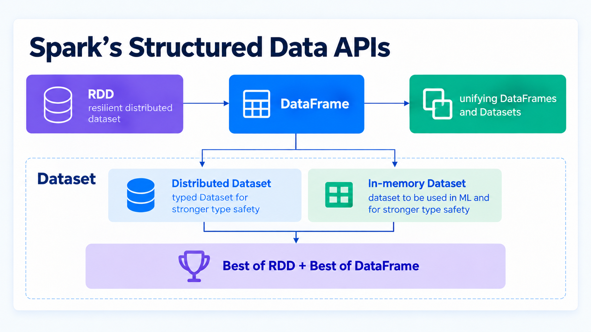

# Databricks Certified Machine Learning Practitioner Associate

## Machine Learning Operations

### Architecting MLOps Solutions

#### Closing the Monitoring Loop

- move from manually checking a model to a a self-monitoring solution that flags - and can even fix its own drift

### Machine Learning Operation Quiz

**1. In the context of Model Monitoring, which specific type of drift occurs when the statistical properties (e.g., mean, standard deviation) of the input data change over time, potentially introducing inconsistencies that impact model quality?** - Data Drift (Statistical properties of input data change).

**2. The Databricks-recommended MLOps deployment pattern is Deploy Code. When comparing this to the "Deploy Model" pattern, what is the crucial architectural practice required by the Deploy Code model regarding the execution environment?** - The training pipeline must be run in each environment (Dev, Staging, Prod), and the model is deployed/registered in Production.

**3. When deploying models using LakeFlow Jobs and the Databricks CLI, what is the significance of implementing conditional logic for handling scenarios where models are not ready for production?** - LakeFlow Jobs can be configured to check model status, deploy models, perform batch inference, and handle scenarios where models are not ready for production, providing robust workflow management for model deployment processes

**4. When exploring and monitoring executing LakeFlow Jobs in the Databricks environment, what is the recommended approach for investigating task outputs and debugging workflow execution?** - Access the Jobs Console from the Databricks sidebar, locate the job using the job_id, explore task details by clicking on task tabs, and investigate output logs and metrics in the Run Tab for debugging information and verification of successful execution

**5. In the context of machine learning pipeline automation using the Databricks REST API, what is the fundamental advantage of using API-based job creation compared to UI-based approaches for MLOps workflows?** - API-based job creation enables programmatic configuration and execution of MLOps pipelines, allowing for automated creation, execution, and monitoring of sequential tasks representing data ingestion, transformation, feature engineering, and visualization workflows

**6. In model monitoring workflows using Databricks Lakehouse Monitoring, what is the primary purpose of deploying models and setting up monitoring frameworks for performance tracking?** - Model monitoring enables tracking of model performance by sending batched requests to model endpoints, monitoring responses to detect anomalies or drift, and using Databricks Lakehouse Monitoring to continuously track and alert on model performance metrics

**7. When configuring LakeFlow Jobs for MLOps workflows, what is the fundamental relationship between task orchestration and the overall machine learning pipeline automation strategy?** - LakeFlow Jobs with multiple tasks enable monitoring of job runs to ensure successful execution, helping automate machine learning workflows and ensuring seamless execution of data processing and model training tasks

**8. In the context of model testing and deployment using CLI-based workflows, what is the critical consideration for ensuring proper job execution and monitoring in production MLOps environments?** - CLI-based workflows enable setting up and executing LakeFlow Jobs that deploy models, perform performance tests, analyze predictions, and generate summary reports, demonstrating automated and streamlined model deployment and testing with efficient job management

**9. When automating the execution of an MLOps pipeline using the Databricks REST API (Demonstration 2.1), what is the primary purpose of the `get_final_task_output` function called after the job has run?** - To poll the job status to confirm successful completion, retrieve JSON data output, and visualize the generated PNG file.

**10. In the machine learning pipeline workflow using Databricks API, what is the key architectural component that enables real-time monitoring and notification capabilities for MLOps processes?** - The workflow includes monitoring task progress through REST API calls and setting up email notifications for job completion, providing real-time updates and automated communication for the MLOps pipeline execution

**11. Databricks Lakehouse Monitoring is used to continuously track model performance. When an inference monitor is created (via UI or API), two specific tables are automatically generated and populated. Which table is responsible for recording metrics that compare the current table values to previous analysis windows or a defined baseline table to identify potential degradation?** - The drift metrics table.

**12. When implementing model testing workflows using the Databricks CLI, what is the critical configuration requirement for managing job lifecycle and extracting job identifiers for monitoring purposes?** - The job creation process requires passing a JSON configuration file to the `databricks jobs create` command, which returns a JSON object containing the `job_id` that must be extracted using command-line tools like `grep` and `awk` for subsequent job execution and monitoring

**13. Databricks MLOps Stacks utilize Databricks Asset Bundles (DABs) for Infrastructure as Code (IaC). Which key capability of DABs is essential for integrating the ML solution into continuous deployment (CD) processes across multiple segregated environments (Dev, Staging, Prod)?** - Bundles are configured through YAML files and can be materialized across multiple workspaces enabling CI/CD processes.

**14. In the Recommended MLOps Architecture, what is the primary technical function of the Staging environment, differentiating it from Development?** - Testing the efficacy of the project, including unit tests, integration tests, and performance regression tests.

**15. When creating a LakeFlow Job with multiple tasks using the Databricks UI, what is the primary architectural consideration for configuring task dependencies and email notifications in an MLOps workflow?** - LakeFlow Jobs enable configuration of task dependencies to control execution flow, while email notifications provide status updates for job monitoring, helping automate machine learning workflows and ensuring seamless execution of data processing and model training tasks

**16. In Lakehouse Monitoring for model performance tracking, what is the primary architectural benefit of setting up inference monitoring with baseline and primary tables?** - Inference monitoring enables continuous tracking of model performance and real-time detection of anomalies or drift, with baseline tables serving as the source of truth for comparison against primary inference tables, ensuring prompt handling of necessary adjustments or retraining

**17. The DevOps component of MLOps requires robust version control and CI/CD capabilities. Which Databricks tool is explicitly used to facilitate model code version control, sharing, and seamless Git integration in a collaborative coding environment?** - Databricks Repos (Git folders).

**18. When creating a complex MLOps workflow using the Databricks CLI (Demonstration 2.2), what declarative artifact is written externally to a file and passed to the `databricks jobs create` command to define the entire Job configuration, including sequential tasks, dependencies, and notification settings?** - A JSON configuration file containing the job definition.

**19. Within the Databricks MLOps framework, which platform component centrally provides capabilities such as traceable data lineage, unified security, centralized data discovery, and data governance, aligning directly with the responsibilities of DataOps?** - Unity Catalog (Unified security, governance, and cataloging).

**20. MLOps is defined as the all-inclusive, holistic approach to managing ML systems by integrating three core operational disciplines. Which of these three disciplines is specifically responsible for organizing and governing the full lifecycle of the machine learning model artifact itself?** - ModelOps (Focuses on organizing and governing the lifecycle of ML models).

## Machine Learning at Scale

### Spark Architecture Overview

- **Apache Spark** $\to# open-source engine for fast, scalable data and machine learning analytics
  - **distributed SQL engine**: fast, large-scale data processing with in-memory capabilities
  - **multiple components**: SparkML, streaming, SQL DataFrames, GraphX
  - **multi-language support**: Java, Scala, Python, and R
  - **versatile workflow**: batch, real-time, ML, and graph processing
  - **ecosystem integration**: connects with popular data science and BI tools
  - **open-source community**: driven by global collaboration and innovation

#### Spark's Structured Data APIs

**Resilient Distributed Dataset** | **DataFrame** | **Dataset** | **Unify**
--- | --- | --- | ---
fundamental data structure in Spark | high level API |high level API | dataset and dataframe merge into one unit to reduce the complexity
low level API $\to$ control \& flexibility; code the "how to" | code the "what to do" | compile-time syntax & analysis error detection | dataset API takes on two forms: i) strongly typed API (Java and Scala); ii) untyped API (Python and R)
compute-time syntax & analysis error detection | schema: structured data | schema: structured data | ---
no schema | logical plans and optimizer | logical plans and optimizer | ---
Java, Scala, Python, R | SQL support | more memory efficient | ---
--- | compile-time syntex error detection | Java/Scala | ---
--- | run-time analysis error detect | --- | ---
--- | Java, Scala, Python, R | --- | ---