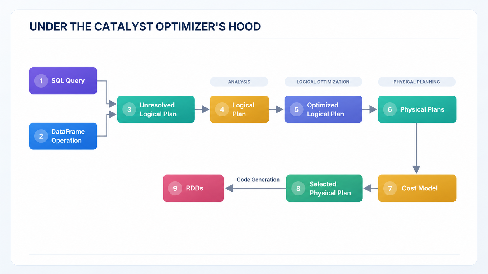

# Databricks Certified Machine Learning Practitioner Associate

## Machine Learning at Scale

### Spark Cluster

- **Driver Program**
  - entry point for your Spark application
  - submit Spark jobs to the cluster
- **Cluster Manager**
  - allocates resources across the workers
  - launches executors on the nodes
  - handles the distribution of tasks
- **Executor Components**
  - **worker node**: executes tasks and return results to the Driver
  - **Spark Executor**: JVM process running tasks (e.g. map, reduce, filter)
  - **Cache**: stores data locally to spend up reuse
  - **Task Thread**: one thread per CPU core

### When is Spark Recommended for ML?

#### Scaling Out or Speeding Up

- **Large-Scale Data Processing**
  - excel at processing massive datasets needing distributed computation
  - **benefit**: handles data that can't fit on a single machine
- **distributed model training**
  - distributes model training and hyperparameter tuning across multiple nodes
  - **benefits**: significantly reduces training time using cluster computing
- **real time data processing \& streaming analytics**
  - integrates with Spark Streaming to apply ML models to real-time data streams
  - **benefit**: enables real-time predictons and analytics
- **end-to-end machine learning pipelines**
  - supports the full machine learning lifecycle
  - simplifies ML workflows with its Pipeline API automating complex process

### When is Spark NOT Recommended to ML?

- **small to moderate-sized dataset**
  - Spark adds unnecessary complexity for small datasets that fit on a single machine
    - **alternative:** use `scikit-learn` or `tensorflow` on one machine
- **low-latency, real-time predictions**
  - Spark isn't optimized for microseconf or milisecond response time
  - **alternative**: use Databricks Model Serving or a similar option
- **short-lived model training on batch scoring**
  - time to initialize a Spark session and distributed tasks can outweight the benefits
  - **alternatives:** use `scikit-learn`, `xgboost` or Docker for lightweight execution
- **strict data privacy / compliance**
  - distributed processing complicates with data privacy regulations
  - **alternative:** use on-premises tools or controlled environments
- **highly custom-algorithms:**
  - custom algorithms development in Spark can be complex and inefficient
  - **alternative:** use Python, `scikit-learn`, or R for flexibility