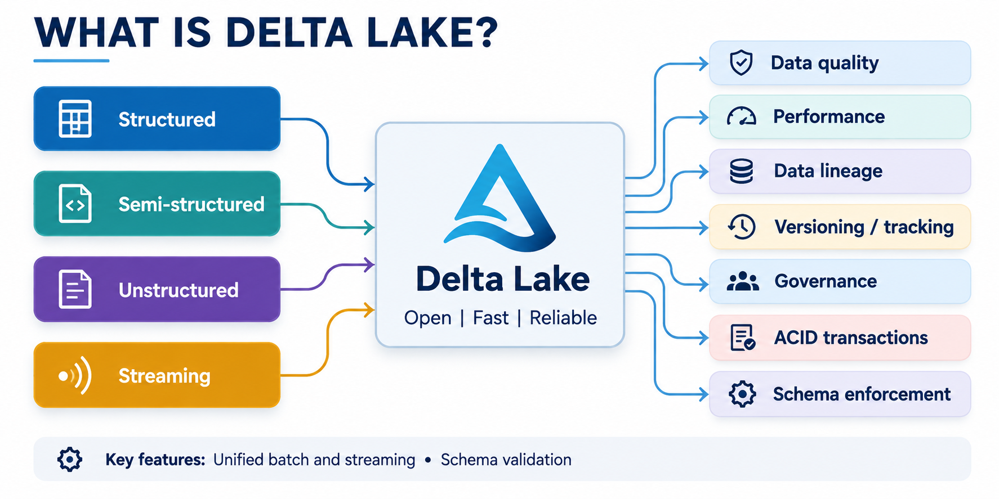

# Databricks Certified Machine Learning Practitioner Associate

## Machine Learning at Scale

### Introduction to SparkML for Model Development

#### What is Delta Lake?

- unified data management layer that brings data reliably and fast

- **Key Features**: unified batch and streaming
  - schema validation
  - upserts with `MERGE`
  - time travel
  - multi language support (Python, Scala, SQL)
  - schema evolution
  - changed data feed
  - optimized performance (data slipping \& clustering)

#### Spark Data Frame

- scalable data manipulation
- high-level API for data manipulation \& UDFs
- query using SQL syntax
- optimized processing $\to$ Catalyst optimizer \& Tungsten Engine
- lazy evaluation
- distributed acess the cluster for parallel processing
- versatile with data types and sources

##### Loading Data

- **Perform select, filter, join, groupBy, and aggregate operations efficiently**
  - read a Delta table into a Spark Dataframe, transform it with the DataFrame API, and write it back to a Delta table (or a Feature Store table)
- **Data Science \& AI on Databricks**
  - **Unity Catalog**: plays a crucial role in managing,, governing, and securing Delta Lake, enhancing Data Science, Data Processing, Lakeflow Jobs, and Databricks SQL capabilities
  - **Key Capabilities**
    - centralized governance, security, metadata and user management
    - data access auditing \& data lineage
    - data search and discovery
    - easy sharing of assets across Databricks workspaces
    - secure data sharing with Delta Sharing
    - FeatureEngineering in Unity Catalog
    - a hoested version of MLflow Models in Catalog Catalog

##### Automated Lineage for ML Workloads

- **End-to-end visibility into how data flow and is consumed in your organization**
  - table and column lineage 
  - notebook, workflow, and dashboard table-centric lineage
    - streaming lineage
    - file path lineage
    - SDP lineage
    - MLflow model lineage
    - feature store lineage
    - Lakehouse query lineage
    - volume lineage
    - AI / BI dashboards

##### Feature Engineering \& the Unity Catalog Feature Store

**Feature Engineering** | **Unity Catalog Feature Store**
--- | ---
critical step in preparing data for machine learning models | features are stored in and provided from Unity Catalog as a Delta table with the primary key and additional metadata
transforms raw data into a format that allows ML models to extract meaningful patterns and make accurate predictions | Feature Registry + Feature Provider support batch (high throughput) and online (low latency) access

##### Machine Learning in Spark

- **Spark Machine Learning libraries** - Spark's built-in capabilities for distributed machine learning
  - MLlib $\to$ original ML API for Spark (RDD-based API)
  - SparkML $\to$ not official name, but refers to the MLlib DataFrame - based API

##### Core modules of SparkML

- **ML Pipeline**: `from spark.ml import Pipeline`
  - **purpose**: streamline the building of Machine Learning workflows by chaining multiple stages - data processing, feature extraction, and model training - into a single pipeline that is fitter and applied as one object

PLACEHOLDER

- **How it works**
  1. each stage declares an `inputCol` and an `outputCol`
     1. `tokenizer.getOutputCol()` wires HashingTF to whatever the tokenizer produced, so renaming a column never breaks the chain
  2. `Pipeline(stages=[...])` is itself an ``Estimator`` - nothing has run yet
  3. `pipeline.fit(training)` runs each step in order and returns a `PipelineModel`, a `Transformer` you call `.transform()` on for new data
- **Extracting, Transforming and Selecting Features**
  - `spark.ml.feature:` this submodules covers five of kinds of feature work- transformation, feature extraction, dimensionality reduction, selection, and locally sensitive hashing
    - `StringIndexer`: converts categorial labels into numerical ones, so string columns can be fed to algorithms that only accept numbers
    - **Feature Extraction -**`word2vec`: an estimator that takes sequences of words and trains a `Word2Vec` mapping each word to a fixed-size vector
    - **Dimensionality Reduction -`PCA`**: `PrincipalComponentAnalysis` - project high-dimensional data into fewer dimensions while preserving as much as variacne as possible
    - **Selection -** `chisqSelector`: keeps the most relevant features, ranked by the chi-squared ($\chi^2$) test of association with the targets
    - **Locality Sensitive Hashing - approximate nearest neighbors search:** hashes datra points so that similar points are more likely to land in the same bucket, making neighbors lookups cheap at scale
- **Classification and Regression**: `spark.ml.classification`, `spark.ml.regression`
  - **purpose**: scalable, distributed algorithms for two kinds of supervised regression
    - classification, which predicts a discrete label
    - regression, for continuous values
    - both submodules share the same `Estimator` / `Transformer` API
- **Clustering**: `spark.ml.clustering`
  - **purpose**; group similar data points together without labelled data
  - clustering is unsupervised
    - it discovers natural groupings in a dataset rather than learning a mapping