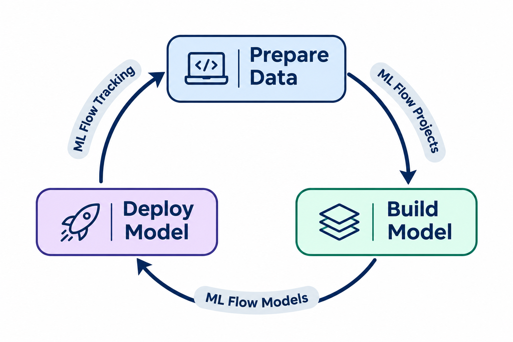

# Databricks Certified Machine Learning Practitioner Associate

## Machine Learning at Scale

### Introduction to SparkML for Model Development

##### Core modules of SparkML

- **Clustering**: `spark.ml.clustering`
  - **purpose**; group similar data points together without labelled data
  - clustering is unsupervised
    - it discovers natural groupings in a dataset rather than learning a mapping
  - **KMeans**: partitions the data into K clusters by feature similarity
    - default choice
  - **Bisecting KMeans**: repeatdly split cluster to build a tree of clusters, which makes the grouping easier to interpret and to cut any depth
- **Collaborative Filtering** $\to$ `spark.ml.recommendation`
  - **purpose**: predict a user's preferences by learning from the past interactions of similar users or items
    - no content feature required, just history of interactions
    - `spark.ml` uss alternating least squares (ALS) $\to$ factors the sparse matrix into two dense latent factor matrices, alternatively holding one fixed ad solving for the other

$$R_{users\times items (sparse)} \approx UF_{users \times factors} \times IF_{items \times factors}$$

  - `maxIter`: maximum number of alternatives passes to run. More iterations refine the factors at the cost of runtime
  - `regParam`: regularization strenght, balancing against simplicity. A higher value yields a simpler model that is less prone to overfitting.
- **Frequente Pattern Mining** $\to$ `spark.ml.fpm`
  - **purpose**: identify recurring patterns, associations and correlations in large datasets
  - **Order-free FP-growth:** compress the input into a prefix-tree (FP-tree), then recursively mines the frequent paterns from it - no candidate generation needed
    - which items customers frequently bought together in the basket
  - **sequential-mining-order-matters-Prefix Span**: find frequent sequences of items in transactional data, respecting ithe order in which they occurred.
    - purchasing behavior over time, where whast came first changes the remaining.

- **MLTuning: Model Selection and Hyperparameter Tuning** $\to$ `spark.ml.evaluation`; `spark.ml.tuning`
  - **purpose:** model selection and hyperparameter optimization, You supply and estimator, a grid of parameters, and an evaluator. The tuner searches the grid and keeps the best model
    - `Evaluator`: what "best"  means $\to$ `BinaryClassification`. The Evaluator scores binary classifiers on area under the ROC (AUC) curve or area under the precision-recall curve (AUPRC)
      - tuner optimizes the selectec metric
    - **Search - K-Fold - `CrossValidator`**: splits the data into K folds, holds each out in turns, and averages the $k$ scores. The most reliable estimate at the cost of $k$ times the training cost
    - **Search - Single Split - `TrainValidationSplit`**: evaluates each parameter combination against one train / validation split. Much cheaper than k-fold, but a noisier estimate.

#### Data Preparation & Feature Engineering with Spark

- **`StringIndexer`**: converts categorical fatures into numerical indices
- **`Imputer`**: handles missing values by imputing them with mean, median, or mode values
- **`StandardScaler`**: normalizes continuous feature to have a mean of 0 and a standard deviation of 1
- **`OneHotEncoder`**: encodes categorical features as binary vectors, avoiding ordinality
- **`VectorAssembler`**: assemble features into a single vector column
  - most Spark algorithms exptect every predictor in one vector column
  - merges several individual columns into a single `features` vector, standard last step before training
  - **memory optimized**: represents each feature row compactly, so large datasets stay memory-efficient across the cluster
  - **dense or sparse:** emits a dense or sparse vector per row - whichever uses less memory fro that row values

##### Reproducible Train-Test Split

- consisten, repeatable evaluation with fixed seeds
  - split the dataset into training, validation and tests sets, so that the split is identical on every run
  - makes evaluation reproducible $\to$ essential for comparing models over time

#### ML Training and Tuning on Spark

- Spark accelerates training in three different ways
  - depende on whether the model itself is distributed, if each dataset fits on one node, or if we are searching many hyperparameters configurations at once.

**Distributed ML Library** | **Single Node ML Library** | **Combination**
--- | --- | ---
data parallel traning | model parallel training | hyperparameter parallel optimization
trains one model across a distributed dataset | trains many independent single-node models in parallel | fits many hyperparameter configurations in parallel for single-node on distributed training
needs a distributed library such as `SparkML` | each dataset must fit on one worker | on Databricks, use `optuna` with the joblib Spark backend, on SparkML, use `CrossValidator`
great for large data with no downsampling, but not every algorithm scales this way | scales out training with any ML Library - ideal fro per-entity models such as one per IoT device | -

- `fit()` $\to$ trains model on the input `DataFrame`
- `explainParams()` $\to$ returns every parameter with its default and user-supplied value

### Databricks provides Managed MLflow

#### Manage the full Machine Learning Lifecycle

- Mlflow is the open-source platform for managing the end-to-end ML Lifecycle
  - fully managed $\to$ Tracking, Projects, Models and Modedl registry $\to$ wrap the ML Lifecycle
- **Key Advantages**
  - **maintenance-free**: a fully managed service removes operational overhead
  - **pre-installed**: ships with the Databricks Runtime for ML
  - **built-in tracking server**: logs every experiment and model with no extra setup
  - **feature-store integration**: centralizes features for consistency accross training and inference
  - **enhanced security**: model-level access control and secure transactions
  - **streamlined operations**: automated tracking of each ML step to analyze and optimize

##### MLflow Tracking

- records the parameters, metrics, artifacts, and model of each run so experiments are reproducible and comparable
  - possible to log everything automatically, or specific values by hand
- **``set_experiment``**: groups runs under a named experiment
  - creates if it does exist and makes it active
- **``start_run``**: opens a new run (an `ActiveRun`), ends the current one first, on use `nested=True`
- **`autolog()`**: logs params, metrics, data lineage, the model and its environmental automatically
- **`log_metric()` / `log_param()`**: record specific values yourself with those calls

#### Streamlining Model Development with Spark

- optimize the model development process - spanning data processing, feature engineering, model training and tuning $\to$ more efficient and repeatable
  - construct a `Pipeline` using `SparkML` that integrates all stages of the machine learning workflow

##### Advantages of Using `SparkML` Pipelines

- **consistency**: ensures taht the same data transformations and model training steps are applied uniformely, reducing the risk of errors and inconsistencies
- **reusability:** pipelines can be saved and reused across diferent datasets or projects, significantly reducing the time needed for model development
- **scalability**: designed to efficiently handle large-scale datasets, Pipelines in SparkML are optimized for distributed processing, making them ideal for big data applications
- **simplified workflow**: by chaining together multiple stages, Pipelines streamline the process, making complex workflows easier to manage and maintain
- **hyperparameter tuning**: integrates seamlessly with cross-validation and hyperparameter tuning methods, allowing for mode efficient and automated model optimization

##### Creeating and Fitting a Pipeline in SparkML

> **One reusable object for the whole workflow**

- a ``Pipeline`` chains feature engineering, scaling and model training object . Fitting it runs every stage in order and returns a `PipelineModel` you can save, reload and apply to new data - streamline, reproducible ML workflow.