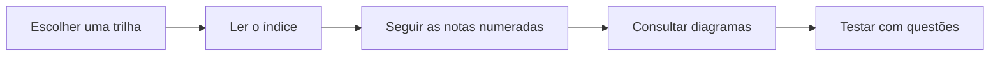

<h1 align="center">Trilhas de Cursos</h1>

  <strong>Da base de dados à plataforma analítica.</strong> 
  Cursos e formações organizados como percursos progressivos, com notas datadas, exemplos e diagramas.

   &nbsp;
   &nbsp;
   &nbsp;
   &nbsp;
  

## Visão geral

Esta área reúne o estudo técnico em sequências numeradas. Cada trilha possui um README próprio,
que funciona como índice editorial, e as notas aprofundam os assuntos na ordem em que foram
estudados.

## Trilhas disponíveis

| Trilha | Foco | Porta de entrada |
|---|---|---|
| **Fundamentos de Engenharia de Dados** | pipelines, armazenamento, sistemas distribuídos e modelagem | [Abrir trilha](data_engineering_fundamentals/README.md) |
| **Formação de Engenheiro de Dados** | cloud, lakehouse, SQL, dbt, Spark, governança e carreira | [Abrir formação](data_engineer_formation/README.md) |
| **Power BI para BI e Data Science** | dashboards, Power Query, DAX e análise | [Abrir trilha](microsoft_power_bi_for_business_intelligence_and_data_science/README.md) |

## Como estudar

1. Comece pelo README da trilha para entender o contexto.
2. Avance pelas notas numeradas e registre os exemplos que deseja testar.
3. Use os [artefatos visuais](../artifacts/README.md) para revisar arquiteturas.
4. Conecte a leitura às [questões](../questions/README.md) quando houver um banco disponível.

Os diagramas referenciados pelas notas ficam em [Artefatos](../artifacts/README.md).

Voltar para a [Personal Knowledge Wiki](../README.md).
