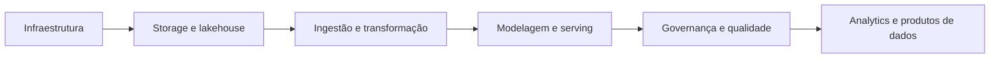

<h1 align="center">Formação de Engenheiro de Dados</h1>

  <strong>Uma trilha ampla para projetar, construir e governar plataformas de dados.</strong> 
  Infraestrutura, armazenamento, transformação, SQL, analytics e desenvolvimento profissional.

   &nbsp;
   &nbsp;
   &nbsp;
   &nbsp;
   &nbsp;
  

## Visão geral

Esta é a principal formação técnica do wiki. Os módulos são independentes o suficiente para
consulta rápida, mas juntos formam uma visão de ponta a ponta: da infraestrutura e do
armazenamento à modelagem, transformação, processamento distribuído e governança.

## Módulos

| Módulo | Pergunta central | Acesso |
|---|---|---|
| **Infraestrutura como código** | Como provisionar ambientes de dados repetíveis? | [Terraform, AWS, Azure e Databricks](iac_terraform_aws_azure_databricks/README.md) |
| **Armazenamento e lakehouse** | Como organizar dados brutos, processados e confiáveis? | [Datalake e Datalakehouse](armazenamento_gestao_dados_datalake_datalakehouse/README.md) |
| **Modelagem e governança** | Como transformar dados em modelos úteis e controlados? | [Data warehouses](modeling_implementation_governance_data_warehouses/README.md) |
| **Integração e transformação** | Como extrair, carregar e transformar dados? | [Airbyte, dbt e SQL](data_engineering_airbyte_dbt_sql/README.md) |
| **Análise de dados** | Como responder perguntas de negócio com SQL? | [SQL para análise](sql_analise_dados/README.md) |
| **Processamento distribuído** | Como lidar com batch, streaming e mensagens? | [PySpark e Kafka](pyspark_kafka_processamento_batch_streaming/README.md) |
| **Desenvolvimento profissional** | Como sustentar a prática técnica e a carreira? | [Bônus da formação](personal_improvement_bonus/README.md) |

## Mapa de competências

## Como navegar

1. Use a tabela acima para escolher o módulo mais próximo do seu objetivo.
2. Dentro de cada módulo, comece pelo README e siga as notas numeradas.
3. Abra os [artefatos visuais](../../artifacts/README.md) quando uma arquitetura precisar de contexto.
4. Relacione os conceitos às [questões de revisão](../../questions/README.md) e a exemplos executáveis.

Voltar para [Cursos](../README.md) ou para a [Personal Knowledge Wiki](../../README.md).
