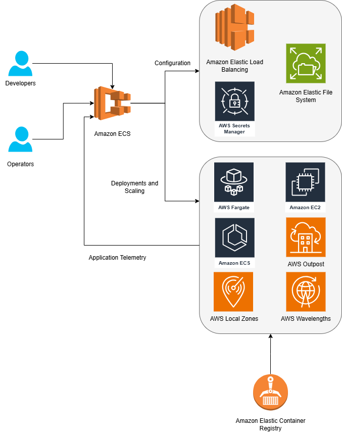

# Formação Engenheiro de Dados

## Infraestrutura como Código com Terraform, AWS, Azure e Databricks

### IaC com Terraform para Deploy de Aplicação Web em Container Docker no Amazon ECS

#### Amazon Elastic Container Service

- serviço totalmente gerenciado de orquestração de containers
- executar workloads de containers na nuvem e on-premises
- integrações automáticas com outros serviços AWS

#### AWS Fargate

- computação ser servidor (*serverless computing*)
- pay-as-you-go
- melhoria do aspecto operacional, maior velocidade, reduz o custo de propriedade
- compatível com ECS e AKS (Amazon Elastic Kubernetes Service)