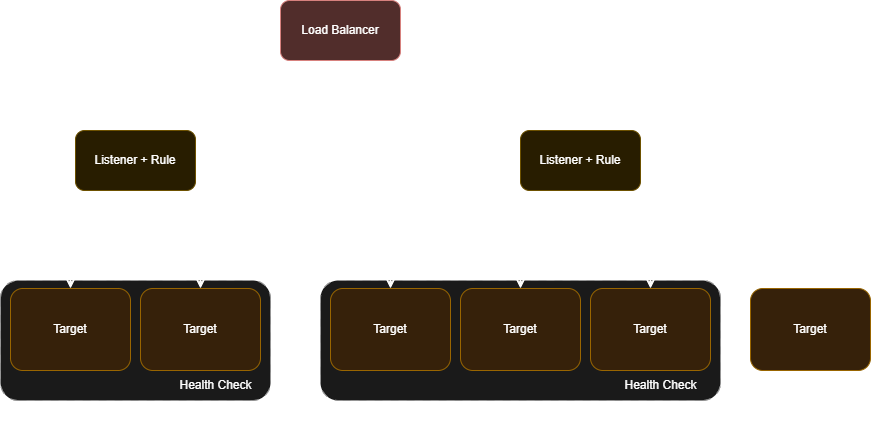

# Formação Engenheiro de Dados

## Infraestrutura como Código com Terraform, AWS, Azure e Databricks

### IaC com Terraform para Deploy de Aplicação Web em Container Docker no Amazon ECS

#### Amazon Elastic Container Service

- ponto de partida para usar o ECS -> criar um cluster
    - pode dar conflito com o nome, 

#### Amazon Cloud Formation

- concorrente do Terraform
- ECS permite o agendamento de tarefas
    - pede uma imagem para definir o container / executar a tarefa

#### Amazon Cloud Watch

- serviço de monitoramento da aplicação
- podemos definir um grupo de logs para monitoramento dos recursos

### ARN - Amazon Resource Name

- string única para identificar um recurso na Amazon
    - desambiguação
    - usando em políticas IAM, chamadas de API
    - identificadores de serviço, região, conta, e outras informações

- na imagem fazemos o mapeamento de portas igual container Docker
- dois principais componentes do ECS
    - tarefa -> imagem que será executada
    - serviço -> maneira com a qual terei acesso aquilo que o container está oferecendo
- para configurar o cluster, usamos o id
- para configurar a tarefa, usamos o ARN
- balanceamento de carga é opcional, mas ajuda a garantir a alta disponibilidade
- porta do container é a porta de acesso da aplicação

### Conhecendo o Application Load Balancer (ALB)

- serviço de balanceamento de carga
- suporte a microsserviços, protocolos HTTP e HTTPS

1. roteamento baseado em conteúdo
    - caminho da URL, parâmetros de consulta, cabeçalhos
    - facilita microsserviços e roteamento baseado em regras
2. suporte a websockets e HTTP/2 -> mais rápido
3. integração a outros serviços AWS
4. balanceamento entre zonas de disponibilidade
5. monitoramento e registro

- usos comuns
    - aplicações baseadas em microsserviços
    - aplicações modernas web
    - ambientes de alta disponibilidade

- serviço pago da AWS (pay-as-you-go)
- pode ser complexo de implementar

- *listeners* -> ouvem as requisições e direcionam baseando-se em regras
    - *target group* -> são as aplicações que queremos acessar

- serviço ALB é provisionado com um recurso EC2
    - application load balancer
    - network load balancer
    - gateway load balancer

### O que é uma VPC (Virtual Private Cloud)?

- permite a criação de uma seção isolada da nuvem pública
    - recursos de rede virtual privada
- controle detalhado
    - seleção de intervalos de IP
    - criação de sub-redes
    - configuração de tabelas de rotas
    - gateway

- Terraform -> regras e configurações necessárias

- características de uma VPC
    - isolamento de rede
    - segurança aprimorada
        - *firewalls* virtuais (grupos de segurança)
        - listas de controle de acesso
    - conectividade de rede personalizável
        - flexibilidade
        - personalização de topologias
    - integração com outros serviços
    - conectividade híbrida
        - VPC -> rede corporativa on-premises