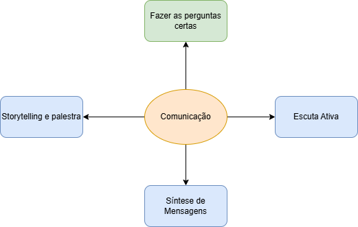

# Formação Engenheiro de Dados

## Cursos de Aperfeiçoamento Profissional - Bônus da Formação

### Planejando sua carreira para as profissões do futuro

*"Excelência nunca é acidente. É sempre o resultado de elevada intenção, esforço sincero e execução inteligente; representa a escolha sábia de muitas alternativas - a escolha, e não o acaso, determina o seu destino"* - Aristóteles.

**Que Mundo é Esse?**

<table>
    <tr>
        <th colspan=2>1980 - Após a Guerra Fria</th>
        <th colspan=2>2020 - Após a Pandemia</th>
    </tr>
    <tr>
        <td>V</td>
        <td>Volatile</td>
        <td>B</td>
        <td>Brittle (Frágil) - tudo pode mudar rapidamente, inclusive mudar a lógica das coisas</td>
    </tr>
    <tr>
        <td>U</td>
        <td>Uncertain</td>
        <td>A</td>
        <td>Anxious (Ansioso) - a troca de informações está cada vez mais rápida e global, sejam elas verdadeiras ou falsas</td>
    </tr>
    <tr>
        <td>C</td>
        <td>Complex</td>
        <td>N</td>
        <td>Non Linear (Não linear) - coisas são imprevisíveis, e é difícil de planejar coisas a longo prazo</td>
    </tr>
    <tr>
        <td>A</td>
        <td>Ambiguous</td>
        <td>I</td>
        <td>Incomprehensible (Incompreensível) - mundo muda mais rápido do que encontramos as respostas</td>
    </tr>
</table>

**Como se preparar para esse mundo?**

- agregar valor além das tarefas automatizáveis
- operar em ambiente digital
- adaptação contínua
    - novos trabalhos
    - novas ocupações

<table>
    <tr>
        <th>Cognição</th>
        <th>Auto Liderança</th>
    </tr>
    <tr>
        <td>
            <ul>
                <li>Comunicação</li>
                <li>Pensamento Crítico</li>
                <li>Planejamento e formas de trabalho</li>
                <li>Flexibilidade mental</li>
            </ul>
        </td>
        <td>
            <ul>
                <li>Auto Consciência e auto gestão</li>
                <li>Empreendedorismo</li>
                <li>Alcance de metas</li>
            </ul>
        </td>
    </tr>
    <tr>
        <th>Digital</th>
        <th>Interpessoal</th>
    </tr>
    <tr>
        <td>
            <ul>
                <li>Fluência Digital e Cidadania</li>
                <li>Desenvolvimento e uso de software</li>
                <li>Entendimento de sistemas digitais</li>
            </ul>
        </td>
        <td>
            <ul>
                <li>Sistemas de mobilização</li>
                <li>Desenvolvimento de relações</li>
                <li>Efetividade do trabalho em equipe</li>
            </ul>
        </td>
    </tr>
</table>

### O Poder das Perguntas

- perguntas desafiam o *status quo*, incentivam a curiosidade e conduzem à descoberta e à inovação
    - conectar pessoas

*"Não se pode ensinar um homem coisa alguma; pode-se apenas ajudar a encontrar a coisa dentro de si"* - Francis Bacon

- fazer perguntas é o que nos diferencia das máquinas
- mitiga riscos de negócios
- estimula o pensamento crítico
    - ampliação do conhecimento e compreensão
- auto desenvolvimento
- resolução de problemas
- comunicação e relacionamento

- **tipos de perguntas**
    - *abertas* - amplas e permite direcionamento
    - *fechadas* - limitadas
    - *significado* - conhecer o valor da informação
    - *ponto de vista* - empatia
    - *ação* - pensar em começar
    - *evidência* - indicadores, tangibilizar
    - *obstáculos* - problemas
    - *aprendizado* - tangibilizar experiências, certificar

- *interlocutor* - perfil? elementos de atenção?
- *foco* - o que eu quero saber?
- *contexto* - qual a situação?
- *reflexão* - tempo para concatenar ideias
- *relevância* - vai agregar valor?

- **5 Por Quês** -> busca da causa raiz

- **comunicação não violenta**
    - respostas conscientes, firmemente baseadas na consciência dos entornos
        - honestidade e clareza
        - empatia
        - observar coisas que nos afetam e aos outros
    1. observação - o que está acontecendo?
    2. sentimento - o que sinto?
    3. necessidade - o que eu preciso?
    4. pedido - o que eu gostaria que acontecesse?
    - "expressa sentimento com racionalidade"
    - "vulnerabilidade conecta pessoas"