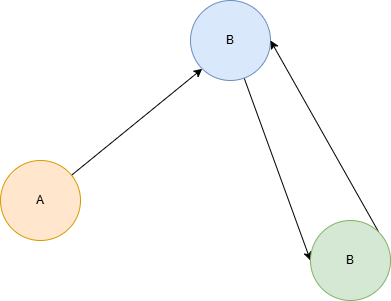

# Formação Engenheiro de Dados

## Cursos de Aperfeiçoamento Profissional - Bônus da Formação

### Introdução à Lógica de Programação

#### Grafos e o Algoritmo *Breadth-First Search*

- análise de grafos -> analisa conexões, informação útil sobre relacionamentos
- pesquisa em largura -> buscar o menor caminho entre dois objetos
- grafo = conjunto de conexões
    - vértices e arestas
    - vértices interconectados entre si

- modelar eventos conectados
- nas buscas em largura, procura-se por todos os nós de um determinado nível, antes de passar para o próximo grau (nível)
    - preferência por conexões do menor grau possível
- não somente encontra o caminho entre dois nós, mas encontra o mais curto

#### *Backtracking*

- forma de recursão
- escolhemos uma opção e voltamos atrás, se chegarmos a um estado que não oferece a solução necessária
    - solução de forma incremental
    - removem soluções que falham

#### *Algoritmos Gulosos*

- a cada etapa, escolhe-se o movimento ideal
    - solução global ideal
- sempre focados na solução ideal local
- inclusive não olham para o passao para otimizar globalmente
- não garantam soluções, mas são eficientes em tempo
- usandos em *Reinforcement Learning*

### Programação Dinâmica

- resolução de subproblemas e escalar até problemas maiores
    - algoritmos *value iteration*
    - algoritmos *policy iteration*
    - algoritmos *policy search*
- útil para problemas de espaço grande e contínuo em tempo real
- estimativa do grande número de possíveis valores alcaçáveis por meio de iterações no valor ou política de PD
- construir "memória" das soluções encontradas até a melhor solução
