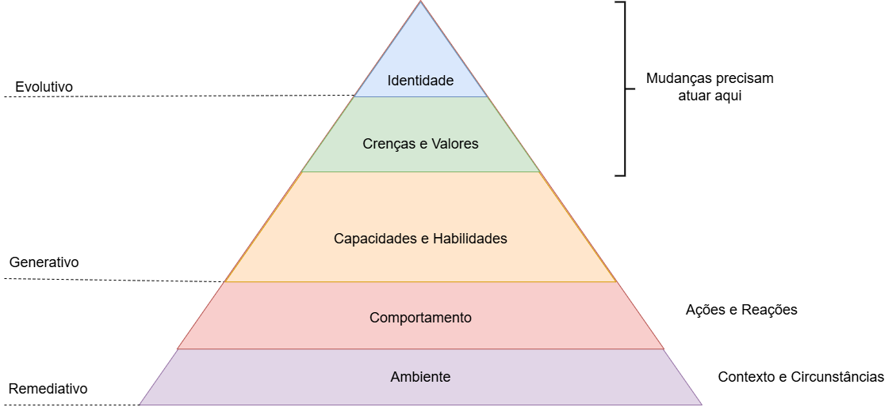

# Formação Engenheiro de Dados

## Cursos de Aperfeiçoamento Profissional - Bônus da Formação

###  Curso de Governança de Dados

#### Lei  de Proteção de Dados

- na Europa -> GDPR
- nenhum dado pode ser coletado / tratado sem o consentimento do dono dos dados
- vazamentos de dados é responsabilidade do controlador dos dados
    - punição financeira (ANPD)
- válido desde que os dados sejam coletados em território nacional

### Soft Skills - Desenvolvendo suas Habilidades Comportamentais

- contato com as pessoas no dia-a-dia depende de soft-skills -> sucesso no ambiente de trabalho
    - ativos profissionais
        - comunicação assertiva
        - colaboração
        - criatividade
- qual marca quero deixar nas pessoas ?
- planejamento do próprio futuro -> sabendo onde quero chegar

- importante conhecer identidade para que as mudanças tenham maior efeito
    - mudanças remediativas -> não se sustentam