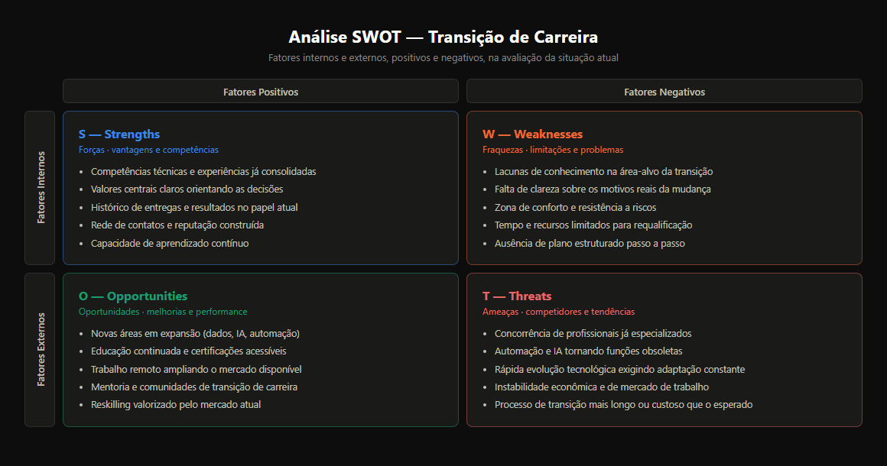

# Formação Engenheiro de Dados

## Cursos de Aperfeiçoamento Profissional - Bônus da Formação

###  DuckDB e Firecrawl para Database e Web Scraping Analytics

#### Web Scraping - Conceito, Aplicabilidade e Segurança

- processo automatizado de extração de informações de websites
  - acessar um ou mais websites
  - baixar o conteúdo das páginas (HTML)
  - analisar para encontrar campos de texto relevantes e outros dados
  - extrair os dados e estruturá-los num formato mais útil para análise posterior
- útil quando o site não oferece API para acessar dados de forma programática
- aplicações:
  - monitoramento e comparação dos preços
  - inteligência de mercado e análise de concorrênca
  - geração de leads
  - agregação de notícias e conteúdo $\to$ tendência da mídia
  - análise de sentimentos
  - pesquisa acadêmica / científica
  - monitoramento de imóveis
  - coletas de dados financeiros
  - monitoramento de ações
  - treinamentos de modelos de machine learning
- **segurança (riscos e considerações)**
  - riscos em ambas as perspectivas
  - quem faz o scrapping
    - bloqueio de IP para agentes agressivos
    - termos de serviço (ações legais)
    - direitos autorais
    - privacidade (LGPD / GDPR)
    - *robots.txt* $\to$ diretrizes sobre o que pode ser acessado
    - honeypots ou armadilhas para identificar scrappers e bloqueá-los
    - consumo excessivo de recursos $\to$ similar a um DDoS acidental
  - website
    - detecção de bots $\to$ restringir requisições
    - monitoramento de tráfego (picos de um único IP)
    - alterações na estrutura de sites (quebra de scrappers)
    - login obrigatório
- **boas práticas**
  - verificar e respeitar o *robots.txt*
  - ler e considerar termos de serviço
  - raspagem de forma responsável: limitar a taxa de requisição, fora do horário de pico
  - identificar o bot: usar um cabeçalho User-Agent com contato
  - preferir APIs
  - focar em dados públicos
    - evitar dados privados
    - garantir a conformidade com as leis de proteção de dados

#### O que é e quando usar Firecrawl?

- ferramenta oferecida como uma API para rastrear (crawl) e extrair dados de websites
- foco em sites modernos baseados em JavaScript
  - SPI (single page applications)
  - React, Vue, Angular
- **características**
  - processamento de JavaScript
    - renderiza o JS antes de extrair os dados
    - bom para conteúdos carregados dinamicamente
  - extração de conteúdo estruturado
    - página web $\to$ dados limpos e estruturados
  - foco em LLMs e RAG
    - facilmente utilizável por LLMs em aplicações de RAG
  - simplicidade via API $\to$ abstrai múltiplas complexidades de gerenciamento ou configurar pipelines de scrapping
  - extração específica $\to$ usando seletores
- **aplicações**
  - scrapping de sites dinâmicos
  - alimentar LLMs ou sistemas RAG
  - obter dados estruturados rapidamente via API
  - monitoramento de conteúdo
  - construção de rápida de datasets
  - evitar complecidade da infraestrutura de scrapping
  - extrar dados específicos de dados complexos

### Guia de Transição da Carreira

- **carreira**: sequência individualmente percebida de atividades e comportamentos associados em experiência e atividades relacionadas ao trabalho
  - qual meu papel na sociedade?
  - importante estar bem onde estivermos
    - eu defino minha carreira
      - valores centrais orientam o caminho
      - sucesso é uma definição interna
      - oportunidades e realidade
  - quais motivos para uma transição de carreira?
    - dar o remédio para a causa raiz
    - processo de transição pode não ser simples ou rápido $\to$ vai testar e demandar força de vontade

$$vontade=f(\text{clareza dos motivos})$$

#### Dimensões para Adaptações da Carreira

1. preocupação com a carreira? o quanto eu consigo antecipar?
   1. como eu vejo?
2. controle?
   1. o quando considero que posso agir e determinar os caminhos?
   2. preparar para mudança?
3. curiosidade: possibilidades de atração e de mercado?
4. confiança: quanto consigo enfrentar a mudança?

- 4 dimensões $\to$ recursos psicossociais necessárias para lidar e enfrentar transições e adversidades

#### Portfolio de Carreira

- nova maneira de pensar, falar e criar o profissional
  - forte inesgotável descoberta e realização
  - vasta e diversificada jornada profissional incluindo reviravoltas
  - cada identidade leva tempo para ser desenvolvida e pode ser em diferentes modelos de trabalho
    - podem ser desempenhadas simultaneamente
- maior propriedade da própria carreira
- importante deixar claro como o portfolio contribui para os requisitos da posição
  - narrativa da carreira deve ser o elo de conexão entre habilidades necessárias e as habilidades possuídas
  - o que cada atuação traz para habilidades
  - pitch de carreira $\to$ estar sempre preparado