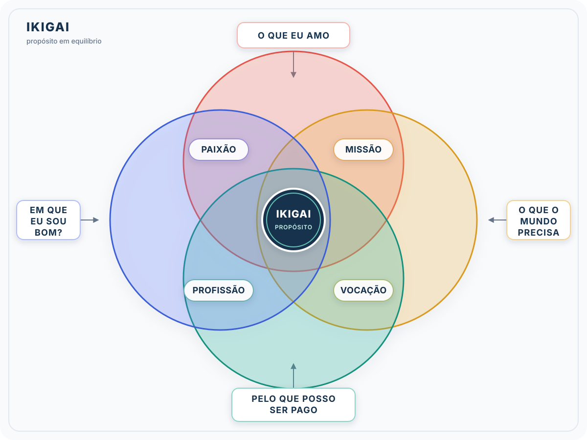
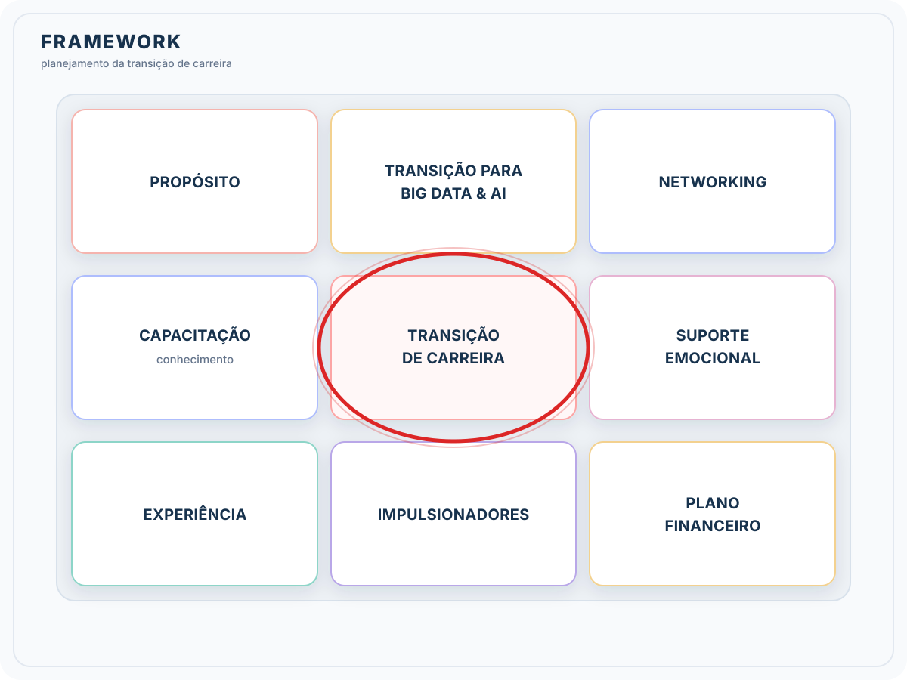

# Formação Engenheiro de Dados

## Cursos de Aperfeiçoamento Profissional - Bônus da Formação

### Guia de Transição da Carreira

#### Análise de mercado e tendências

- tendências do mercado $\to$ manter-se atualizado
  - não dá para esperar conseguir a oportunidade para se atualizar
  - importante ter a conexão com as pessoas relevantes
    - sites especializados
    - newsletter
    - LinkedIn
    - meetups
    - eventos
    - e-learning
    - certificações
    - relatórios da indústria
    - networking
    - podcast
    - Hackhatons
    - mentoria

#### Mindset Fixo $\times$ Mindset Crescimento

- não podemos nos compara com ninguém
  - cada um está no seu próprio tempo

| **Mindset Fixo** | **Mindset de Crescimento**
| --- | --- |
| <ul><li> Habilidades são inatas<li>Evita desafios<li>Desiste frente a obstáculos | <ul><li> Habilidades são possíveis de serem desenvolvidas<ul><li>trabalho árduo<li>boas estratégias<li>contribuição de outras pessoas</ul><li>investimento em aprendizado<li>aceita desafios<li>persiste frente aos obstáculos</ul> |

- para desenvolver o mindset de crescimento
  - aprender algo novo a cada mês, se desafiar
  - leia histórias de sucesso
  - esteja ao feedback
  - revisão e aprendizado dos próprios erros

#### Auto Conhecimento

- o que está mais alinhado comigo?
- "para quem não sabe para onde vai, qualquer caminho serve"
- prática voltada para si
  - **valores** $\to$ alicerces de crenças, princípios e padrões que moldam atitudes, decisções e condutas
    - núcleo vital na construção da indentidade
    - impacto em como a pessoa se relaciona
    - importante buscar empresas com alinhamento de valores
      - não conseguimos viver muito tempo em dissonância
      - chegar numa lista de 3 valores inegociáveis
        - são aqueles que mais teremos dificuldades se trabalharmos em dissonância
        - respodem porque fazemos determinadas coisas ou porque vamos numa determinada direção
  - **propósitos** (ikigai)
  - **apreciação**
    - **frustração** - aprendizados da situação, como fez para superar
    - **conquistas** - compreender as competências expressadas, entender o que foi necessário

##### Ikigai

- "razão de ser" ou "motivo para acordar de manhã"
  - ponto onde paixão, missão, profissão e vocação se encontram
  - sentido profundo de propósito e satisfação na vida
  - buscar isso no trabalho, mas com a consciência de que nem todos os dias são ideais
- **benefícios**
  - clareza de propósito
  - motivadores
  - realização pessoal
  - redução do estresse
  - equilíbrio de saúde mental
  - melhor qualidade de vida
  - facilitador da tomada de decisão
- como aplicar?
  - em que eu sou bom?
  - o que você ama?
  - o que o mundo precisa?
  - pelo que você pode ser pago?

> *"Meu ikigai (propósito) tem por missão <minha missão>, por conta da minha paixão <minha paixão> utilizando meu talento <meu talento>, por isso meio da minha atuação <profissão>.*

- **missão + paixão**: alegria e plenitude, sem prosperidade
- **missão + vocação**: entusiasmo + complacência, mas senso de incerteza
- **profissão + vocação**: confortável, mas sentimento de vazio
- **paixão + profissão**: satisfação, mas sendo de inutilidade

- **Linha da Vida**: uma forma de apreciação da nossa trajetória, contar nossa história de vida
  - histórias engajam
  - ressignificamos os acontecimentos
- colocar no papel os momentos mais marcantes
  - uma pessoal
  - uma profissional
  - apreciar tudo o que já superei e aprendizados
- depois refletir e compartilhar com alguém de confiança
  - aproximação gera confiança e fortalece a relação

> *"A clareza sobre quem somos nos dá o poder de resistir à tentação de viver a vida de outra pessoa"* - Brown B.

##### Competências Transferíveis

- mudar de carreira não significa começar do zero
  - podemos levar competênicas de uma atuação profissional para outra
  - o rol é específico para cada pessoa
- cada vez mais aceito no mercado, verificar pessoas se movimentando
  - C - conhecimento
  - H - habilidades
  - A - atitude
- competências técnicas vs. comportamentais
- quais competências são necessárias e quais análogas eu já tenho
- competências transferíveis devem ser acompanhadas de cases / projetos para serem demonstradas
- habilidades transferíveis comuns
  - conhecimento do negócio / segmento
  - gestão de projetos
  - raciocínio matemático
  - indicadores / análises de dados
  - orçamento
  - planejamento
  - pensamento estratégico
  - liderança
  - comunicação
  - soft skills em geral
  - habilidade de trabalhar com times distribuídos / remotos
- identificar meu diferencial em cada competência transferida

###### Mapeando as competências

- avaliar como estão os níveis de uma determinada competência
  - importante a declaração do que significa a competência
- importante mapear quais são as competências necessárias para cada área
  - testes comportamentais
  - feedbacks
  - avaliação 360
- identificação das competências
  - reflexão sobre experiência e projetos de que já participou
  - revisão dos feedbacks recebidos
  - resultados já alcançados
- plano de ação para quelas que precisam ser desenvolvidas

##### Framework para Planejamento

