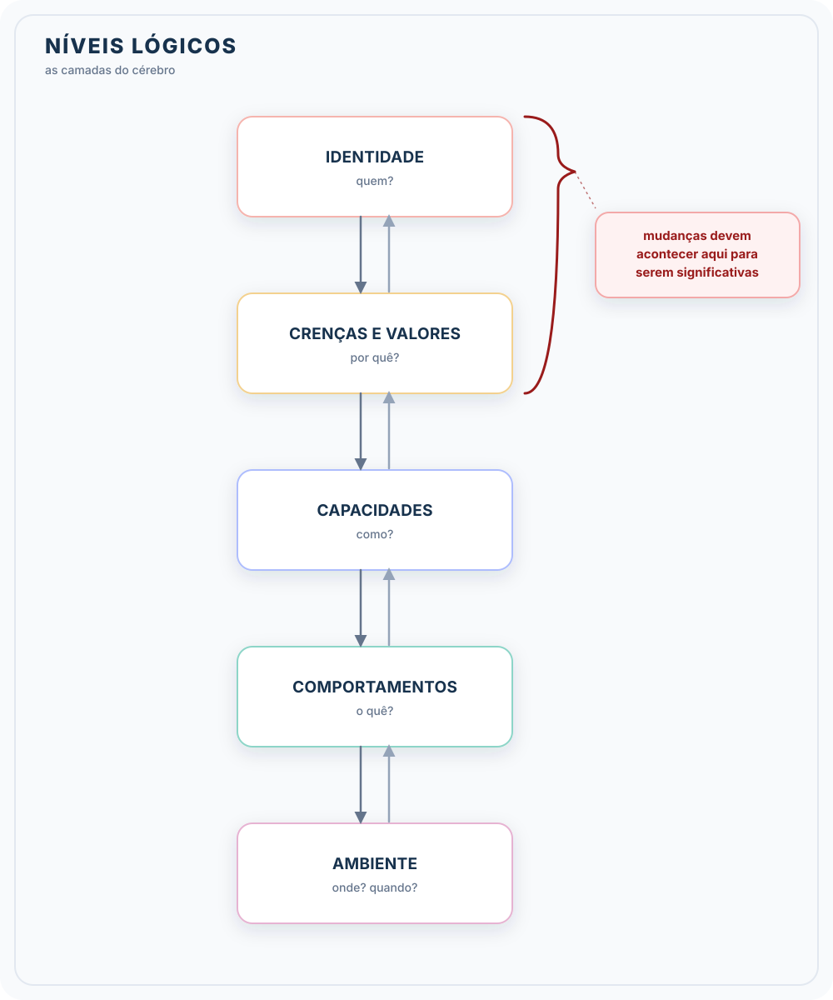
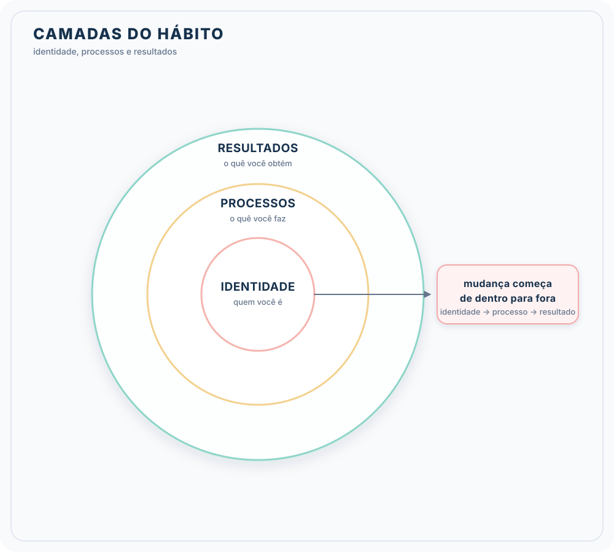
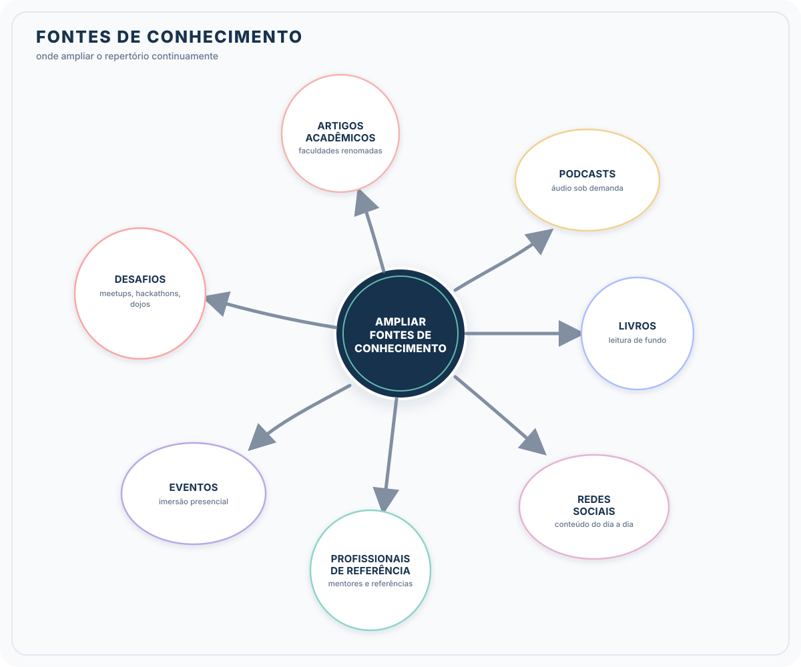

# Formação Engenheiro de Dados

## Cursos de Aperfeiçoamento Profissional - Bônus da Formação

### Guia de Transição da Carreira

##### Framework para Planejamento

- clareza sobre o propósito para entender o motivo por trás das camadas
- o cérebro possui várias camadas

- interagimos com ambiente por meio dos comportamentos
- corportamentos vêm dos mapas mentais e estratégias
  - moldam habilidades
- habilidades estruturadas pelo sistema de crenças
- crenças moldadas por identidade
- transição de carreiras $\to$ mudança de hábitos
  - alinhamento, buscar resultados
  - 1 \% melhor a cada dia $\to$ consistência

- três camadas da mudança do hábito

##### **Como eu quero ser lembrado?**

> Eu + [o que eu faço] + [para quem] + [por quê] + [como] + [impacto]

- **comunicar seu propósito**
  - tenha clareza sobre o propósito
  - faça conexões com suas experiências e realizações
  - pitch pessoal bem estruturado
  - adaptar a mensagem conforme a situação e o público alvo
  - paixão autêntica
  - prepare-se para responder perguntas detalhadas
  - seja genuíno e evite exageros
  - propósito te move nos momentos de crise. Lembrando do porque escolhi aquele caminho
  - desenvolver uma proposta de valor que vincule seu propósito às necessidades das empresas
    - qual problema você resolve?
    - como você adiciona valor com base em suas habilidades?
    - por que sua abordagem se destaca ou é superior?
  - normal ser necessário algum ajuste ao longo da vida
    - sonhos alcançados
    - mudar o peso dos diferentes papeis

#### Capacitação (Conhecimento)

- nova posição $\to$ novos conhecimentos necessários
- precisamos ter estratégia pois vamos concorrer com pessoas que estejam a mais tempo no campo 
  - planejamento para se desenvolver e se manter atualizado
- desenvolvimento por meios acadêmicos ou cursos livres

| **Acadêmica** | **Cursos Livres**
| --- | --- |
| <li>fornece conhecimento de base (estruturado) | <li>alinhamento ao mercado |
| <li>construção de um networking orgânico, de maior vínculo | <li> mais rapidamente pode pôr a mão na massa |
| <li>maior duração e mais caro | <li> depende muito da qualidade do fornecedor e podem ser necessários mais de um curso

##### **Identificar os principais focos no conhecimento**

- profissionais da área e conhecimentos mais comuns
- análise dos requisitos da vaga
- ativos e temais mais abordados
- avaliação honesta dos principais conhecimentos e identificação de lacunas
- *lifeling leraning*: prática do estudo contínuo
  - inteiramente sob meu controle
  - dedicação e consistência
  - compartilhar conhecimento

- mentores
  - plataforma de networking
  - eventos e conferências
  - comunidades e fórums
- buscar internamente na empresa
  - aproveitar os programas de mentoria
  - recomendações de colegas e gestores
- mudar para um novo campo $\to$ novo mundo
  - manter foco (recurso escasso)
  - especialização $\times$ múltiplos assuntos
    - priorização (decisões estratégicas)
  - cuidado com estímulos internos e externos
    - filtrar coisas relevantes
  - metas bem definidas (visão clara)
    - atenção para atividades em maiores resultados
- recursos de apoio $\to$ grupo de estudos e comunidades
  - certificações
  - documentação, guias e tutoriais

- **Estudos Dirigiso e Estratégias**
  1. **objetivos de estudo**: visão clara sobre o que quero aprender
     1. metas concretas
     2. aprender por partes menores e mais gerenciáveis
     3. mensurar progresso
  2. **planejamento**: cronograma de estudos que se encaixe na sua rotina diária
     1. quais tópicos estudar
     2. gerenciamento de tempo
        1. técnica de Pomodoro
     3. concentração e foco