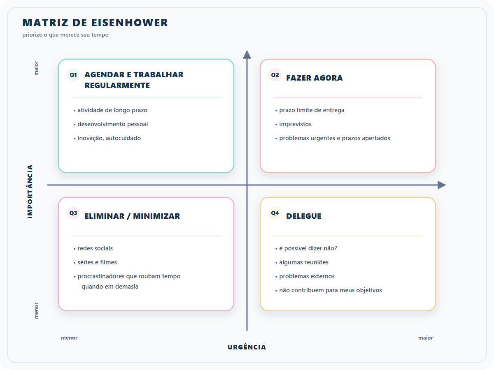

# Formação Engenheiro de Dados

## Cursos de Aperfeiçoamento Profissional - Bônus da Formação

### Guia de Transição da Carreira

#### Matriz de Eisenhower

- gestão do tempo é muito importante

1. listar tarefas e atividades
2. classificar nos quadrantes
3. focar muito nos quadrantes 1, 2 e reduzir ao máximo o tempo no 3 e 4.
4. **benefícios**
   1. melhorar foco e eficiência
   2. ajuda a reduzir estresse ao priorizar o que importa
   3. aumenta a produtividade ao evitar tarefas desnecessárias

#### **Experiência**

- pode ser difícil, pois geralmente se pede alguma experiência anterior
- diversificar possibilidades
  - identificar pontos fortes $\to$ como eles podem alavancar?
    - ter isso sempre de forma clara !
