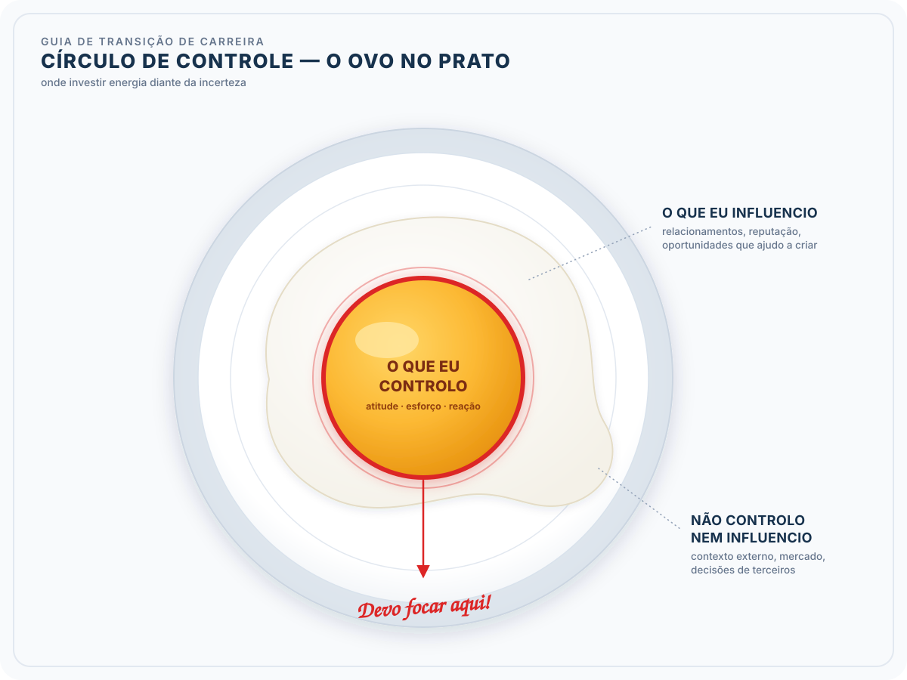

# Formação Engenheiro de Dados

## Cursos de Aperfeiçoamento Profissional - Bônus da Formação

### Guia de Transição da Carreira

#### Autoestima

- o sentimento de inferioridade pode aparecer
  - incertezas que nos fazem questionar nossas habilidades e escolhas
- exercício de valorização $\to$ linha da vida
  - lembrar das qualidades e das conquistas
- técnicas de racionalizar e desafiar
  - "qual evidência que suporta esse pensamento?"
- linguagem corporal pode afetar:
  - como os outros nos vêem
  - como nos vemos
  - "pose do poder" $\to$ aumentar a confiança
- visualizar o sucesso
  - se imaginar na nova carreira, usando as habilidades de forma efetiva
- concentrar no valor proporcionado aos outros
  - como posso ajudar os outros com o que eu sei?
  - reconhecer que não é necessário saber tudo
    - disposição para aprender. Mais valiosa que o conhecimento prático
    - habilidade de se ajustar e resolver problemas
- avaliação da incerteza
  - parte natural de qualquer transição, não viável ter todas as respostas de imediato
    - criar oportunidades de descoberta
    - "ovo no prato"

- coisas que que dependem de outras pessoas, podemos, no máximo, influenciar mas nunca controlar
  - controle é somente as minhas ações (coisas da "gema")
- celebrar as conquistas (por menores que sejam)
  - manter registro dos avanços
- apoio da família e amigos
  - crucial $\to$ envolver essas pessoas
    - compartilhar planos
    - buscar apoio, checar se elas estarão ao seu lado
  - podemos enfrentar limitações
    - tempo
    - financeiras
    - sensibilidade emocional
  - importante comunicar o que estão à nossa volta
- **equilíbrio entre vida pessoal e profissional**
  - transição não é corrida
  - observar outras pessoas e entender que cada um tem sua experiência
    - não é linear

#### Plano Financeiro

1. avaliação da situação financeira atual
   1. despesas fixas
   2. quanto está comprometido com esses gastos e dívidas
   3. considerar que você pode começar com um salário mais baixo
   4. entender o que dá para cortar
      1. montar uma planilha para analisar despesas e receitas
2. estabelecimento de objetivos financeiros e redução de dívidas
   1. alinhado com interesses e objetivos
   2. poupar dinheiro para transição
   3. **reduzir dívidas** (prioridade !)
   4. investimento em desenvolvimento próprio
   5. objetivos claros (metas maiores $\to$ menores)
3. orçamento de controle de despesas
   1. oportunidades de redução
   2. gastos sazonais
   3. diversificação de fontes de receita
4. diversificação de fontes de renda
   1. estabilidade financeira + flexibilidade
   2. ajuda a poupar ou liquidar dívidas
   3. refletir sobre hobbies que pode ser uma fonte de receita
      1. cuidado, já temos processo de transicação de carreira orçamento. A renda extra não pode onerar
5. investimento e criação de fundo de investimento
   1. garantir uma base financeira estável
   2. alocação estratégica dos recursos (liquidez $\to$ retorno)
   3. imprevisto (pensar em liquidez)
   4. salários 3x a 6x
   5. aumentar patrimônio ao longo do tempo + segurança financeira extra
   6. em momentos de crise, priorizar despesas críticas (essenciais)