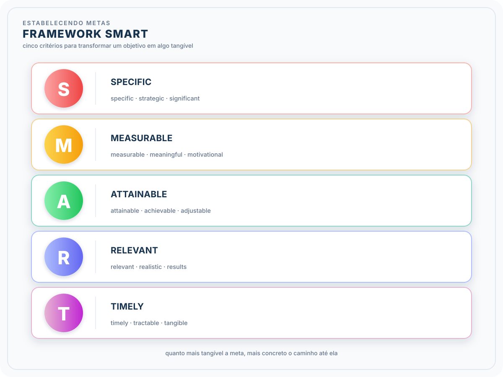

# Formação Engenheiro de Dados

## Cursos de Aperfeiçoamento Profissional - Bônus da Formação

### Guia de Transição da Carreira

#### Plano Financeiro

6. saúde mental e plano financeiro
   1. problemas financeiros = causa de estresse e ansiedade
   2. plano financeiro = focar nas prioridades
   3. outros pontos de atenção
      1. envolvimento da família $\to$ impactos na renda familiar
         1. alinhamento de todos
         2. pensar em alternativas
         3. conversas honestas
            1. escolher o momento certo pois não é uma conversa fácil
            2. transparência sobre a situação: expor, estar aberto a ouvir, estabelecer prioridades
            3. incentivar a participação familiar: todos devem fazer parte da solução
            4. prioridades: quais despesas são essenciais
            5. reforçar o objetivo final: transição é um investimento no futuro
      2. negociação da saída $\to$ no caso de uma saída do emprego atual por conta da mudança de carreira
         1. liberação parcial do FGTS (estabilidade financeira)
         2. preparação: listar contribuições, mostrar o interesse na mudança de carreira
         3. erros comuns
            1. subestimar o tempo necessário para a transição
            2. não ajustar o estilo de vida
            3. falta de reserva de emergência
            4. desconsiderar despesas ocultas
               1. não planejar imprevistos
               2. viagens, certificações ou formações

#### Impulsionadores

- pontos fortes que podem alavancar esse momento de transição $\to$ competências transferíveis
  - maturidade corporativa
  - poder de comunicação e relacionamento
  - profundo conhecimento em algum segmento do mercado
- após a identificação, a ideia é que esse ponto esteja sempre no holofote
  - currículo, entrevistas, LinkedIn

#### Transição para Big Data e AI

- **oportunidades**
  - participação da indústria e abordagens colaborativas
  - gap entre educação tradicional e realidade do mercado de trabalho
    - experiência prática com tecnologias de ponta
  - reimaginar trajetórias $\to$ programas de aprendizado alinhados com a realidade técnica e prática do mercado de trabalho
  - novas exigências de habilidades
  - modelos sustentáveis de qualificação em larga escala e rapidez
  - tudo, hoje em dia, envolve a geração de dados
  - boas oportunidades salariais
    - habilidades de UA cada vez mais necessárias
    - ocuparações criativas vs IA
    - *reskiling* $\to$ funções que serão substituíveis $\times$ funções que serão criadas
    - sempre bom manter a reflexão: como a ferramenta inteligência artificial pode ser usada para melhorar o meu dia de trabalho?

##### Reskiling $\times$ Upskiling

- habilidade cognitivas e de auto eficácia
  - pensamento analítico e criativo
  - resiliência, flexibilidade e agilidade, motivação e autoconsiência, curiosidade, aprendizagem contínua
- capacitação tecnológica
- de certa forma, todos nós vamos precisar fazer "transições de carreira"
  - 23 \% dos empregos atuais vão ser modificados até 2027

#### Soft Skills

- aprimoram interações humanas $\to$ culturas organizacionais focadas em pessoas
  - IA deve potencializar talentos humanos
  - ajudar a construir conexões interpessoais
- priorizar o desenvolvimento de soft skills
  - **ética** $\to$ ética da IA
    - desafios diários nas relações máquina-homem
      - clientes e consumidores
      - preservar a autenticidade e confiança
    - privacidade e viés algorítimico
    - impacto da IA nos empregos e relações humanas
    - valorização da virutde, integridade e caráter moral
  - **comunicação interpessoal**
    - valorização das comunicações genuínas, entre seres humanos
      - tratamento de questões sensíveis
      - fomento da confiança e autenticidade
    - tendência da comunucação escrita perder valor, visto que a IA pode escrever de maneira convincente e humana
    - comunicação oral ainda é a melhor forma de demonstrar sentimentos e características humanas
      - capacidade de ter conversas profundas e significativas
      - discussões para realização dos problemas
      - apresentações menos estruturadas e mais interativas

#### Pensamento Crítico

- habilidade de analisar, avaliar, interpretar e sintetizar informações de forma lógica, objetiva e fundamentada
  - decisões embasadas e resolver problemas
- questionar suposições, identificar vieses, examinar evidências, considerar diferentes perspectivas
- **desafios**
  - IA enfrenta questões complexas no ambiente de trabalho

#### Novas funções em crescimento

- engenheiros de modelos de IA e *prompt engineers*
- designers de interface / interação
- criadores de conteúdos com IA
- curadores de dados e treinadores
- especialistas em ética e governança

> *"Oportunidades não acontecem. Você as cria."* - Chris Groser

### Planejndo a Mudança de Carreira: Por onde começar?

- sempre iniciar com o planejamento da mudança

#### Objetivos alinhados ao propósito

- não é apenas confirmar a mudança, mas tangibilizar
- objetivo claro e alinhado ao propósito
  - qual cargo especificamente?
  - atuar numa empresa? abrir consultoria? trabalhar no exterior?
- possível de acompanhamento e que esteja claro o que eu quero alcançar no fim da jornada
  - profissional de referência?
  - ser um especialista?
  - alcançar um cargo de liderança?
- quanto mais tangível, mais a coisa se torna concreta

#### Estabelecendo metas

##### Cronograma

- estruturar o que é necessário a ser estudado, no que focar em cada etapa, o que buscar no mercado
- condizente com a rotina
  - cuidado com a sobrecarga
  - celebrar cada conquista no caminho (progressos $\times$ marcos)
- para que não haja procrastinação
- ferramentas de agendamento
  - tempo para rever o planejamento
  - marcos de checkpoints
  - realista e flexível $\to$ considere imprevistos
  - acompanhamento de progresso
  - margem de segurança

##### Recursos Necessários

- definir o que é necessário para transição
  - capacitação, ferramentas, planejamento financeiro
- possíveis obstáculos
  - avaliar possíveis riscos $\to$ mitigação (plano de contingênicas)
    - tempos para conseguir nova oportunidade
    - dificuldade com a formação
    - imprevisto pessoal

###### **Comunicação da Mudança de Carreira**

- compartilhar a necessidade, os objetivos e o plano de mudança de carreira com todas as partes interessadas
  - apoio e obtenção de oportunidade
  - criar mensagem clara $\to$ motivo da mudança (pitch de carreira)
  - familiares, amigos, mentores, pessoas que possam oferecer apoio
  - canais apropriados para desenvolver intenções (comunicar)

###### Ação

- colocar em prática o plano desenvolvido
  -  planejamento da mudança e o framework de transição de carreira
-  plano não é um guia definitivo
   -  pode sofrer alterações ao longo do percurso
   -  a vida nem sempre seguirá os planos

###### Monitoramento

- avaliar as etapas e o tempo planejado
  - ritmo de progressão
  - 1 \% melhor todo dia
- ajustar o que não saiu como planejado e reconhecer

#### Neuro Plasticidade

- cérebro = peça central do sistema nervoso
  - interação com ambiente externo
  - coordenar as funções intensivas do campo
- trabalha com seu máximo de eficiência = rendimento
- controle das funções vitais e habilidades relacionadas ao raciocínio, atenção e memória
  - conscientes ou inconscientes
- transmissão de impulsos elétricos pelos neurônios
  - sinapses
  - habilidade de aprender $\to$ ligado à quantidade de sinapses formadas
- cada cérebro é unico, formado por conexões nervosas ao longo de toda a vida
  - o cérebro tende a economizar energia, e por isso, pode ser difícil mudar hábitos
- cérebro possui capacidade contínua de neurogênese
  - criação de novos neurônis
  - plasticidade $\to$ capacidade de aprender por toda a vida
    - mudar, moldar e se adaptar (funcional + estruturalmente)
- plasticidade neuronal $\to$ experiências e aprendizados (estabelecer e desfazer conexões entre neurônios)
  - ambiente interno + externo
  - sinapses podem regenerar neurônios
  - interação com ambiente estimula a formação de novas conexões $\to$ aprendizagem
- alguns comportamentos são adquiridos
- sinapses facilitam o fluxo de informações
  - maior complexidade de ligações
  - associação de circuitos independentes
    - aprender conceitos novos a partir de conhecimentos pré-existentes
- aprender faz parte de todas as fases da vida

### Personal Brand - Preparação para Novas Oportunidades

- **personal brand** $\to$ percepção que as outras pessoas têm sobre você como profissional
  - competências técnicas
  - habilidades interpessoais
  - valores
  - comunicação e impacto no mercado
- como me posiciono como especialista na área: soluções inovadoras, contribuições para comunidade e capacidade de solucionar problemas
- **por que importa**
  - LinkedIn $\to$ plataforma para desenvolvimento de carreira e branding pessoal
    - troca de insights
    - tendência do mercado
    - aprendizagem contínua
    - amplicação de horizontes no mundo corporativo
    - conexão de talentos e oportunidades
  - não basta ter um bom perfil
    - conextar e interagir com as pessoas
    - marca pessoal deve refletir objetivos de carreira e quem eu sou
      - como eu me diferencio da multidão

