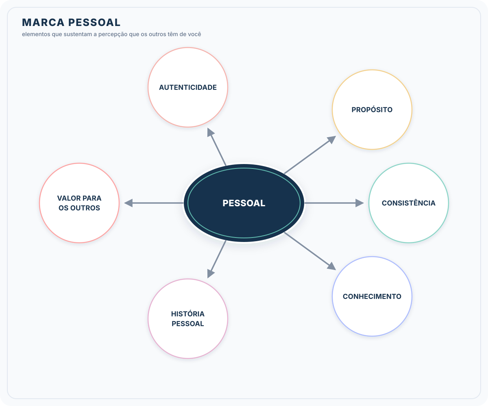

# Formação Engenheiro de Dados

## Cursos de Aperfeiçoamento Profissional - Bônus da Formação

### Guia de Transição da Carreira

### Personal Brand - Elementos

- contexto é importante para mim e para os outros

- **Autenticidade:** na comunicação e nas ações, a marca pessoal deve refletir quem você realmente é
  - valores, paixões e personalidade
  - experiências, conquistas e interesses ou grupos
- **Propósito:** visão clara dos objetivos profissionais e do que quero alcançar com a sua marca
  - guia para ações e comunicações
  - resumo do perfil para expressa de forma clara
    - compreensão rápida de quem eu sou
  - título do perfil deve refletir o propósito
- **Consistência:** coerente na mensagem e na maneira com que me apresento, offline ou online
  - linguagem visual
  - tom de voz
  - qualidade do conteúdo divulgado
  - consistência visual ou narrativa do perfil
    - foto, imagem de capa
    - descrição de cargo, conteúdo compartilhado
- **Conhecimento:** demonstrar conhecimentos e experiências
  - conteúdos produzidos (artigos, vídeos, palestras)
  - autoridade no tema
  - experiências listas, recomendações, certificados e habilidades endossadas
  - discussões sobre tópicos relevantes $\to$ credibilidade
- **História Pessoal:** jornada pessoal pode ser tornar componentes impactantes da marca pessoal
  - profundidade
  - narrativa cativante, destacando pontos únicos, desafios enfrentados, lições aprendidas
- **Valor para os outros:** ofereça algo de valor para sua audiência
  - conhecimentos, inspiração, entretenimento, suporte
  - como eu posso ajudar os outros a alcançar seus objetivos?
  - compartilhar insights, informações úteis e conteúdo inspirador
    - construção de relacionamentos significativos

#### Importância

> *"Você é a marca; seu currículo é apenas o panfleto.* - Tom Peters

- **primeiro contato:** perfil no LinkedIn representa a primeira impressão que terão de você
  - precisa ser marcante, evidenciando experiências e habilidades
- **recrutamento:** perfil otimizado, palavras-chave da área de atuação, aumentam as chances de ser encontrado

#### Networking

- LinkedIn $\to$ criação e manutenção de uma rede de contatos profissionais ampla e diversificada
  - fonte valiosa de oportunidades
  - informações sobre o setor
  - potenciais recomendações
- **vagas:** busca ativa por oportunidades de emprego
- **feedback/credibilidade:** seções de recomendação e endossos possibilitam reconhecimento de habilidade e experiências
  - tornar o perfil mais atrativo para recrutadores e potenciais conexões

#### Insights

- seguir líderes e empresas do setor pode oferecer perspectivas valiosas sobre a indústria, novas tendências e melhores práticas
  - manter-se informado e engajado

- **LinkedIn**
  - vitrine para trajetória profissional
  - canal para compartilhar conhecimentos
  - conectar com tendências do mercado
  - participar de debates com especialistas para enriquecer o repertório
  - atrair oportunidades, consolidar presença no mercado
  - acesso a redes de contato que de outra forma poderiam ser inexploradas
  - foto do perifl e foto de capa
    - papeis cruciais na construção da primeira positiva e na comunicação da marca pessoal
    - **profissionalmismo:** seriedade, destaque do rosto (60 - 70 \% da imagem)
    - **fundo:** neutro e livre de distrações, foco em mim
    - **iluminação:** evitar sombras no rosto
    - **sorria:** suave e autêntico, perfil mais acolhedor e acessível, sensação de positividade
    - **alta-qualidade:** foto em alta resolução e nitidez, margem profissional
  - capa do perfil deve ser relacionada com os valores e o propósito
  - headline
    - importante para otimizar seu perfil para ser encontrado nas buscas
    - **específico e criativo:** expressar atividades de forma clara, com um toque criativo (autenticidade)
    - **incluir palavras-chave:** aumentar visibilidade do perfil
    - **mostre seu valor:** de forma rápida
    - **evitar jargões:** título deve ser claro para profissionais de outras áreas também
      - conexões interdisciplinares
  - url do perfil
    - personalizar para mostrar cuidado e facilitar o compartilhamento
  - resumo profissional
    - resumo da trajetória profissional
    - destacar movimentações estratégicas ou transições que evidenciem crescimento ou desenvolvimento
    - história $\to$ situação atual $\to$ aspirações futuras
      - exemplos concretos para ilustrar habilidades e conquistas
      - resultados tangíveis
    - habilidades específicas / áreas de especialização
      - como foram utilizadas? em quais situações ?
        - técnicas, conhecimento do setor, competências interpessoais
      - palavras-chave (maneira fluida)
        - familiaridade com a linguagem do setor
  - adicionando experiências
    - buscar trazer números tangíveis
    - experiências, contribuições, lições aprendidas
    - palavras-chave
  - formação acadêmica
    - destacar a base acadêmica e de conhecimento e o compromisso com o desenvolvimento contínuo
    - validar competências técnicas e teóricas
  - recomendações
    - demonstração real das competências
    - demonstração de confiança
  - publicações
    - forma das pessoas te conhecerem
  - palavras-chave $\to$ ajuda o perfil a ser encontrado por oportunidades
    - correspondência com interesses e habilidades
    - análise da descrição de vagas
    - profissionais de referência
    - inclusão com seções estratégicas
    - pesquisa no LinkedIn
    - variações
    - monitoramento
      - participação ativa e análise de estratégias

#### Busca de Vagas

- além de ter boas qualificações
- estratégia abrangente: planejamento + network + posicionamento profissional + preparação para processos seletivos
- "melhor vaga"
  - o que você procura? $\to$ descobrir o que é importante par mim para orientar minhas decisões?
  - pontos a considerar
    - alinhamento com valores e propósito
    - compatibilidade com competências e interesses
    - benefícios financeiros e não financeiros (flexibilidade, aprendizado, impacto)
    - qualidade de vida e equilíbrio pessoal $\times$ profissional
    - momento pessoal

#### Mercado de Trabalho

- estar bem informado sobre as tendências do setor
  - terminologias em alta
  - setores em crescimento
  - habilidades demandadas
  - relatórios de mercado para demandas futuras
    - LinkedIn, GlassDoor, Gartner, Github, Octoverse
  - acompanhar empresas dos sonhos

#### Networking

- participar de eventos, presenciais ou virtuais
- conexões com pessoas influentes na área
- envolver-me em comunidades e grupos especializados
- solicitar informações ou referências
  - evite ser insistente $\to$ pensar na relação ganha-ganha
- conectar-me com pessoas chave
- ofereça valor também $\to$ as pessoas não gostam de se sentir usadas

#### Adaptação do Currículo

- personalize o currículo para cada oportunidade
  - enfatizar as habilidades e experiências mais pertinentes à posição
  - palavras-chave + portfolio $\to$ projetos pertinentes que evidenciam habilidades para a posição desejada
  - enfatizar resultados

#### Abordagem Proativa

- identificar empresas na qual eu gostaria de trabalhar
  - investigar cultura, valores, desafios
- conectar com profissionais dessas empresas e mostrar interesse genuíno
- algumas oportunidades são preenchidas antes de serem divulgadas
- seja ativo
  - participar de fórums e grupos
  - contribua para projetos de código aberto
    - evidencia o conhecimento técnico e habilidades de colaboração
  - publique artigos no LinkedIn ou no Medium

##### Locais para Buscas de Vagas

1. LinkedIn
2. Indeed
3. Glassdoor
4. Vagas.com
5. Gupy
6. **focadas em tecnologia**
   1. Github Jobs
   2. Stack Overflow JObs
   3. HackerRank
   4. Workana / Freelancer.com
7. **agregadores de vagas**
   1. google jobs

- sites das empresas $\to$ algumas preferem anunciar as vagas na própria página
  - aba "Carreiras"
- outras redes sociais
- feiras e eventos de emprego
  - *campus party*
  - eventos locais e universitários
  - meetups profissionais
- headhunters e empresas de recrutamento
  - mais útils para vagas de nível sênior ou executivos
- plataformas de trabalho remoto
  - we work remotely
  - remot OK
  - outsourcely

#### Entrevista

- via de mão dupla !
- preparação
  - qual a empresa?
  - o que pedem na vaga?
  - quem trabalha lá?
  - roteiro da entrevista $\to$ saber ser estratégico nas respostas
    - ChatGPT
  - pode ter desafio?
- fundamental abordar os diferenciais
  - charma atenção dos recrutadores e se destacar como o candidato ideal
  - saber comunicar o que me torna único
  - bom se preparar para cada entrevista