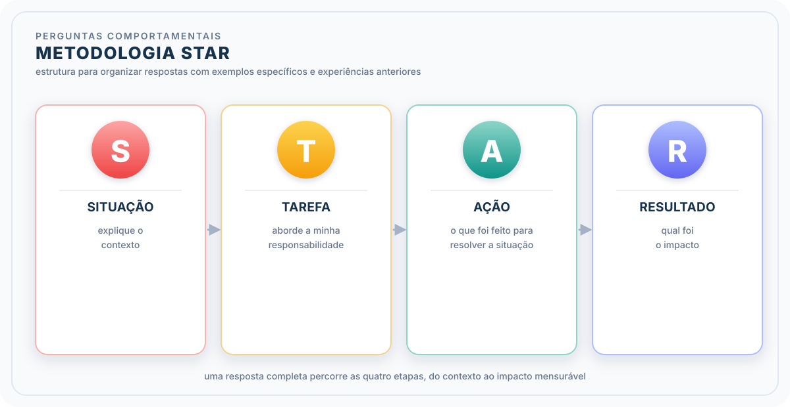

# Formação Engenheiro de Dados

## Cursos de Aperfeiçoamento Profissional - Bônus da Formação

### Guia de Transição da Carreira

### Personal Brand - Elementos

#### Entrevista

##### Linguagem Corporal

- forma de comunicação não veral, baseada em gestos, expressões faciais, posturas, outros movimentos que transmitem informações
  - consciente ou inconsciente
  - sutil ou explícito
- não verbal impacta mais em casos de entrevistas remotas
- transmitir mensagens de simpatia e acessibilidade
- técnicas para reduzir a ansiedade
  - preparação $\to$ considerar imprevistos
  - prática
  - visualização positiva
  - ambiente favorável
  - respiração
  - resumo em bullets

##### Metodologia STAR - perguntas comportamentais

- organziação das respostas a perguntas que solicitam exemplos específicos e experiências anteriores

- **Respostas sobre pontos fracos**: oportunidade para mostrar autoconhecimento e disposição para desenvolver

1. **seja honesto, mas estratégico:** ponto fraco que não seja crítico para função. Demonstre esforço para desenvolver
2. **Estruture sua resposta:** seja específico e detalhe ações tomadas para superar impactos

- **Como abordar a transição de carreira**
  - *storytelling* que faça sentido sobre a transição (*pitch*)
    - qual motivo fez pensar numa nova carreira
    - como determinou qual carreira iria procurar
    - quais competências são meu destaque na nova carreira
  - entrevistador quer entender se a mudança de carreiras disfarça um "oportunismo"
- **entrevistas para posições remotas**
  - preparo técnico + habilidade interpessoais
    - garanta a qualidade técnica
    - demonstrar familiaridade com o trabalho remoto
    - personalize suas respostas
    - proatividade e autodisciplina

##### Rapport com Entrevistador

- conexão positiva $\to$ impressão favorável
  - sorria e expressão facial convidativa
  - demonstre interesse genuíno
  - busque por pontos em comum
  - atenção à comunicação não verbal
- empatia + escuta ativa
  - demonstre que está atento: mantenha contato visual, balance a cabeça em sinal de concordância, evite interrupções
  - frase que ressaltam escuta ativa:
    - "compreendo que resultou ..."
    - "isso faz sentido, e tive uma experiência similar em outro contexto..."
- **Perguntas difíceis**
  - algo que não está preparado, ou que ainda é delicado
    - respirar e pedir um momento para refletir
    - seja verdadeiro, mas mostre aprendizados
    - foque na solução
    - menos é mais

##### Entrevistas em Grupo

- avaliam habilidades como colaboração e liderança num ambiente dinâmico
  - otimiza a parte de seleção
- lidere sem dominar
- escute os demais
- trabalhe em equipe

- **o que perguntar no final da entrevista**
  - perguntas que demonstrem seu interesse na vaga e na empresa
  - perguntas estratégicas
    - projetos na área de diversidade, qualidade de dados
    - temas estratégicos que demonstrem pesquisa
- demonstrem interesse pelo time e pelo ambiente de trabalho

- **Encerramento da entrevista**
  - realinhar seus interesses
  - resuma seus pontos fortes e competências transferíveis
  - faça uma pergunta final
  - confirme próximos passos
  - follow-up pós-entrevista $\to$ permanecer na lembrança do recrutador
    - cuidado com a insistência
  - lições aprendidas com o resultado

### Presença nas Redes Sociais

- forma com que eu sou percebido online através dos perfis, publicações, interações e conteúdos
  - vitrine da marca pessoal no mundo digital

#### Autoridade

- postar o tipo certo de conteúdo aumenta a credibilidade e posiciona você como referência
  - artigos de opinião
  - cases
  - dicas práticas ("pulo do gato")
  - conquistas (certificações / prêmios)
  - insights / resumos
- engajamento $\to$ seguir as empresas
  - interagir com publicações
  - se fazer presente
  - tipos de conteúdo
    - checklists e guias rápidos
    - estudos de caso com resultados mensuráveis
    - dicas práticas sobre ferramentas
    - história de superação ou aprendizados
    - enquetes ou perguntas abertas
- **evitar polêmicas online**
  - temas que envolvem religião, política ou questões pessoais
  - atenção de questões de diversidade

#### SEO

- palavra-chave: temas pertinentes à sua área em títulos e descrições
- otimize as imagens: texto alternativo para imagens
- redigir descrições claras $\to$ descrições detalhadas e concisas
- **destaque projetos pessoais**
  - antes e depois $\to$ problema inicial vs. resultados alcançado
  - apresente dados: resultados tangíveis
  - mantenha uma frequência de publicações
    - categorias de conteúdo: dicas, projetos, eventos
    - estabeleça frequência
    - ferramentas de agendamentos
- **crescimento da rede**
  - conexões significativas
  - envie mensagens personalizadas
  - engaja-se em grupos e fóruns

### Oportunidades Internacional

- remoto ou imigrante
- mercado de trabalho global
  - países com alta demanda por profissionais estrangeiros
  - setores em crescimento
    - tecnologia
    - saúde
    - engenharia
  - oportunidade através de programas como
    - Global Visa Talent (Austrália)
    - Express Entry (Canadá)
- tendências no mercado no exterior $\to$ olhar expandido do mercado
- empresas que contratam internacionalmente
- **diferenças culturais no trabalho**
  - estilos de comunicação variados
  - abordagens na gestão do tempo e prazos
  - estruturas hierárquicas específicas
  - dicas para adaptação
    - manter-me observador e aberto a mudanças
    - familiaridade com expressões locais
    - feriados e tradições culturais
- entrevistas internacionais
  - perguntas culturais
  - entrevistas técnicas rigorosas
  - idioma (prática)
- hackhatons e desafios globais
  - benefícios
    - networking com recrutadores e profissionais internacionais
    - destque portfolio com projetos reais
- estudando no exterior para facilitar a transição
  - pode ser a chave para carreira internacional
  - reconhecimento de diploma no país
  - criação de uma rede de contatos local
- mentor internacional $\to$ guiar a transição com conselhos baseados em experiência
- LinkedIn pode ajudar
  - publicar em inglês
  - conectar com recrutadores globais
  - palavras-chave em inglês

##### Entrevistas Técnicas Globais

- domínio técnico: fazer simulados
- inglês técnico
- adaptar a padrões internacionais
- contribua com projetos open source
- negociação salarial $\to$ médias salariais locais
- resiliência $\to$ isolamento, estresse, adaptação
- nômades digitais
  - trabalho remoto usando tecnologia e internet
  - liberdade de viajar e viver em diferentes lugares do mundo
  - avanço da conectividade global, ferramentas digitais de colaboração e crescente adoção do trabalho remoto

> *"Pessoas com metas triunfam porque sabem exatamente para onde vão"* - Earl Nightingale