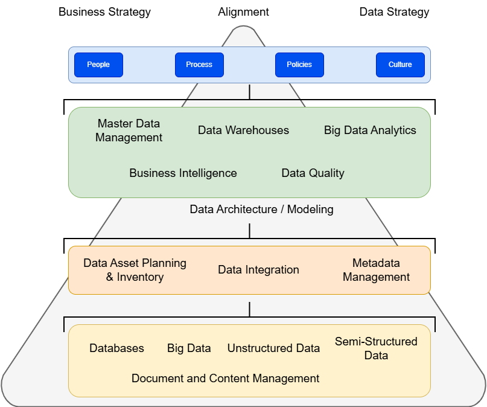

# Formação Engenheiro de Dados

## Cursos de Aperfeiçoamento Profissional - Bônus da Formação

###  Curso de Governança de Dados

#### Estratégias de Dados

- planejar ações para alcançar um objetivo
    - adaptação
    - sucesso e evolução contínua
- estratégia de dados -> alinhada com a estratégia de negócios
    - estratégia de dados suporta a estratégia de negócios
    - governança de dados para entregar as informações

- estratégia tem que ser *top-down*

#### Global Data Management Community

- estratégia de addos -> diferencial
- certificação -> [Link para certificação](https://dama.org)
    - *Body of Knowledge*

#### 7 erros que devem ser evitados em Governança de Dados

- erros são esperados, fazem parte do aprendizado
    - principalmente quando a empresa nunca implementou

1. não definir claramente o que é governança de dados
2. tratar governança de dados como um **projeto** e não como um **processo**
    - governança de dados é *contínua e sistêmica*
3. não considerar governança de dados como uma **estratégia corporativa**
    - top-down
    - cultura e estrutura organizacional
4. não considerar a cultura da empresa
    - mudar paradigmas = barreiras
5. oferecer governança de dados como solução para todos os problemas
    - cuidado com reforma radicais
6. esperar muito dos patrocinadores
    - crítico para o sucesso
    - há um limite para o que o *sponsor* pode fazer
7. confiar no efeito *Big Bang*
    - pense "globalmente", aja "localmente"

- ROI sobre governança de dados -> +5 anos
    - benefícios passam a superar os custos em aprox. 2 - 3 anos
    - médio a longo prazo
- **governança de dados**: pessoas se responsabilizando pelos ativos de informação da organização
    - observância dos processos

#### Estratégias de Implementação

1. **Definição da Estratégia**
    - governance charter -> objetivos da implantação
    - partes interessadas
    - declaração da missão
    - definição dos mecanismos de controle de dados
    - escopo e abrangência
    - definição de autoridades e responsabilidades
    - compromisso da alta liderança
2. **Escolha do Modelo de Governança**
    - processos, condutas, costumes, políticas para gerir e reorganizar a organização
    - interesses das partes interessadas
    - aplicar esses conceitos aos ativos de dados
    - processo de gestão
    - comum
        - Comitê de Governança
        - Data Governance Office
        - Data Governance Working Group -> especialidade em business + tecnologia
3. **Seleção do Comitê de Governança**
    - executivos de alto nível
    - presidentes das linhas de negócio cujos dados estão sendo governados
    - Líder: executivo sênior subordinado ao CEO
        - autoridade para aprovar projetos
        - lista de prioridades
    - patrocinadores executivos (promotor de governança)
    - presidente do Data Governance Office
        - direciona o processo
        - garante o seguimento das políticas
        - apoia e patrocina empreendimentos
        - apoia estratégias e projetos
4. **Criação do Data Governance Office**
    - em pequena empresa -> uma pessoa que pode iniciar o processo
    - Master Data Council -> aplica a governança de dados
        - DGL (Data Governance Leader) -> um passo abaixo do VP -> tempo integral para todas as unidades do negócio
            - parecido com um PMO
                - aplica políticas
                - propõe projetos
                - coordena grupos de tecnologia
                - métricas de sucesso
                - priorização (líder)
                - precisa entender o jogo político
        - representantes
            - de TI -> para questões de tecnologia
        - coordenador de Governança de Dados
            - programa reuniões
            - atas de reunião
            - atualiza registros de pendências/ problemas
            - tarefas administrativas
5. **Assessment**
    - provável que já existam soluções em andamento mas ainda sem integração à estratégia organizacional
    - avaliar a situação atual para suportar planos de ação
    - Assessment
        - Cultural / Maturidade
        - Capacidade dos Recursos Disponíveis
        - Processos de Gestão
        - Colaborativo
    - já existem iniciativas de MDM (Master Data Management)? qual abrangência?
    - já existe a iniciativa de gestão de documentos? dados estruturados e não estruturados?
    - qual nível de qualidade dos dados? qual métrica?
    - Enterprise Information Management?
        - armazenamento?
        - archive?
        - data ownership?
        - uso de dados?
    - comparação de resultados dos relatórios periódicos

