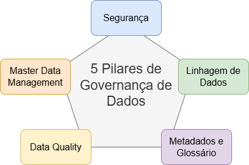

# Formação Engenheiro de Dados

## Cursos de Aperfeiçoamento Profissional - Bônus da Formação

###  Curso de Governança de Dados

#### Estratégias de Implementação

6. **Definição de Políticas e Procedimentos**
    - práticas de gerenciamento
        - time de qualidade de dados
    - políticas baseadas nos objetivos do programa
        - aprovadas pelo Comitê Gestor
    - aderência é crucial
    - facilmente compreensíveis e com fácil acesso
    - dinâmico e atualizadas de acordo com a evolução dos objetivos da empresa

7. **Design Funcional**
    - analisa funções e processos necessários
        - responsabilidades
    - divulgação dos envolvidos
    - determinar os princípios básicos
    - baseline das políticas de governança de dados
        - determinar se o benefício está ocorrendo
    - refinar ou criar processos de dados
    - critérios e métricas de qualidade de dados

8. **Processo de Melhoria Contínua**
    - ver informações importantes com mais clareza
    - processo contínuo de melhoria
        - expor problemas e falhas
        - resolução dos problemas documentadas
    - depende, em última instância das pessoas
        - papeis e responsabilidades
        - suportadas pelas tecnologias

#### Os 5 Pilares da Governança de Dados

- pode ter um Data Warehouse como um repositório central -> mais comum
- recentemente
    - Data Lake
    - Data Lakehouse
    - gerenciamento de metadados
    - vários repositórios para lidar com diversos tipos de dados

    

- **O que são Metadados?**
    - dados sobre os dados
    - insights -> modificações, históricos
    - consigo apresentar como os dados são tratados e transformados e como isso impacta nos resultados
    - facilita a descoberta dos dados

- **O que é Master Data Management?**
    - tecnologia, as ferramentas e os processos que garante os dados principais coordenados por toda a empresa
        - serviço de dados mestre
            - dados precisos
            - consistentes e completos
                - empresas e parceiros de negócios
    - única fonte de referência mestre para todos os dados críticos
        - menos erros e menos redundância
    - não é apenas tecnológicos, mas podem modificar processos de negócios
        - problemas políticos
    - a solução precisa manter os dados limpos e consistentes
        - processos e tecnologias
    - políticas de
        - transformação
        - integração de dados
        - coleta
        - limpeza
        - identificação
        - reparação
    - esquemas e taxonomias para manter a referência mestre de qualidade
    - particular interesse de grandes organizações
        - atividades de fusão / aquisição
        - integração de dados de larga escala
        - linhas de produtos segmentadas -> experiências desintegradas
    - *Como funciona o MDM?*
        - cria a lista mestre
            - limpar e padronizar os dados
            - correspondência de dados de todas as fontes para consolidar duplicatas
            - criar / entender o modelo de dados
            - definir o conteúdo dos atributos
            - mapear fontes de dados para o modelo de dados mestres
                - processos de ETL
                    - normalizar os formatos de dados
                    - substituir valores ausentes
                    - padronizar valores
                    - tratar duplicatas
                    - mapeamento de atributos
        - manter a lista mestre, devido à escalabilidade dos dados
            - manter uma cópia única de referência
            - múltiplas listas (cópias) da lista mestre
                - processo de merge contínuo