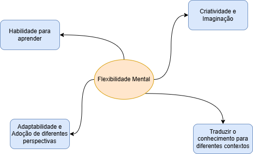

# Formação Engenheiro de Dados

## Cursos de Aperfeiçoamento Profissional - Bônus da Formação

### Aprender a Aprender

- autodescoberta, autorreflexão e adaptação
- pensar sobre o pensamento -> metacognição

*"Diga-me e eu esqueço. Ensine-me e eu lembro. Envolva-me e eu aprendo."* - Benjamin Franklin

### Mindset de Crescimento

- crê no desenvolvimento da inteligência / habilidades
- busca aprendizado para superar limitações
- abraça desafios e encara falhas como aprendizado
- esforço = caminho da excelência
- enfrenta problemas com entusiasmo

- Aprendizado = transformação pela experiência

#### Estilos de Aprendizagem

- *sensorial/intuitivo8 - coleta dos sentidos
- *visual/verbal* - visão / audição
- *processamento ativo/reflexivo* - experimentação ativa ou observação reflexiva
- *compressão sequencial/global* - informações organizadas em raciocínio
    - linear
    - não-linear

**neuro plasticidade** - capacidade de fazer / refazer ligações sinápticas quando submetido a estímulos
    - aprender faz parte de toda a vida
- devemos ir para a *região lenta* do cérebro
    - região da reflexão
- tomamos decisões por gatilhos inconscientes
    - decisão da *região rápida* do cérebro (economia de energia)

<table>
    <tr>
        <th>Dopamina</th>
        <th>Serotonina</th>
        <th>Noradrenalina</th>
        <th>Acetilcolina</th>
    </tr>
    <tr>
        <td>
            <ul>
                <li>Motivação e recompensa</li>
                <ul>
                    <li>Exercícios</li>
                    <li>Dormir bem</li>
                    <li>Metas</li>
                    <li>Celebrar conquistas</li>
                </ul>
            </ul>
        </td>
        <td>
            <ul>
                <li>Redução dos maus hábitos</li>
                <li>Aumento da capacidade de decisão</li>
                <ul>
                    <li>Agradecer</li>
                    <li>Recordar bons momentos</li>
                </ul>
            </ul>
        </td>
        <td>
            <ul>
                <li>Concentração</li>
                <ul>
                    <li>Manter-se desafiado</li>
                    <li>Rotina consistente</li>
                </ul>
            </ul>
        </td>
        <td>
            <ul>
                <li>Formação de memórias</li>
                <ul>
                    <li>Aprender coisas novas</li>
                    <li>Estimular os sentidos</li>
                </ul>
            </ul>
        </td>
    </tr>
</table>