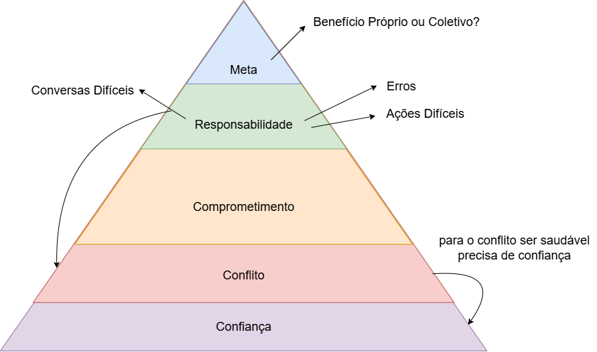

# Formação Engenheiro de Dados

## Cursos de Aperfeiçoamento Profissional - Bônus da Formação

###  Soft Skills - Desenvolvendo suas Habilidades Comportamentais

#### Trabalho em Equipe - Formação de Equipes

- equipe = número de pessoas com habilidades **complementares** que estão comprometidas com um **propósito comum**, um conjunto de metas de desempenho e possuem abordagem para que detenham-se **mutualmente responsáveis**
    - compartilhar objetivos para serem eficazes

1. compromisso e propósito comuns
2. metas de desempenho (o que precisamos entregar?)
3. habilidades complementares
4. responsabilização mútua

#### Os 5 Desafios de Equipes

1. *Falta de confiança* -> impede que as relações sejam verdadeiras, impede a auto-exposição
2. *Medo do Conflito* -> pessoas diferentes discordam; mas o conflito sábio traz o debate e incentiva a pesquisa
3. *Falta de Comprometimento* -> piorado com a falta de abertura;
    - precisa de apoio às tomadas de decisão; 
    - pessoas que figem estar comprometidas
4. *Evitar Responsabilidades* -> precisamos estar dispostos a tomar ações difíceis
5. *Falta de atenção aos resultados* => não podemos buscar as coisas convenientes

