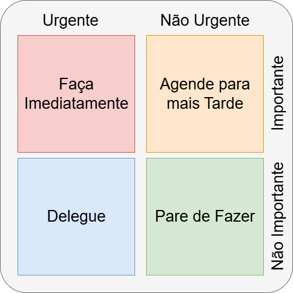

# Formação Engenheiro de Dados

## Cursos de Aperfeiçoamento Profissional - Bônus da Formação

###  Soft Skills - Desenvolvendo suas Habilidades Comportamentais

#### Foco nos Resultados

- objetivo das organizações, mas precisa ser balanceado com o bem estar da equipe
    - resultados somente alcançados pela equipe
    - quanto de valor agregado em cada valor (custo / benefício)
- foco na entrega de software funcionando
    - maneira iterativa e incremental
    - adaptação aos feedbacks

#### Foco no Cliente

- busca constante para ajudar clientes a tomarem decisões que atendam às suas necessidades
    - sucesso -> satisfação contínua do cliente
    - cultura de fidelização
    - testar e receber o feedback

#### Adaptação às Mudanças

- mundo VUCA
    - volatile
    - uncertain
    - complex
    - ambiguity
- habilidade de adaptação e responder às mudanças
- saber lidar com incertezas
    - aberto ao novo
    - sair da zona de conforto -> zona de aprendizagem e desenvolvimento

#### Aprender com os Erros

- erro = resultado que aponta numa outra direção (Steve Jobs)
    - o que estava tentando?
    - o que deu errado?
    - por que deu errado?
    - o que posso aprender com esse erro?
- erro é risco, mas não podemos criar cultura do medo

#### Data Driven

- decisões baseadas em números ou resultados de experimentos
- aprendizado empírico planejado desde o início

#### Time Box

- gerenciamento do tempo
    - cumprimento dos prazos
    - ter foco
    - estabelecimento do tempo para as discussões
- gerenciar planejamento e execução
- perder prazos -> sucessão de atrasos
- durações recomendadas
    - sprint (1 - 6 semanas)
    - retrospectiva (4 h)
    - review (4 h)
    - sprint planning (8 h)
    - daily meeting (15 min)

- **Matriz de Enseinhower**

#### Foco em Pessoas

- troca, face a face, traz mais benefícios, entendimentos e colaboração
- trabalhar de forma colaborativa
    - diferentes expertises
    - apoiando uns aos outros, dentro ou fora do time

#### Ownership e Accountabilities

- protagonistas x vítimas
    - **protagonistas** -> podem decidir sobre própria carreira e futuro. Não esperam ser solicitados, prontificam e estão à frente
    - **vítimas** -> terceirizam a culpa, empecilhos, não se responsabilizam por resultados, procrastinam e não assumem a liderança
- empresas precisam ser empresas que aprendem
    - profissionais protagonistas
- modelos mentais -> crenças que influenciam como nós vemos o mundo + tomada de decisão
    - *crescimento* -> acredita que o talento pode ser desenvolvido pelo trabalho duro, boas estratégias, e input dos outros
    - *estagnado* -> acreditam que talento é inato

<table>
    <tr>
        <th></th>
        <th>Estagnado</th>
        <th>Crescimento</th>
    </tr>
    <tr>
        <td>Desafios</td>
        <td>Evita</td>
        <td>Abraça</td>
    </tr>
    <tr>
        <td>Obstáculos</td>
        <td>Desiste com facilidade</td>
        <td>Persiste</td>
    </tr>
    <tr>
        <td>Esforço</td>
        <td>Vê como algo que não traz resultado</td>
        <td>Caminho para maestria</td>
    </tr>
    <tr>
        <td>Sucesso dos demais</td>
        <td>Sente-se ameaçado</td>
        <td>Busca inspiração e lições das pessoas</td>
    </tr>
    <tr>
        <td>Aprendizagem</td>
        <td>Ou eu já sou bom nisso, ou não sou</td>
        <td>Posso aprender o que eu desejar</td>
    </tr>
    <tr>
        <td>Erros</td>
        <td>Não sou bom quando erro</td>
        <td>Quando eu erro, eu aprendo</td>
    </tr>
    <tr>
        <td>Visão do mundo</td>
        <td>Minhas habilidades determinam tudo</td>
        <td>Minhas atitudes determinam tudo</td>
    </tr>
    <tr>
        <td>Resultado</td>
        <td>Atinge menos do que o potencial total</td>
        <td>Atinge cada vez mais performances diferenciadas</td>
    </tr>
</table>

#### Comprometimento

- envolver objetivos e responsabilidade com resultados
    - dedicação e não vitimização
    - raio de influência -> protagonismo
- ajuda a desenvolver outras habilidades
    - impulsiona o desenvolvimento pessoal e profissional
- pessoas sentem-se bem em lidar com alguém confiável
- sucesso nunca maior que o nível da sua competência / comprometimento
    - colocar o próprio desenvolvimento na agenda
- **organizacional-afetivo** - aceitação dos objetivos organizacionais
    - intensidade dos sentimentos positivos e negativos
- **continuação, calculativo ou instrumental**: trocas e avaliação dos custos associados às saída
- **normativo**: sentimento de lealdade e obrigação para a organização

#### Confiança é a base

- para qualquer relacionamento -> Impacta na qualidade
    - comunicação flui
    - aceitação e tolerância a erros é maior
- falta de confiança  = + controle, - autonomia, - eficiência, + lentidão -> empresa obsoleta

- transparência e acelera mudanças
1. declare as intenções
2. diga o que vai fazer
3. faça o que disse que ia fazer

- confiança sempre impacta custos e velocidade
    - menos compreendida, mais negligenciada e mais subestimada
    - variável mais poderosa -> transforma comportamentos -> possibilita mudança
- como fazemos o que fazemos é importante
