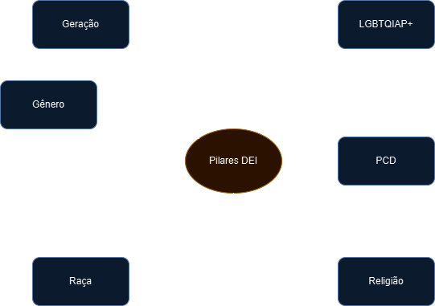
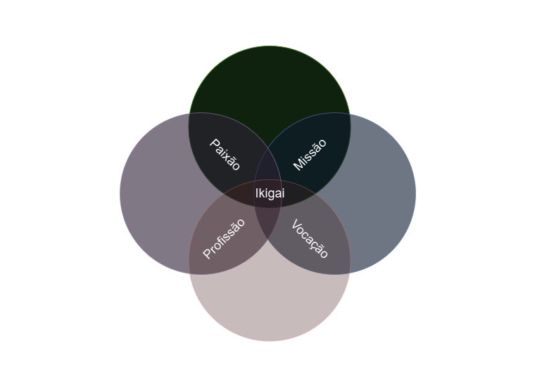

# Formação Engenheiro de Dados

## Cursos de Aperfeiçoamento Profissional - Bônus da Formação

### Diversidade, Equidade e Inclusão

- fator para a diversidade
    - envelhecimento médio da população

- ESG
    - environmental
    - social
    - governance

- Benefícios
    - inovação -> flexibilidade e adaptabilidade à mudanças -> melhor compreensão dos clientes -> atração e retenção de profissionais -> melhor tomada de decisão

- *vieses inconscientes* = preconceitos ou esteriótipos que afetam nosso pensamento e comportamento
    - processos mentais rápidos e simplistas
    - micro-agressões e revisitações do vocabulário
    - A = autoconhecimento
    - I = informe-se
    - R = repense
    - S = seja proativo

### Mudança de Carreira

- sempre há tempo de se renovar
- busca da satisfação pessoal = autoconhecimento
- desafios renovados = novas habilidades
- melhores condições financeiras
- alinhamento com paixões e valores morais -> propósito

- planejamento é fundamental

*"Seu trabalho vai preencher uma grande parte de sua vida, e a única maneira de se estar verdadeiramente satisfeito é fazer o que você acredita ser um grande trabalho. E a única maneira de fazer um grande trabalho é amar o que você faz. Se você ainda não encontrou, continue procurando. Não se acomode."* - Steve Jobs

- análise do momento de carreira e os objetivos profissionais
    - qual é a minha missão
    - SWOT atual
    - a mudança (planejamento)
        - não fazer no impulso
        - decisões sustentáveis a longo prazo

- **Qual é minha missão?**
    - o que me faz me sentir motivado
    - fazer coisas com amor e dedicação

*"Ser o que (talentos), através do (comportamento) para alcançar o (objeto geral)"*

*"Ser a pessoa que __________________________, ______________________ e ________________________ que, através do ________________________ e da ______________________, consiga ___________________________ e ____________________"*.

**Ikigai** = razão de ser + razão pela qual levantamos pela manhã

- A + B + C -> alegria e plenitude, porém sem prosperidade
- A + B + D -> entusiasmo e complacência, incerteza
- A + C + D -> satisfação, mas senso de inutilidade
- B + C + D -> confortável, mas senso de vazio