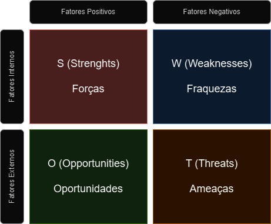
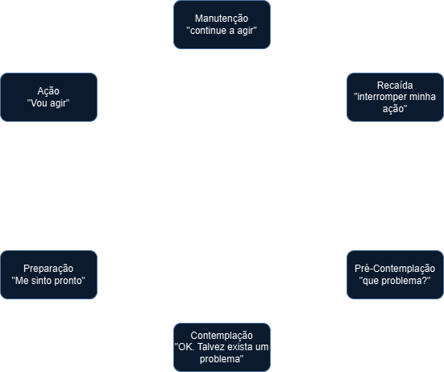

# Formação Engenheiro de Dados

## Cursos de Aperfeiçoamento Profissional - Bônus da Formação

### Análise da Situação Atual

- entender onde está para saber o melhor caminho a seguir
    - sem romantizar
    - analisar com calma -> SWOT

- na parte de cima -> situação atual
- na parte debaixo -> sentimentos com a condição atual
    - fatores positivos e forças na situação atual
    - o que da minha condição é oportunidade
- repetir o mesmo processo para a situação desejada

### A mudança

- ciclo da mudança

- como capitalizo pontos fortes da situação atual para a situação desejada?
- o que fazer para aproveitar oportunidades?
- como minimizo pontos fracos e neutralizo ameaças?
- qual o *primeiro* passo?
    - objetivos menores
    - passo-a-passo

- após a integração
    - criar alinhamento (negação)
    - maximizar a comunicação (frustração)
    - reforçar motivação (depressão)
    - desenvolver capacidades (experimentação)
    - compartilhar experiências (decisão)

- ajustes de rotas são normais, mas precisam ser bem alinhados e fundamentados
    - podemos estar passando por momentos ruins
    - atento aos processos internos
    - resiliência

### O Futuro Chegou

- rápida evolução tecnológica e digital
- mudanças nas exigências profissionais
    - inteligência artificial
    - análise de Big Data
    - biotecnologia
    - energia sustentável
    - robótica
    - realidade virtual
    - medicina genômica
- capacidade de adaptação -> habilidade crucial
    - muitas funções sendo automatizadas ou tornando obsoletas
- necessidade de educação continuada
- trabalho remoto, economia de *freelancers*
- empreendedorismo digital

*"O melhor jeito de prever o futuro é criá-lo"* - Peter Drucker

### Futuro pós ChatGPT

- modelo de linguagem natural
- GPT -> *Generative PreTrained Transformer*
    - treinado para prever a próxima palavra numa sequência
- o que estamos perdendo com o contato com a tecnologia?
    - diminuição da intimidade entre humanos
    - menos perguntas são feitas
    - sem riscos, sem aprendizados
- *reskilling* -> alguns empregos acabam e outros aparecem
    - será muito necessário no futuro.
- envelhecimento da população
