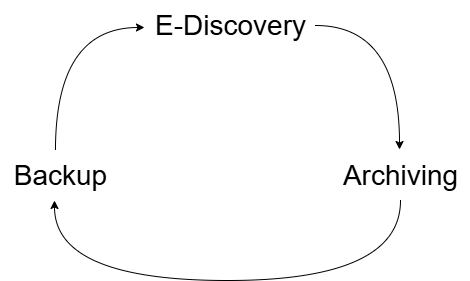

# Formação Engenheiro de Dados

## Cursos de Aperfeiçoamento Profissional - Bônus da Formação

###  Curso de Governança de Dados

- controle sobre os dados, responsabilidade
- processo formal de gestão de dados
- TI não é uma entidade isolada, mas faz parte da empresa

- **governança de dados** -> conjunto de práticas e processos que ajudam a garantir o gerenciamento formal de ativos de dados dentro de uma organização
    - *Data Stewardship*
    - *Data Quality*
    - controle sobre ativos de dados
    - métodos, tecnologias, comportamentos
- Governança de Dados
    - segurança / privacidade
    - integridade
    - usabilidade
    - integração
    - conformidade
    - disponibilidade
    - funções e responsabilidade
    - fluxos de dados internos e externos
    - qualidade de dados
    - colaboração
        - liderança
        - motivação
    - eficiência de análise
    - redução de custos
    - procedimentos mais precisos
    - mais transparência
    - treinamento e práticas institucionais
    - aumento do valor dos dados da organização
    - sistemas padronizados
    - melhor resolução dos problemas
    - monitoramento e rastreabilidade aprimorados
    - crescimento geral da receita da empresa

1. **Backup** -> necessário, mas consome recursos da empresa
    - relevância para o negócio?
    - testar a restauração dos dados de backup
2. **Archiving** -> processo de decisão da criticidade dos dados (quais dadis precisam passar por governança)
3. **E-Discovery** -> descobrir o que temos em casa
    - saber o que está disponível

Governança $\neq$ Gerenciamento de dados

Governança -> estratégia de dados -> áreas de negócio (estratégia corporativa) -> passam os requisitos de governança para o TI que provisionam os recursos