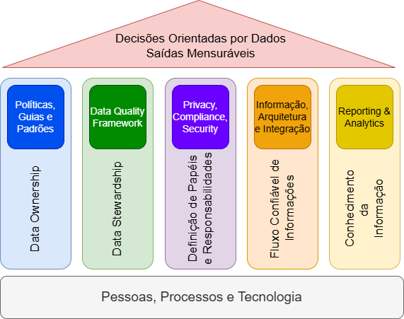

# Formação Engenheiro de Dados

## Cursos de Aperfeiçoamento Profissional - Bônus da Formação

###  Curso de Governança de Dados

#### Estratégias da Governança de Dados

- respostas tangíveis sobre priorização de benefícios financeiros e mitigar riscos de negócios
    - quais dados podem ser usados em quais cenários?
    - definições
    - requisitos
    - responsabilidades
- sistema que determine direitos de decisão, responsabilidade
    - processos
    - maneira holística dos controles

1. definição de qualidade dos dados
2. glossário de negócios (definições e conceitos)
    - atualizações constantes
3. funções e responsabilidades
4. catálogos de dados
    - entendimento e descoberta
    - coleções relacionadas com base no acesso
5. criação de metadados -> E-Discovery
    - linhagem de dados
    - relacionamento de dados
    - significado dos dados

#### Framework para Governança de Dados

- estrutura real / conceitual para suportar a construção / processos
- focar no *business*, ou seja, o motivo por trás das atividades técnicas
    - lucro, faturamento e custos

#### Fases de Maturidade em Governança de Dados

- governança de dados não é estática

1. **caótica**
    - sem padrões
    - reativo
    - sem master plan
    - sem estratégica
2. **reativa**
    - padrões
    - DQM - *Data Quality Management*
    - Master Plan -> estratégia definida e comunicada
3. **definida**
    - KPIs definidos / medidos
    - dicionários de dados
    - stewardship
    - Master Plan
    - tecnologias de suporte
    - análise de causa raiz
4. **proativo**
    - feedback contínuo + melhoria
    - análise de causa raiz alimentada no feedback
    - abordagem proativa
    - DQM automatizado
    - silos de informação integrados
5. **preditivo**
    - feedback automático
    - DQM totalmente automatizado
    - estratégia muito alinhada
    - pessoas, processos e tecnologias operando em harmonia
