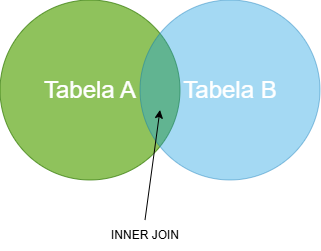

# Formação Engenheiro de Dados

## SQL para Análise de Dados e Data Science

### O que é um Relacionamento entre Tabelas de Dados?

- conexão estabelecida entre duas ou mais tabelas com base em um ou mais campos em comum
  - associar, combinar e recuperar dados de múltiplas tabelas
  - integridade e consistência
  - evita redundâncias
- **cardinalidade**
  - 1 : 1 (um para um)
  - 1 : N (um para muitos)
  - N : 1 (muitos para um)
  - N : N (muitos para muitos)
- no caso de N : N, usa-se uma tabela intermediária (tabela de junção ou associação)
- relacionamentos
  - primary key (PK) -> foreign key (FK)
  - PK -> identifica unicamente um registro
  - FK -> campo numa tabela que corresponde às PKs de outras tabelas

### O que é Integridade Referencial?

- garante a consistência e a confiabilidade das relações entre tabelas
  - assegura que relacionamentos se mantenham válidos
    - cada registro com A tenha referência válida em B
    - excluir o registro em B é bloquado em A, a menos que seja exclusão em cascata
    - inserções em A devem referenciar B
- essencial para evitar erros e inconsistências nos dados
  - garantia da representação da realidade modelada
- SGBD -> mecanismos para gerenciar integridade referencial
  - exclusão em cascata, por exemplo
- instrução `CHECK` -> forma de validação de dados 
  - só permite a inclusão de dados que passam na validação
  - pode causar problemas de performance

### Conceito de `INNER JOIN` e quando usar

- combina registros de duas ou mais tabelas
  - condição de correspondência
    - todas as colunas com correspondência comum em ambas as tabelas envolvidas

