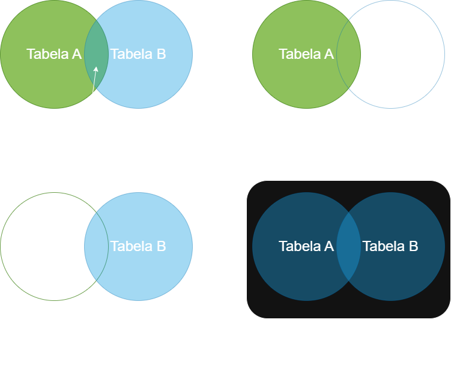

# Formação Engenheiro de Dados

## SQL para Análise de Dados e Data Science

### Conceito de `LEFT JOIN` e Quando Usar

- todos os registros da tabela à esquerda e os correspondentes da tabela à direita
  - caso não haja correspondência, valor nulo
- podemos usar `CASE` ... `WHEN` para preencher os dados nulos (similar ao `COALESCE`)
  - `CAST` -> conversão explícita de tipos
- ordem das tabelas impacta nos `JOIN`s e também na performance das consultas

### Conceito de `RIGHT JOIN` e Quando Usar

- todos os registros da tabela da "direita" e os registros correspondentes da tabela da "esquerda"
  - caso não haja correspondência, valores nulos

### Conceito de `FULL`, `CROSS` e `SELF JOIN` e Quando usar

- `FULL JOIN` -> tdos os registros de ambas as tabelas
  - sem correspondências, valor nulo
- `CROSS JOIN` -> produto cartesiano de duas tabelas, combinando cada linha da primeira tabela com cada linha da segunda tabela

$$T_{n\times m}=A_n \times B_m$$

- `SELF JOIN` -> tabela unida a si mesma, encontrando registros dentro da mesma tabela que compartilham alguma característica em comum