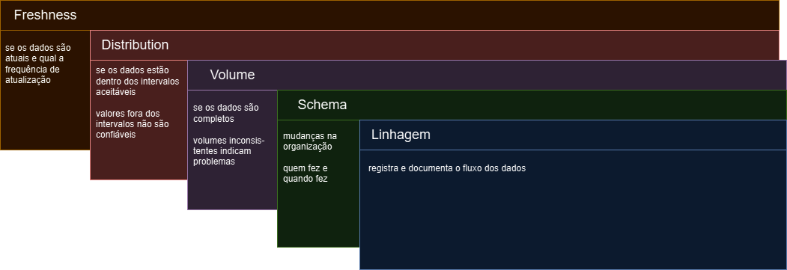
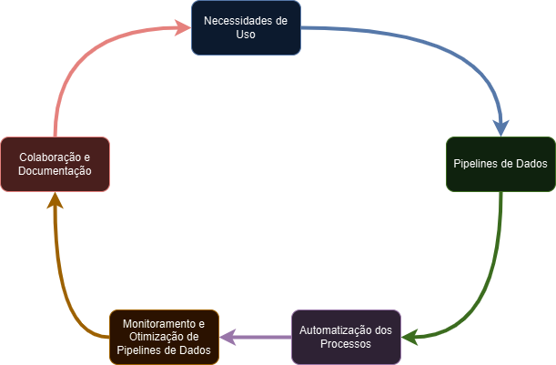

# Fundamentos da Engenharia de Dados

## O que é Linhagem de Dados?

- trajetória de dados ao longo do tempo
    - origens
    - transformações
    - aplicações
    - destinos
- representação visual ou lógica
    - integridade e qualidade
- auditoria, governança e análise de impactos
- rastreamento e documentação
- visão de como os dados foram utilizados

### Importância da Linhagem de Dados

- ajuda a garantir a qualidade
- transparência e confiança nos dados
- auditoria e conformidade regulatória
    - visão documentada dos processos
- melhora a eficiência de negócios
    - fluxo de dados
    - identificação de oportunidades

## Definindo o Conceito de Data Observability

- relacionada com o sistema que fornece os dados

<table>
    <tr>
        <td>Observabilidade de Dados</td>
        <td>Linhagem de Dados</td>
        <td>Qualidade dos Dados</td>
    </tr>
    <tr>
        <td>Ambiente Gerador</td>
        <td>Histórico</td>
        <td>Detalhes das Transformações</td>
    </tr>
</table>

- visualizar e entender o estado e o comportamento dos dados
    - monitorar, rastrear e auditar o fluxo de dados
    - disponibilidade de metadados
    - informações sobre as transformações e as operações
- capacidade de acessar e analisar dados de todas as partes do sistema
    - aplicações
    - infraestrutura
    - usuários
    - visão completa e identificar melhorias

- ferramentas + processos
    - coletas, armazenamento, análise e visualização, métricas
    - identificar e solucionar problemas em tempo real
        - alta disponibilidade
- observabilidade = qualidade + confiabilidade do sistema

### Pilares de Data Observability

- *Freshness*
    - se os dados são atuais
    - frequência de atualização
- *Distribution*
    - se os valores estão dentro de intervalos esperados
    - valores fora dos intervalos não são confiáveis
- *Volume*
    - se os dados são completos
    - volumes inconsistentes indicam problemas
- *Schema*
    - mudanças na organização
    - quem fez e quando fez
- *Linhagem*
    - registra e documenta todo o fluxo de dados

### Contrato de Dados

- acordo formal -> expectativas, responsabilidades e obrigações entre as partes
    - coleta
    - armazenamento
    - restrições e condições
    - proteção
    - compartilhamento
- garantir integridade, privacidade, segurança
- cumprimento de regulamentos e leis
- uso de maneira ética e correta

## O que é Data Ops?

- abordagem de gestão de pipelines baseado em DevOps
    - agilidade
    - qualidade
    - confiabilidade
- otimizar fluxos de trabalho dos pipelines de dados
    - automação de tarefas repetitivas
    - monitoramento contínuo
    - colaboração entre dados x software
- benefícios
    - redução de erros
    - ciclo de vida de desenvolvimento
        - rapidez de novos modelos, novos conjuntos de dados, novas visualizações
            - concepção -> produção
    - aumento da produtividade da equipe

### Implementação

1. definir processos
2. Automatização
3. Colaboração
4. Monitoramento
5. Feedback -> compartilhamento de informações
6. Cultura -> experimentação, inovação e melhoria contínua

implementação = processo contínuo

- **MLOps** -> extensão do DataOps focado em modelos de aprendizado de máquina.
    - treinamento
    - teste
    - monitoramento
    - implementação
    - gerenciamento dos modelos em produção

- **Ferramentas**
    - Apache Airflow
    - AWS Glue
    - Talend
    - Apache Nifi
    - StreamSet
    - Data Kitchen

### Demonstração Prática 3

- SQLFlow (Gudusoft) -> representação visual do fluxo de dados
    - analogia -> árvore genealógica
    - por que o dado existe?
- problemas de dados podem ser resolvidos conhecendo-se a linhagem

## O que é DevOps?

- conjunto de práticas que têm como objetivo integrar desenvolvedores e operações de TI
    - entregar software de forma mais eficiente e com mais qualidade
- automação de processos de implantação
- monitoramento e análise de métricas
- testes automatizados e contínuos
- feedback e iterações
    - permitir resposta rápida, eficiente e confiável
- na Engenharia de Dados -> processo eficiente de coleta, armazenamento, processamento e análise de dados
    - automação de infraestrutura (IaC)
    - controle de versão
    - integração contínua
    - entrega contínua
    - monitoramento -> qualidade, estabilidade, performance
    - automação de processamento de dados
    - automação de testes

### Infraestrutura como Código (IaC)

- gerenciamento da infraestrutura como código
- provisionamento automático e replicável
    - consistência
    - eficiência -> reduz esforço de configuração
    - flexibilidade
    - controle de versão
- aplicações IaC na Engenharia de Dados
    - criação de ambientes de infraestrutura
    - serviços de processamento de dados
    - gerenciamento de fluxos de dados
    - configuração de monitoramento e alerta

### CI/CD (Integração Contínua / Entrega Contínua)

- CI -> integrar o código desenvolvido por várias pessoas num mesmo repositório central de forma contínua
    - inclui testes de integração
- CD -> automatizar o processo de entrega de software
    - build
    - testes
    - empacotamento
    - deploy
- aplicações de CI/CD na Engenharia de Dados
    - gerenciamento de código-fonte
    - teste automatizado
    - pipeline de dados
    - configuração de infraestrutura como código
    - monitoramento e alertas
    - entrega contínua

### Containers e Orquestração de Containers

- container -> virtualização que permite empacotar a aplicação e suas dependências
    - ambiente isolado e portável
- orquestração -> técnica usada para gerenciar e escalonar aplicativos em containers
    - vários hosts na rede virtual
    - gerenciamento automático
    - portabilidade
    - escalabilidade sob demanda
    - resiliência
    - eficiência em aproveitamento de recursos
    - flexibilidade
- aplicações containers em Engenharia de Dados
    - desenvolvimento e testes de soluções de dados
    - implantação de soluções de dados
    - orquestração de clusters de banco de dados
    - processamento de dados distribuído
    - automação dos processos de dados

## Cloud Computing x Solução Local

<table>
    <tr>
        <th>Cloud</th>
        <th>Local</th>
    </tr>
    <tr>
        <td>Escalabilidade sob demanda</td>
        <td>Controle Total</td>
    </tr>
    <tr>
        <td>Redução de Custos</td>
        <td>Latência de Rede</td>
    </tr>
    <tr>
        <td>Facilidade de Acesso</td>
        <td>Investimento Inicial</td>
    </tr>
    <tr>
        <td>Manutenção Simplificada</td>
        <td></td>
    </tr>
</table>

### Modern Data Stack

- abordagem moderna e integrada para gerenciamento de dados, que envolve a combinação de ferramentas numa única plataforma
    - armazenamento
    - integração
    - ferramentas de análise
    - processamento de dados
    - automação de fluxo de trabalho
    - infraestrutura em nuvem

## Demonstração Prática 4

- pipeline de extração, limpeza, transformação e enriquecimento de dados usando Python
- engenharia de dados é sobre o processo e não sobre ferramentas
- dividir o problema macro em problemas menores