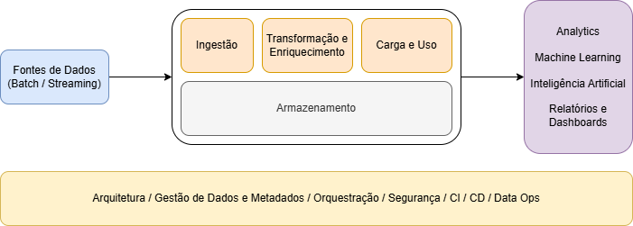

# Fundamentos da Engenharia de Dados

## Ciclo de Vida da Engenharia de Dados

- *Fontes de Dados* - praticamente tudo que gera dados
    - conectores especializados
    - ferramentas heterogêneas (desafio do ponto de vista da conexão)

- *Ingestão de Dados* - puxar os dados e colocá-los em minha plataforma
    - merge de dados

- *Transformação e Enriquecimento*
    - preparação para uso futuro
    - enriquecimento - dados em contexto
        - múltiplas fontes para aumentar o significado
        - enriquecimento = integração de dados