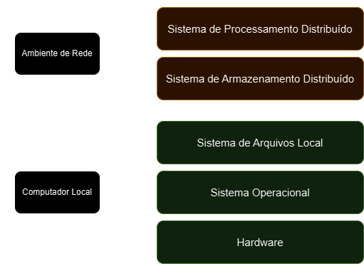

# Fundamentos de Engenharia de Dados

## Sistemas de Arquivos Distribuídos e Sistemas de Processamento Distribuído

- computador = sistema operacional + sistema de arquivos (pelo menos)
- ambientes distribuídos demandam novas camadas sobre a camada local de um sistema local
    - cada máquina $k$ tem seu próprio sistema de arquivos
    - cada máquina $k | k \leq N$ tem seu próprio sistema operacional
- sistemas de arquivos distribuídos para gerenciar os $k$ sistemas de arquivos locais
- sistema de processamento distribuídos, capaz de ler e gravar dados do sistema de armazenamento distribuído e realizar o processamento usando todas as $N$ máquinas do *cluster*

### Hierarquia dos Sistemas Distribuídos

<table>
    <tr>
        <th>Tecnologia</th>
        <th>Camada</th>
    </tr>
    <tr>
        <td>Apache Spark</td>
        <td>Sistema de Processamento Distribuído</td>
    </tr>
    <tr>
        <td>HDFS (Hadoop Distributed File System)</td>
        <td>Sistema de Arquivos Distribuído</td>
    </tr>
    <tr>
        <td>EXT4</td>
        <td>Sistema de Arquivos Local</td>
    </tr>
    <tr>
        <td>Linux</td>
        <td>Sistema Operacional</td>
    </tr>
</table>

- é possível interagir localmente com cada máquina do sistema distribuído
- processamento distribuído -> computação para quando a capacidade local não é suficiente
    - Um ou ambos
        - alta capacidade
        - Alto volume de dados
- nem todo *software* está preparado para processamento distribuído
- ferramentas que oferecem mais flexibilidade demandam conhecimento em programação
    - ambiente em nuvem