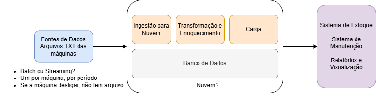

# Fundamentos de Engenharia de Dados

## Estudo de Caso 1

- Empresa de Manufatura
- Máquinas que enviam sinais na forma de arquivos TXT
    - Sistema de estoque
    - Painel de Rendimento
- Dados --> A cada 1 hora
    - 10 máquinas + 5 futuras (6 meses)
    - 1 MB por arquivo
    - Segunda a sexta, 12h/dia
- Equipe
    - 3 Engenheiros de dados
    - 1 Arquiteto de Dados
    - 1 Eng. machine learning
    - 2 Cientistas de Dados
    - 1 Analista de Dados
    - 1 Eng. IA (futuramente)
- Alguma infra NA AWS

### Compreensão dos Requisitos de Negócio

1. Compreender o problema --> Extrair valor dos dados enviados das máquinas
2. Compreender o que deve ser entregue
    - extrair dados das máquinas (sensores)
    - alimentar sistema de estoque
    - funcionamento da máquina - manutenção
    - pipeline que extrai da fonte e salva em dois destinos
3. Pesquisar fontes dos dados
    - máquinas
    - como? onde serão extraídos
        - arquivos TXT no servidor da empresa
    - a fonte permite o requisito do negócio?
4. identificamos a infraestrutura atual e o que é necessário
    - empresa começando a migração para nuvem
    - servidores locais
5. desenhamos o esboço da solução

    - natureza dos dados -> dados em batch
    - seria *streaming* se coletássemos direto das máquinas em tempo real
    - *batch* -> movimentação assíncrona (escrita / leitura)
