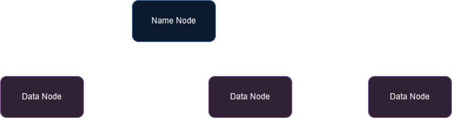

# Fundamentos de Engenharia de Dados

## Vantagens e Desvantagens dos Sistemas Distribuídos

### Vantagens

- **escalabilidade** - o sistema distribuído pode ser dimensionado conforme a demanda
    - vertical - aumentar hardware
    - horizontal - aumentar o volume de máquinas

- **confiabilidade** - mesmo em caso de falta de um ou mais nós

- **desempenho** - paralelização de tarefas

- **flexibilidade e adaptabilidade** - para diversos contextos

### Desvantagens

- complexidade para projeto e manutenção (conhecimento especializado)
- sobrecarga de comunicação e latência
    - redes isoladas
- riscos de segurança -> vulnerabilidades
- custo geralmente maior

## Compressão de Arquivos para o Armazenamento Distribuído

- reduzir o uso de armazenamento utilizado
    - sistemas de grande escala
    - nível de arquivo (zip / bzip2)
    - nível de bloco (tamanho fixo, compactação com ou sem perdas)
    - compactação em trânsito -> compactação HTTP ou dimensionamento de parcela TCP
- dados de texto ou código são altamente compactáveis
    - imagens ou vídeos não

## Demonstração Prática 1

- definição do ambiente Hadoop

- comandos são recebidos pelo *namenode* repassados para os *data nodes*
- *data nodes* ficam se comunicando com o *namenode* (heart beat)
- bloco é a unidade de armazenamento do cluster
- *namenode* não armazena dados
    - apenas metadados dos dados distribuídos nos *data nodes*
    - sistemas de arquivos distribuídos
- existe replicação (tolerância a falhas) -> parâmetro configurável
- *namenode* marca *data node* como indisponível caso ele não receba comunicações (configurável)
- quando o *namenode* para de receber dados de um *data node*, ele replica dados para cumprir o fator de replicação
    - tolerância a falhas
- HDFS - ciente de qual rack as máquinas se encontram
