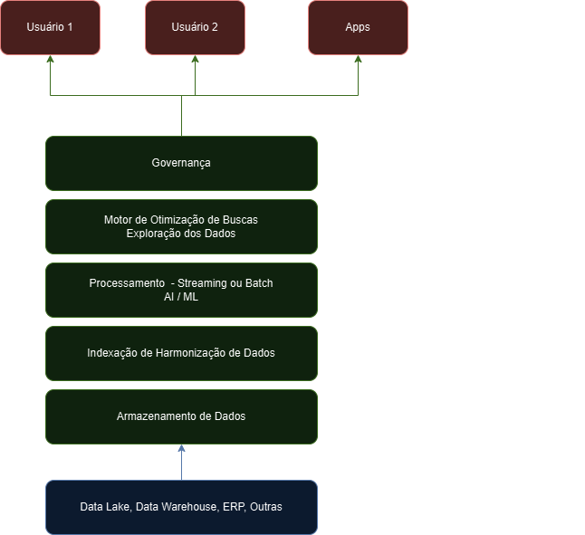
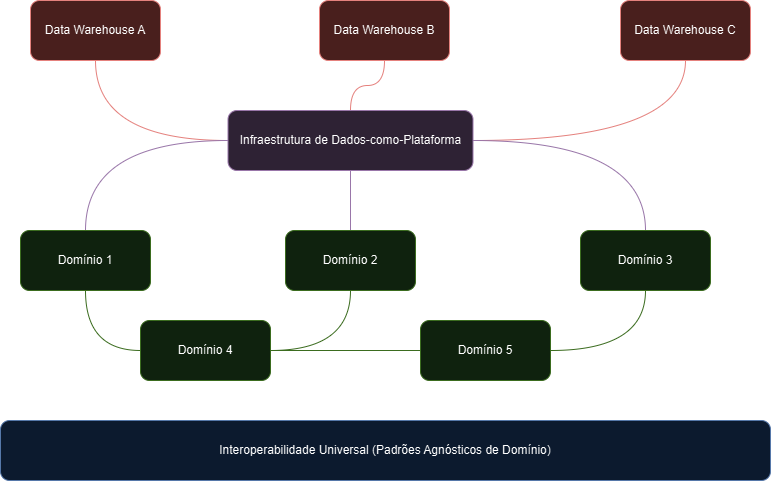

# Fundamentos de Engenharia de Dados

## Como implementar um Data Lake?

1. **identificar os requisitos** - o que será incluído no DL? qual cenário?
2. **escolher a plataforma** - local ou nuvem? distribuído?
3. **integração** - ELT - concepção de arquitetura do Data Lake
4. **armazenamento** - bruto ou semi-estruturado
5. **agendamento** - atualizações automáticas com cuidados (indexação, tageamento)
6. **acesso** - ferramentas de análise
7. **governança de dados** - qualidade, confiabilidade dos dados
8. **monitoramento** - performance, governança e manutenção

## Como implementar um Data Lakehouse?

1. **identificar requisitos** - o que vai no data lakehouse?
2. **escolher plataforma** - normalmente já na nuvem
3. **integração de dados** - várias fontes, ETL, atender diferentes fontes
4. **armazenamento** - bruto, semi-estruturado, estruturado, grande volume
5. **governança, atualizações e monitoramento** - semelhante ao DW e  DL

## Vantagens e Desvantagens

<table>
    <thead>
        <tr>
            <th colspan="2">Data Warehouse</th>
            <th colspan="2">Data Lake</th>
            <th colspan="2">Data Lakehouse</th>
        </tr>
        <tr>
            <th>Vantagens</th>
            <th>Desvantagens</th>
            <th>Vantagens</th>
            <th>Desvantagens</th>
            <th>Vantagens</th>
            <th>Desvantagens</th>
        </tr>
    </thead>
    <tbody>
        <tr>
            <td>Dados Estruturados e Limpos - análise e relatórios facilitados</td>
            <td>Pode ser caro e complexo de implementar</td>
            <td>Capaz de armazenar grandes volumes de dados não estruturados e semi-estruturados</td>
            <td>Governança de dados menos robusta</td>
            <td>Combina vantagens do DW e do Data Lake</td>
            <td>Caro e complexo de implementar e manter</td>
        </tr>
        <tr>
            <td>Performance de consultas é melhor em geral</td>
            <td>Exige um processo de análise e limpeza preliminar à carga</td>
            <td>Flexível com formatos de dados e fontes</td>
            <td>Performance pode ser menor -> dados não otimizados</td>
            <td>Flexibilidade para formatos e fontes</td>
            <td>Necessidade de conhecimento especializado</td>
        </tr>
        <tr>
            <td>Governança de dados mais robusta, qualidade e confiabilidade</td>
            <td>Restringe armazenamento de grandes quantidades de dados não estruturados</td>
            <td>Escalável para grandes volumes</td>
            <td>Caro e complexo de manter</td>
            <td>Escalável</td>
            <td>Ferramentas adicionais para limpeza e modelagem / análise</td>
        </tr>
        <tr>
            <td>Maior capacidade de suportar demandas de negócio e análise avançada</td>
            <td>O mesmo para dados em tempo real, ou com fontes dinâmicas, não estruturadas</td>
            <td>Análise avançada, aplicações de Big Data, Machine Learning e IA</td>
            <td>Depende de ferramentas adicionais para limpeza, modelagem e análise</td>
            <td>Análise avançada, Big Data, Machine Learning, IA</td>
            <td>Conceito recente no mercado</td>
        </tr>
        <tr>
            <td>Massivamente presente no mercado</td>
            <td>Nasceu numa época antes do Big Data</td>
            <td>Nasceu na época do Big Data</td>
            <td></td>
            <td></td>
            <td>Uso das ferramentas traz maturidade</td>
        </tr>
    </tbody>
</table>

## Enterprise Data Hub

- arquitetura de dados de escala que combina
    - variedade de tecnologias
    - coleta, armazenamento, gerenciamento, análise

- repositório centralizado de dados
    - ponto único de acesso
    - empresa muito madura em dados (complexo)
- combinação DW, DL e bancos No SQL, sistemas de gerenciamento do fluxo de trabalho
    - análise, visualização
    - governança dos dados e metadados

## Arquitetura Data Mesh

- arquitetura descentralizada
    - autoatendimento orientado a domínio de negócio
    - preocupado com os dados em si
        - DW, DL, pipelines são opções secundárias
    - transferência da responsabilidade dos dados da equipe local para a equipe do domínio
        - apoiado pela equipe da plataforma de dados que fornece uma plataforma independente de domínio
- muita maturidade necessária, em nível da equipe de domínio
- arquitetura muito recente

## Demonstração Prática 2: Data Lakehouse

- dados formato original semiestruturado -> Data Lake -> análise tabular
- armazenar em qualquer formato + analisar na forma tabular = Data Lakehouse
    - Airbyte: ELT -> nuvem
    - Data Lake: Amazon S3 (AWS)
    - Dremio: Data Lakehouse engine
        - monta queries em SQL, mesmo com dados originalmente em formatos semi-estruturado