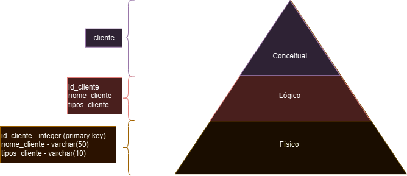

# Fundamentos da Engenharia de Dados

## Introdução à Modelagem dos Dados

### Definição dos Dados

- valores, observações ou resultados de medição, armazenados em um sistema
    - estruturados
    - semi-estruturados
    - não estruturados
- se processados -> informações que suportam a tomada de decisão
    - descrevem eventos, tendências, relações
    - modelagem para armazenamento de forma eficiente

### O que é Modelagem de Dados

- processo de criar estruturas lógicas que representam como os dados são armazenados, relacionados e usados
    - definição de tabelas, campos, relacionamentos
    - diagramas e especificações de uso
- essencial para sistemas de informação eficiente e confiáveis

### Modelagem Relacional x Modelagem Dimensional x Modelagem de Data Lakes

- **relacional** - baseada nas relações entre entidades (tabelas e campos)
    - definição de relações entre entidades
    - amplamente usada em SGBDs
    - dados transacionais são bons exemplos
- **dimensional** - usada em sistemas de BI e Data Warehouses, modelando-os de forma a facilitar a análise multidimensional
    - tabelas fato (medidas) -> quantitativas
    - tabelas dimensão (contexto)
        - podem ter hierarquias para permitir análises mais detalhadas
    - permite fácil agregação e análise
    - escalável / performático
    - dashboards e relatórios
        - histórico
        - previsão
    - modelagem dimensional = modelagem relacional com foco em agregação e análise

- **data lakes** - sistemas de armazenamento focados na análise de grandes volumes de dados não estruturados
    - menos estruturada e mais flexível que a Modelagem Relacional
    - foco no armazenamento bruto dos dados
    - estruturação posterior (inclusive em Data Warehouses)

### O que é Esquema em Modelagem de Dados?

- estrutura lógica que descreve como os dados estão organizados no Banco de Dados
    - tabela, campos, relacionamentos
        - restrições e propriedades de dados
- garantir a integridade e coerência dos dados armazenados
    - mandatório no Data Warehouse -> definido antes da carga dos dados
- SGBD -> muitos bancos de dados -> cada banco de dados com seu esquema
- Data Lake -> sem esquema pré-definido
    - alguma organização é sempre necessária

### O que são Constraints?

- modelagem = estados consistentes dos dados
- constraints -> limitações / regras aplicadas aos dados para garantir integridade
    - regras de validação de forma
    - integridade referencial
    - `NOT NULL`,
    - `UNIQUE`,
    - `PRIMARY KEY`
    - `FOREIGN KEY`
    - `CHECK`
    - `DEFAULT`

### Tipos de Modelos de Dados

- **modelo conceitual**
    - quais entidades?
    - como se relacionam?
    - quais são as regras?
    - camada abstrata
        - representação independente da tecnologia
        - estrutura de negócio
        - comunicação aos *stakeholders*
    - diagramas de entidade relacionamento
        - garantir projeto de forma consistente e coerente com as necessidades do negócio

- **modelo lógico**
    - atributos das entidades
    - representação lógica dos dados
    - independente da tecnologia usada na implementação
    - ajuda a determinar viabilidade da implementação do modelo proposto
    - capturar a estrutura do negócio
        - adaptado para se adequar às necessidades da implementação do banco de dados
        - diagrama de entidades de relacionamento
        - pode ajudar a identificar eventuais problemas na implementação física

- **modelo físico**
    - script de implementação com tipagem definida
    - constraints
    - representação física dos dados, incluindo
        - estrutura de armazenamento
        - configurações específicas do banco de dados
    - descreve como dados são armazenados e acessados
    - específico para cada SGBD
    - definições de constraints, índices e particionamento de dados
        - nomes das tabelas e campos
        - tipagem
        - tamanho
        - índices
        - chaves estrangeiras
    - etapa final -> garantir
        - eficiência
        - desempenho
        - escalabilidade
