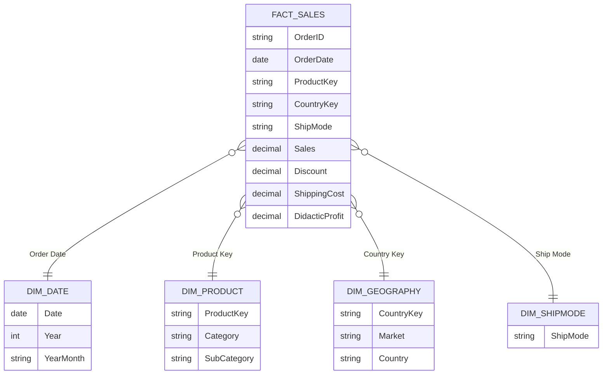

# Microsoft Power BI para Business Intelligence e Data Science

## Laboratório Prático 1 - Dashboard Analítico de Vendas Globais

### Perguntas de negócio a serem respondidas

1. qual o valor total vendido? -> métrica (cartão de métricas)
    - abrindo o Power Query, podemos visualizar os tipos de dados
2. quantas vendas por categoria de produto? -> soma categorizada (pizza / barras)
    - variáveis categóricas -> contagem
3. quantas vendas foram realizadas por país considerando prioridade de entrega?
    - três informações no mesmo gráfico
    - gráfico de barras empilhadas
4. qual foi a média de desconto nas vendas por subcategoria de produto?
    - muitas subcategorias (gráficos de barras)
    - barras horizontais e verticais
5. quais países tiveram maior média de valor de venda? Demonstre em um mapa
    - filtrar dados por ano, por segmento e por país
    - dados georreferenciados (mapa)
    - tomar cuidado com a quantidade de bolhas

- aprendizado por contexto -> *storytelling*
    - explorar o contexto de negócios
    - identificação do contexto de dados

- na leitura dos dados, Power BI tenta identificar tipos de variáveis e delimitadores

- coisas importantes a considerar na construção dos dashboards
    - tomada de decisão na construção de dashboards
    - uso de filtros
    - segmentação de dados
    - layouts finais
        - títulos
        - versionamento
        - estilos de cores

## Capítulo 3 - Modelagem, Relacionamento e DAX

- modelagem de dados ajuda a garantir que as informações mostradas estejam

## O que é Modelagem de Dados?

- representação visual do sistema de coleta e gerenciamento de informações
- visão unificada dos dados da organização
- relação entre diferentes conjuntos de dados e métodos utilizados para a coleta
- modelagem de dados
    - **conceitual** - conceitos e relações de dados
    - **lógico** - armazenamento e relações no banco de dados
    - **físico** - como os dados são armazenados
- organização do armazenamento
- facilitar recuperação e análise

- Power BI não é ferramenta de modelagem de dados
    - modelo simplificado (lógico + físico)
    - evita erros de relacionamentos, mas não realiza o relacionamento caso os dados não estejam bem organizados

- Foco do BI -> passado (análise descritiva)
- foco do profissional de dados -> resolver problemas

- **Análise de Modelagem de Dados em BI**
    - criação de um dataware house (DW)
    - cubos multidimensionais -> agregar e analisar dados de várias fontes
    - modelos StarSchema -> consistência e facilidade de acesso
    - otimização de consultas
    - integração de dados -> consistência de qualidade
    - governança de dados -> rastreamento e auditoria
    - linhagem de dados
        - ciclo de vida de dados
- **Benefícios da Modelagem de Dados**
    - importação e estruturação de dados
    - criação de tabelas e relações
    - medidas e cálculos personalizados
    - filtros e segmentações
    - publicação de relatório e dashboard
    - importante conhecer o modelo de negócios

## Laboratório 2 - Dashboard de Vendas, Lucro, Custo e KPI

- os relacionamentos devem refletir a regra de negócios
- os relacionamentos não são detectados no caso de inconsistência nos dados
- posso carregar uma pasta inteira de arquivos para acelerar os trabalhos
    - necessário garantir a qualidade de dados antes disso
- não é obrigatório haver relacionamentos entre todas as tabelas
- Power BI só vai identificar os relacionamentos de negócios que já representamos
    - erros conceituais -> regras de negócios não representadas
    - erros de dados
        - erros pontuais na coleta -> tratamento e registro de dados
- gerenciar relações no Power BI
    - detecção automática
    - evitar relacionamento muitos-para-muitos -> tabela intermediária para criar esses relacionamentos
- para checar problemas de relacionamentos -> investigação
    - checar a presença de duplicatas na coluna de *primary key* - colunas identificadoras
- utilizar agrupamentos para contar duplicatas
- caso deseje voltar algum passo, usar o histórico de etapas aplicadas
- outro problema que pode acontecer é a presença de espaços ou caracteres estranhos
- cardinalidade -> regra de negócios que explica o relacionamento de tabelas
- tipos de cardinalidade
    - **um-para-muitos** - um item da tabela à esquerda pode estar relacionado a muitos itens na tabela à direita
    - **muitos-para-um** - inverso do um-para-muitos
    - **um-para-um** - cade elemento da tabela à esquerda pode estar relacionado apenas a um item da tabela à direita
        - nenhuma das tabelas pode ter linhas duplicadas
    - **muitos-para-muitos** - múltiplos elementos de uma tabela à direita podem estar relacionados a múltiplos elementos de outras
        - problemas de integridade referencial
        - é bom colocar tabelas intermediárias com relacionamentos um para muitos
        - otimização das consultas

- perguntas de negócio a serem respondidas
    1. qual foi o total de valor de vendas considerando cada modo de envio? Use um gráfico de cascata
    2. quais mercados tiveram o maior custo médio de envio dos produtos vendidos? Use um gráfico treemap
    3. A empresa tem como objetivo (meta) manter uma média de 350 para o valor de venda todos os meses. Mostre um indicador (KPI - *Key Performance Indicator*) com o valor médio de venda. A empresa ficou abaixo ou acima da meta no mês de Abril / 2014?
    4. Considere que o lucro é equivalente a $Lucro = Valor_{venda} - Custo_{envio}$. Qual categoria de produto apresentou maior lucro médio?
    5. Qual foi o comportamento da margem de lucro ao longo do tempo? Considere a margem de lucro como o lucro dividido pelo valor venda.

## Example Use Case

### Scenario

A global retailer (in the style of the public *Global Superstore* dataset) wants to monitor sales, shipping cost and margin by market, category and ship mode. It also tracks the average sale value of each order line against a monthly target of **350**.

The example below uses a 10-line inline sample so every number can be checked by hand. The sample lives in the wiki only; it is not the real Kaggle file.

### Research context

- Superstore-style dashboards usually track **sales, profit, orders, average order value, shipping cost and ship mode performance**, often sliced by region and market ([DEV Community: Global Superstore analytics](https://dev.to/luxacademy/power-bi-projects-global-superstore-analytics-47mh), [Medium: Global Superstore analysis](https://medium.com/@vmrajput20/global-superstore-analysis-2cea4f1cfa37)).
- Margin is normally a `DIVIDE` of **summed profit by summed sales**, and base measures are built first and ratios derived from them ([The Bricks: profit margin](https://www.thebricks.com/resources/guide-how-to-calculate-profit-margin-in-power-bi), [The Bricks: combining measures](https://www.thebricks.com/resources/guide-how-to-combine-two-measures-in-power-bi)).
- The lab's profit, $Sales - Shipping\ Cost$, is a **didactic simplification**: it ignores product cost, so its margins are much higher than a real gross margin. The section keeps it because it is the lab's definition.

### Metrics and equations

**Didactic profit (lab definition), per order line:**

$$
\text{Didactic Profit}_i = \text{Sales}_i - \text{Shipping Cost}_i
$$

**Profit margin (ratio of sums):**

$$
\text{Profit Margin \%} = \frac{\sum_{i} \text{Didactic Profit}_i}{\sum_{i} \text{Sales}_i} \times 100
$$

**Average sale value of month $m$ (average over order lines):**

$$
\text{Avg Sale Value}(m) = \frac{1}{n_m} \sum_{i \in m} \text{Sales}_i
$$

**Target attainment against the 350 target:**

$$
\text{Target Attainment \%}(m) = \frac{\text{Avg Sale Value}(m)}{350} \times 100
$$

**Year-over-year growth:**

$$
\text{YoY \%}(m) = \frac{\text{Sales}_{m} - \text{Sales}_{m-12}}{\text{Sales}_{m-12}} \times 100
$$

**Average ticket (average sales per order):**

$$
\text{Average Ticket} = \frac{\sum_{i} \text{Sales}_i}{\left|\{\text{Order ID}\}\right|}
$$

> **Why the ratio of sums?** An average of row-level margins weights a \$20 line the same as a \$2,000 line. The ratio of sums weights each dollar of sales equally, so it is the margin of the whole business.

### Data model

Star schema with one fact table and four dimensions. Each dimension links to the fact table through one key, one-to-many, single direction.



| Table | Type | Grain | Notes |
|---|---|---|---|
| `Fact_Sales` | Fact | One order line | Holds the numeric measures and the calculated `Didactic Profit` column |
| `Dim_Date` | Dimension | One day | Built with `CALENDAR`, marked as a date table |
| `Dim_Product` | Dimension | One product | Category and Sub-Category |
| `Dim_Geography` | Dimension | One country | Market and Country |
| `Dim_ShipMode` | Dimension | One ship mode | Used as a slicer and a column axis |

### Sample data

Ten order lines. `Didactic Profit` is shown for reference; in Power BI it is a calculated column.

| Line | Order ID | Order Date | Ship Mode | Market | Country | Category | Sub-Category | Sales | Discount | Shipping Cost | Didactic Profit |
|---|---|---|---|---|---|---|---|---|---|---|---|
| 1 | O1 | 2014-04-03 | Standard Class | APAC | Australia | Furniture | Chairs | 300.00 | 0.00 | 20.00 | 280.00 |
| 2 | O2 | 2014-04-10 | First Class | EU | France | Technology | Phones | 450.00 | 0.10 | 35.00 | 415.00 |
| 3 | O3 | 2014-04-18 | Second Class | US | United States | Office Supplies | Paper | 120.00 | 0.00 | 10.00 | 110.00 |
| 4 | O3 | 2014-04-18 | Second Class | US | United States | Technology | Accessories | 380.00 | 0.20 | 40.00 | 340.00 |
| 5 | O4 | 2014-03-05 | Same Day | EU | Germany | Office Supplies | Binders | 200.00 | 0.15 | 25.00 | 175.00 |
| 6 | O5 | 2014-03-22 | Standard Class | LATAM | Brazil | Furniture | Tables | 500.00 | 0.05 | 50.00 | 450.00 |
| 7 | O6 | 2014-03-27 | First Class | US | United States | Technology | Copiers | 800.00 | 0.00 | 60.00 | 740.00 |
| 8 | O7 | 2013-04-12 | Standard Class | APAC | India | Office Supplies | Storage | 250.00 | 0.10 | 30.00 | 220.00 |
| 9 | O8 | 2013-04-25 | Second Class | EU | United Kingdom | Furniture | Bookcases | 340.00 | 0.25 | 45.00 | 295.00 |
| 10 | O9 | 2014-04-27 | Standard Class | LATAM | Brazil | Office Supplies | Art | 150.00 | 0.00 | 15.00 | 135.00 |

Totals: Sales **3,490.00**, Shipping Cost **330.00**, Didactic Profit **3,160.00**, 9 distinct orders.

### Calculated columns (DAX)

```dax
-- Fact_Sales: row-level profit (lab definition)
Didactic Profit =
    Fact_Sales[Sales] - Fact_Sales[ShippingCost]

-- Fact_Sales: discount bands for slicing
Discount Band =
SWITCH(
    TRUE(),
    Fact_Sales[Discount] = 0, "No discount",
    Fact_Sales[Discount] <= 0.2, "Up to 20%",
    "Above 20%"
)

-- Dim_Date: sortable text key (yyyy-MM sorts correctly as text)
Year-Month =
FORMAT(Dim_Date[Date], "yyyy-MM")

-- Dim_Date: the date table itself
Dim_Date =
CALENDAR(DATE(2013, 1, 1), DATE(2014, 12, 31))
```

Calculated columns are computed once per row and stored in the model. Use them for row-level attributes you want to slice or sum later. Use measures (below) for anything that depends on filter context.

### Measures (DAX)

```dax
Total Sales = SUM(Fact_Sales[Sales])

Orders = DISTINCTCOUNT(Fact_Sales[OrderID])

Average Ticket = DIVIDE([Total Sales], [Orders])

Shipping Cost = SUM(Fact_Sales[ShippingCost])

Didactic Profit = [Total Sales] - [Shipping Cost]

Profit Margin % = DIVIDE([Didactic Profit], [Total Sales])

-- Average over the order lines in the current filter context.
-- Put Year-Month on the axis to get one value per month.
Average Sale Value = AVERAGE(Fact_Sales[Sales])

Target Sale Value = 350

Target Attainment % = DIVIDE([Average Sale Value], [Target Sale Value])

Sales LY = CALCULATE([Total Sales], SAMEPERIODLASTYEAR(Dim_Date[Date]))

YoY % = DIVIDE([Total Sales] - [Sales LY], [Sales LY])

-- Average of the average-by-month values (a different metric; shown as a pitfall)
Avg of Monthly Averages =
AVERAGEX(VALUES(Dim_Date[Year-Month]), [Average Sale Value])
```

`Target Sale Value` is a constant. In a real model, put it in a small disconnected table so it can be edited without touching DAX.

### Expected results

These values were calculated by hand from the sample table. They are the numbers Power BI should show once the sample is loaded.

| Lab question | Visual | Expected result |
|---|---|---|
| Lab 1 Q1 | Card: `Total Sales` | 3,490.00 |
| Lab 1 Q2 | Bar: `Total Sales` by Category | Technology 1,630.00; Furniture 1,140.00; Office Supplies 720.00 |
| Lab 1 Q3 | Stacked bar: Country × Ship Mode | United States: Second Class 500.00, First Class 800.00 |
| Lab 1 Q4 | Bar: average discount by Sub-Category | Overall average discount 8.5% |
| Lab 1 Q5 | Map: average sale value by Country | France 450.00 (one line); United States 433.33 (three lines) |
| Lab 2 Q1 | Waterfall: sales by Ship Mode | Standard 1,200.00; First 1,250.00; Second 840.00; Same Day 200.00 |
| Lab 2 Q2 | Treemap: average shipping cost by Market | US 36.67 (highest); EU 35.00; LATAM 32.50; APAC 25.00 |
| Lab 2 Q3 | KPI: average sale value, April 2014 | 280.00, which is **80.00%** of 350, so **below target** |
| Lab 2 Q4 | Bar: average didactic profit by Category | Technology 498.33 (highest); Furniture 341.67; Office Supplies 160.00 |
| Lab 2 Q5 | Line: profit margin by month | 2013-04 87.29%; 2014-03 91.00%; 2014-04 91.43% |

Supporting numbers:

| Month | Lines | Avg Sale Value | Target Attainment | Sales | Didactic Profit | Profit Margin |
|---|---|---|---|---|---|---|
| 2013-04 | 2 | 295.00 | 84.29% | 590.00 | 515.00 | 87.29% |
| 2014-03 | 3 | 500.00 | 142.86% | 1,500.00 | 1,365.00 | 91.00% |
| 2014-04 | 5 | 280.00 | 80.00% | 1,400.00 | 1,280.00 | 91.43% |

- Overall profit margin: $3{,}160 / 3{,}490 = 90.54\%$.
- YoY for April 2014 against April 2013: $(1{,}400 - 590) / 590 = 137.29\%$. March 2014 has no March 2013 lines, so its YoY is blank.
- Average sale value across all 10 lines: $3{,}490 / 10 = 349.00$.

### Pitfalls shown in this example

- **Average of averages.** The average of the three monthly averages is $(295 + 500 + 280)/3 = 358.33$, not the line average of 349.00. The monthly target is a per-month average, so `Average Sale Value` in a monthly visual is correct, but `Avg of Monthly Averages` answers a different question.
- **Mean of margins vs ratio of sums.** The mean of the three monthly margins is 89.91%, but the ratio of sums over all lines is 90.54%. Use the ratio of sums.
- **Repeated Order IDs.** Order O3 has two lines. `Orders` must use `DISTINCTCOUNT`, or the count is 10 instead of 9.
- **Profit definitions.** The lab's profit ignores product cost, so margins near 90% are a teaching artifact, not a business result. Do not compare them with the dataset's own `Profit` column.
- **Discount boundary.** A discount of exactly 0.20 falls in "Up to 20%" because the band uses `<=`. Check the boundary you intend to show.
- **Date coverage.** The sample spans April 2013 and March–April 2014. Sparse years make YoY blank for months without a prior-year match.
- **Relationships.** Power BI only relates tables with consistent keys. Check that `CountryKey` and `ProductKey` match exactly in both tables before expecting a relationship.