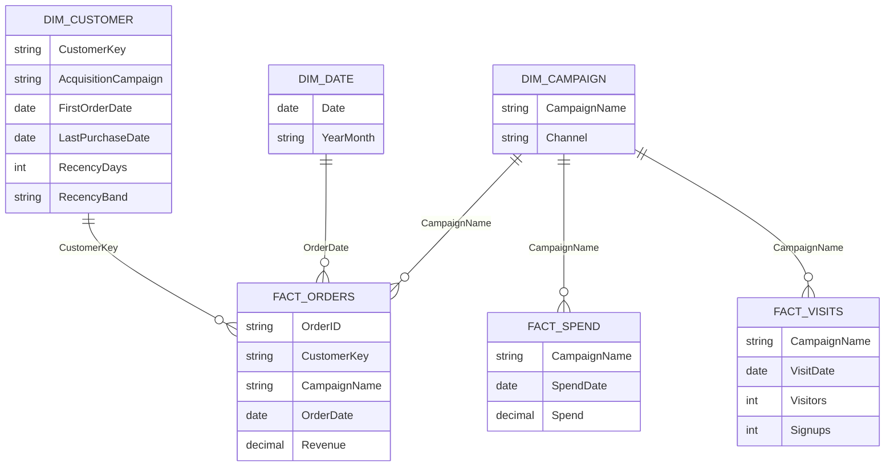
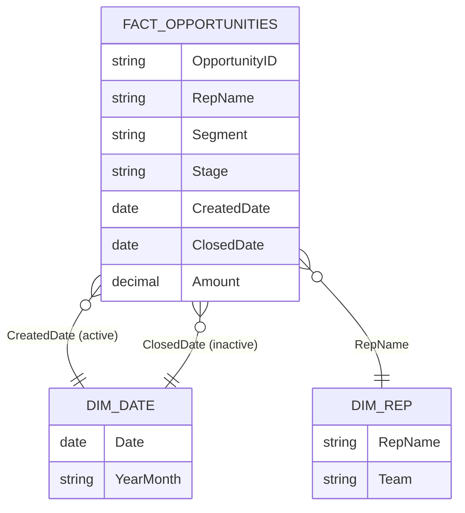

# Microsoft Power BI para Business Intelligence e Data Science

## Power Query M Language x Expressões DAX

- Linguagem M -> Power Query (transformação de dados)
    - cada etapa aplicada representa um comando em linguagem M
- DAX -> *Data Analytics Expressions* -> funções semelhantes às funções Excel

## Tipos Especiais de Gráficos
- **gráfico de cascata** -> útil para poucas categorias nas variáveis (cada coluna complementa a outra para chegar no total)
- **gráfico treemap** -> útil para um pouco mais de categorias que o de cascata
    - área é proporcional à participação de cada categoria
- **gráfico de indicadores** -> mostrar se o negócio está alcançando os KPIs (metas)

## Cálculos Personalizados

- é comum ter que *calcular valores* para construir gráficos e análises
    - colunas consideram o cálculo para cada linha dos dados
    - medidas são valores únicos
- no caso de cálculos personalizados, é bom usar as expressões DAX padronizadas
    - otimização da execução dos cálculos
- pensar em arredondamento para melhorar a visualização dos dados.

## Dashboard para Dados de Marketing

- marketing -> planejar e executar a concepção, preço, promoção e distribuição de ideias, bens e serviços para criar trocas que satisfaçam objetivos individuais e organizacionais
    - atrair e manter clientes
    - pesquisas de mercado
    - análise de concorrência
    - definição de estratégia
    - planejamento de campanhas publicitárias
        - atrair novos clientes
        - aumentar as vendas
        - criar conscientização da marca
        - manter clientes existentes
        - entender o mercado

- **Principais KPIs de Marketing**
    - *taxa de conversão* - proporção de visitantes que executam uma ação desejada
    - *taxa de retenção* - proporção de clientes que compram novamente
    - *custo de aquisição por cliente* - custo total de adquirir novo cliente, considerando custos de publicidade e marketing
    - *ROI - retorno sobre o investimento* - o lucro ou prejuízo obtido em relação ao investimento numa campanha de marketing
    - *conscientização da marca* - medida da familiaridade e reconhecimento da marca entre o público-alvo
    - *engajamento* - medida da interação dos usuários com conteúdo, campanhas e canais de marketing
    - *Net Promoter Score* - medida da lealdade dos clientes, baseada em sua disposição para recomendar uma empresa ou produto para outras pessoas
    - *tráfego do website* - número de visitas no website

## Mini-Projeto 1 - Análise das Campanhas de Marketing

- visão do cliente
- visão do comportamento de compra do cliente
- visão da performance das campanhas de marketing
- visão dos padrões de compra no ponto de venda

- recurso de paginação
- sempre bom checar a amostra na leitura dos dados para buscar erros mais gritantes
- compreender os dados -> dicionário de dados
    - pode ser necessário construir o dicionário de dados
- **recência**: dias desde a última compra
- evitar a quantidade excessiva de gráficos -> evitar a alta carga cognitiva
- bom verificar se os padrões observados fazem sentido no negócio
    - ser curioso a respeito dos dados
- pode usar a segmentação como visual -> blocos
-  guia de estilização ajuda bastante para definir temas de cores
    - aplicado a todo o relatório
- análise de dispersão -> bivariada
    - analisar a relação de duas variáveis ao mesmo tempo
        - bom para identificar outliers
    - vale a pena transformar como logaritmo
    - remover outliers -> Power Query
- *árvore hierárquica*
    - boa para formar explicações de perfis
    - evitar colocar muitos níveis hierárquicos
- matrizes -> tabelas de contingências
    - são registro simples
    - parece com tabela dinâmica
    - muitas vezes é útil renomear os valores categóricos para melhorar a legibilidade
- no momento de construir visuais, sempre pensar no equilíbrio entre a quantidade de informações x número de gráficos

## Dashboard para Área Comercial

- área comercial
    - garantir a venda do produto ou serviço
    - estratégia de vendas
    - negociações e contratos
    - acompanhar desempenho
    - obtenção de receita
    - relação com clientes -> prospeção ao pós-venda
- **Principais KPIs da área comercial**
    - *volume de vendas*: quantidade de produtos ou serviços vendidos
    - *ticket médio*: valor médio por transação
    - *taxa de conversão*: proporção de visitantes ou contatos que se tornaram clientes
    - *ciclo de vendas*: tempo médio que leva para fechar uma venda
    - *retenção de clientes*: taxa de clientes que compram novamente após a primeira compra
    - *lucratividade*: receita líquida obtida pela venda de produtos ou serviços, descontados os custos
    - *produtividade da equipe de vendas*: quantidade de vendas realizadas por vendedor por período
    - *satisfação do cliente*: medida da satisfação dos clientes com a empresa, produtos e serviços oferecidos

- empresas existem para satisfazer uma necessidade identificada no mercado
- botões no Power BI Desktop -> ctrl + click
- área comercial
    - comum dividir as vendas em segmentos
- importante analisar se o tipo de variável está correto
- evitar colocar muitos gráficos num único relatório
    - alta carga cognitiva
    - pode ser melhor dividir os gráficos em múltiplas páginas para melhorar o foco nas informações
    - paginação ajuda no storytelling
- Power BI indica qual tabela, colunas e qual elemento visual foram utilizados para se construir cada elemento visual
- importante pensar em contraste de cores
- tentar evitar redundância das informações
    - checar se o público alvo está apto a entender o gráfico mais limpo
- ao acrescentar informações, aumentar a área do gráfico
- *múltiplos pequenos* -> cria gráficos em quadrantes separando-se por uma terceira categoria
    - controle deslizante para controlar a escala do gráfico
- excesso de core diferentes aumenta a carga cognitiva
- *gráfico de funil* é bom para poucas categorias
- *narrativa inteligente* -> tenta resumir os visuais no relatório podendo calcular algumas métricas extras
    - também é atualizada pelos filtros cruzados
- não precisa usar sombra em todos os visuais
    - usar para dar destaque à informação desejada
- *principais influenciadores*
    - análise estatística para demonstrar a comparação do valor das médias entre diferentes categorias
- *gráfico de faixas* -> mostra uma medida em barras empilhadas, e uma terceira variável como os segmentos empilhados
    - as faixas mostram a comparação entre duas colunas
- pode ser útil colocar uma caixa de texto mostrando a explicação de como usar o gráfico
- *gráficos de mapas* são bons ocupando uma página
- usar o filtro estrategicamente para direcionar análises
- o índice aponta para as paginações feitas
    - inserir -> botões -> navegador

## Example Use Case

### Scenario

A retailer runs three paid campaigns (Spring Email, Social Boost, Search Ads) and also gets organic customers. The marketing team wants to know:

- how many visitors become sign-ups, and at what rate;
- what each new paying customer costs (CAC);
- whether the campaigns return their spend;
- how many customers come back, and how recently each one bought.

The example uses an inline sample of 3 campaigns, 8 customers and 11 orders. Every number below was computed by hand, so the results can be checked. The data lives only in this wiki page.

### Research context

- Marketing dashboards usually track **conversion rate, CAC, ROI, ROAS and retention**, along with funnel drop-off and channel trends ([Power BI for Marketing: Campaign ROI](https://powerbiconsulting.com/blog/power-bi-for-marketing-analytics-campaign-roi-2026), [Zebra BI marketing template](https://zebrabi.com/template/marketing-performance-dashboard-power-bi-template/)).
- Each KPI should be a measure built with `DIVIDE` over sums. Averaging per-row ratios breaks at other drill levels ([Scribd: Power BI project](https://www.scribd.com/document/946899985/Power-Bi-Project)).
- Recency is days since the last purchase. This section uses **business-rule bands** (0–30, 31–60, 61+ days), which read well on a small sample. RFM quintile scoring needs far more customers to be meaningful ([Xperiun: RFM with DAX](https://xperiun.com/blog/using-dax-for-customers-segmentation-by-rfm-recency-frequency-and-monetary-value/), [ecosire: customer segmentation](https://ecosire.com/blog/power-bi-customer-analytics-segmentation)).
- The CAC, ROI and ROAS formulas are standard definitions. I did not find copy-ready DAX for them in the sources, so the measures below are written from those definitions.

### Metrics and equations

**Conversion rate (visitors to sign-ups):**

$$
\text{Conversion Rate \%} = \frac{\text{Sign-ups}}{\text{Visitors}} \times 100
$$

**Customer acquisition cost (paid campaigns only):**

$$
\text{CAC} = \frac{\text{Total Spend}}{\text{New Paid Customers}}
$$

**Return on investment and return on ad spend:**

$$
\text{ROI \%} = \frac{\text{Revenue} - \text{Spend}}{\text{Spend}} \times 100
\qquad
\text{ROAS} = \frac{\text{Revenue}}{\text{Spend}}
$$

**Retention rate (customers with at least two orders):**

$$
\text{Retention Rate \%} = \frac{|\{c : \text{Orders}_c \ge 2\}|}{|\{c\}|} \times 100
$$

**Recency, measured against a reference date $R$:**

$$
\text{Recency}_c = R - \text{LastOrderDate}_c \quad \text{(days)}
$$

**Orders per customer and average ticket:**

$$
\text{Orders per Customer} = \frac{|\text{Orders}|}{|\text{Customers}|}
\qquad
\text{Average Ticket} = \frac{\sum_{o} \text{Revenue}_o}{|\text{Orders}|}
$$

> **Why only paid customers in CAC?** Organic customers cost nothing to acquire, so counting them in the denominator makes the campaigns look cheaper than they are. This is the most common mistake in this section.

### Data model

Star schema. The three facts (orders, spend, visits) each link to the campaign dimension. Customers link to orders only, and each customer carries its acquisition campaign as a text column.



| Table | Type | Grain | Notes |
|---|---|---|---|
| `Dim_Campaign` | Dimension | One campaign, including `Organic` | Channel and `Is Paid` flag |
| `Dim_Customer` | Dimension | One customer | Acquisition campaign, last purchase, recency |
| `Fact_Orders` | Fact | One order | Revenue, attributed to the campaign that drove the order |
| `Fact_Spend` | Fact | One spend entry per campaign and day | Source of total spend |
| `Fact_Visits` | Fact | One visit entry per campaign and day | Visitors and sign-ups |
| `Dim_Date` | Dimension | One day | Built with `CALENDAR`, marked as a date table |

**Two campaign attributions.** The *order attribution* (`Fact_Orders[CampaignName]`) is the campaign that drove the order. The *acquisition campaign* (`Dim_Customer[AcquisitionCampaign]`) is the campaign of the customer's first order. They can differ: a customer acquired by one campaign may later order through another.

### Sample data

**Dim_Campaign**

| CampaignName | Channel | Is Paid |
|---|---|---|
| Spring Email | Email | TRUE |
| Social Boost | Social | TRUE |
| Search Ads | Paid Search | TRUE |
| Organic | Organic | FALSE |

**Fact_Spend**

| CampaignName | SpendDate | Spend |
|---|---|---|
| Spring Email | 2024-05-01 | 500.00 |
| Spring Email | 2024-05-15 | 300.00 |
| Social Boost | 2024-05-01 | 600.00 |
| Social Boost | 2024-05-20 | 400.00 |
| Search Ads | 2024-05-10 | 900.00 |

**Fact_Visits**

| CampaignName | VisitDate | Visitors | Signups |
|---|---|---|---|
| Spring Email | 2024-05-01 | 400 | 40 |
| Spring Email | 2024-05-15 | 200 | 30 |
| Social Boost | 2024-05-01 | 500 | 25 |
| Social Boost | 2024-05-20 | 300 | 15 |
| Search Ads | 2024-05-10 | 700 | 56 |

**Fact_Orders**

| OrderID | CustomerKey | CampaignName | OrderDate | Revenue |
|---|---|---|---|---|
| O01 | C01 | Spring Email | 2024-05-03 | 200.00 |
| O02 | C02 | Spring Email | 2024-05-05 | 120.00 |
| O03 | C01 | Spring Email | 2024-06-10 | 150.00 |
| O04 | C03 | Social Boost | 2024-05-02 | 300.00 |
| O05 | C04 | Social Boost | 2024-05-20 | 80.00 |
| O06 | C03 | Social Boost | 2024-06-18 | 100.00 |
| O07 | C07 | Social Boost | 2024-06-03 | 110.00 |
| O08 | C05 | Search Ads | 2024-05-12 | 450.00 |
| O09 | C06 | Search Ads | 2024-05-14 | 150.00 |
| O10 | C05 | Search Ads | 2024-06-02 | 200.00 |
| O11 | C08 | Organic | 2024-04-28 | 100.00 |

**Dim_Customer** (`Recency` is measured against the reference date **2024-06-30**)

| CustomerKey | AcquisitionCampaign | FirstOrderDate | LastPurchaseDate | Orders | Lifetime Revenue | RecencyDays | RecencyBand |
|---|---|---|---|---|---|---|---|
| C01 | Spring Email | 2024-05-03 | 2024-06-10 | 2 | 350.00 | 20 | 0–30 days (Active) |
| C02 | Spring Email | 2024-05-05 | 2024-05-05 | 1 | 120.00 | 56 | 31–60 days (Warm) |
| C03 | Social Boost | 2024-05-02 | 2024-06-18 | 2 | 400.00 | 12 | 0–30 days (Active) |
| C04 | Social Boost | 2024-05-20 | 2024-05-20 | 1 | 80.00 | 41 | 31–60 days (Warm) |
| C05 | Search Ads | 2024-05-12 | 2024-06-02 | 2 | 650.00 | 28 | 0–30 days (Active) |
| C06 | Search Ads | 2024-05-14 | 2024-05-14 | 1 | 150.00 | 47 | 31–60 days (Warm) |
| C07 | Social Boost | 2024-06-03 | 2024-06-03 | 1 | 110.00 | 27 | 0–30 days (Active) |
| C08 | Organic | 2024-04-28 | 2024-04-28 | 1 | 100.00 | 63 | 61+ days (Cold) |

### Calculated columns (DAX)

```dax
-- Dim_Customer: last purchase, computed from the orders (context transition)
Last Purchase Date =
CALCULATE(MAX(Fact_Orders[OrderDate]))

-- Dim_Customer: flag used to exclude organic customers from CAC
Is Paid Acquisition =
Dim_Customer[AcquisitionCampaign] <> "Organic"

-- Dim_Customer: days between the last purchase and the reference date
Recency Days =
DATEDIFF(Dim_Customer[Last Purchase Date], DATE(2024, 6, 30), DAY)

-- Dim_Customer: business-rule bands
Recency Band =
SWITCH(
    TRUE(),
    Dim_Customer[Recency Days] <= 30, "0-30 days (Active)",
    Dim_Customer[Recency Days] <= 60, "31-60 days (Warm)",
    "61+ days (Cold)"
)
```

In production, move the reference date into a one-row parameter table, so it can change without editing the column.

### Measures (DAX)

```dax
Total Spend = SUM(Fact_Spend[Spend])

Visitors = SUM(Fact_Visits[Visitors])

Signups = SUM(Fact_Visits[Signups])

Conversion Rate % = DIVIDE([Signups], [Visitors])

Revenue = SUM(Fact_Orders[Revenue])

Orders = COUNTROWS(Fact_Orders)

Average Ticket = DIVIDE([Revenue], [Orders])

Customers = COUNTROWS(Dim_Customer)

-- Paid-acquired customers that belong to the campaign(s) in context.
-- TREATAS maps the campaign names in context onto the text column in Dim_Customer.
New Paid Customers =
CALCULATE(
    COUNTROWS(Dim_Customer),
    Dim_Customer[Is Paid Acquisition] = TRUE(),
    TREATAS(VALUES(Dim_Campaign[CampaignName]), Dim_Customer[AcquisitionCampaign])
)

CAC = DIVIDE([Total Spend], [New Paid Customers])

ROI % = DIVIDE([Revenue] - [Total Spend], [Total Spend])

ROAS = DIVIDE([Revenue], [Total Spend])

-- Customers with at least two orders
Repeat Customers =
COUNTROWS(
    FILTER(
        Dim_Customer,
        CALCULATE(COUNTROWS(Fact_Orders)) >= 2
    )
)

Retention Rate % = DIVIDE([Repeat Customers], [Customers])

Avg Recency Days = AVERAGE(Dim_Customer[Recency Days])
```

### Expected results

These values were calculated by hand from the sample. Campaign rows use the campaign slicer; the total row uses no filter.

| Campaign | Spend | Visitors | Signups | Conv. % | New Paid Customers | CAC | Revenue | ROI % | ROAS | Retention % | Avg Ticket |
|---|---|---|---|---|---|---|---|---|---|---|---|
| Spring Email | 800.00 | 600 | 70 | 11.67% | 2 | 400.00 | 470.00 | −41.25% | 0.59 | 50.00% | 156.67 |
| Social Boost | 1,000.00 | 800 | 40 | 5.00% | 3 | 333.33 | 590.00 | −41.00% | 0.59 | 33.33% | 147.50 |
| Search Ads | 900.00 | 700 | 56 | 8.00% | 2 | 450.00 | 800.00 | −11.11% | 0.89 | 50.00% | 266.67 |
| Organic | 0.00 | – | – | – | 0 (not paid) | – | 100.00 | – | – | 0.00% | 100.00 |
| **Total** | **2,700.00** | **2,100** | **166** | **7.90%** | **7** | **385.71** | **1,960.00** | **−27.41%** | **0.73** | **37.50%** | **178.18** |

Supporting totals:

- Customers: 8. Repeat customers: 3 (C01, C03, C05).
- Orders per customer: $11 / 8 = 1.375$.
- Recency bands: 4 Active, 3 Warm, 1 Cold. Average recency: $294 / 8 = 36.75$ days.
- Paid-only ROI: $(1{,}860 - 2{,}700) / 2{,}700 = -31.11\%$. Paid-only ROAS: $1{,}860 / 2{,}700 = 0.69$.

### Pitfalls shown in this example

- **Organic in the CAC denominator.** Counting all 8 customers gives $2{,}700 / 8 = 337.50$, which understates CAC. Only the 7 paid customers belong in the denominator.
- **Organic revenue in ROI.** The total ROI row includes the 100.00 of organic revenue, giving −27.41%. The paid-only ROI is −31.11%. Decide which one the dashboard should show, and label it.
- **Sign-ups are not new customers.** Visitors → sign-ups (166) and sign-ups → first purchase (7 paid) are different funnel steps. Conversion rate uses the first; CAC uses the second.
- **Negative ROI in a short window.** Every paid campaign shows negative ROI on first-window revenue alone. This is the didactic point: campaigns are judged on lifetime value, not one month of revenue. The sample has no lifetime-value measure.
- **Two attributions.** Revenue by campaign uses the order attribution. New customers use the acquisition campaign. A repeat order can land in a different row than the customer's acquisition.
- **Recency reference date.** Using `TODAY()` makes results change each day. The sample fixes the date so the numbers stay reproducible.
- **Average of ratios.** Averaging each campaign's conversion rate would give $(11.67 + 5.00 + 8.00) / 3 = 8.22\%$, not the pooled 7.90%. Use the ratio of sums.

## Example Use Case: Sales Pipeline (Commercial)

### Scenario

A sales team of three reps (Ana, Bruno, Carla) works opportunities in two segments, Enterprise and SMB. Leadership wants to know:

- how much revenue the team wins, and how large a typical deal is;
- how often the team wins the deals it closes (win rate);
- how long a won deal takes from creation to close (sales cycle);
- how much revenue each rep brings in, and how much open pipeline is in play.

The example uses an inline sample of 12 opportunities created in April–June 2024. The data lives only in this wiki page, and every number below was computed by hand.

### Research context

- Common sales KPIs include sales volume, average deal size, conversion rate, sales cycle length, and revenue per rep ([Oneflow: 10 key sales performance metrics](https://oneflow.com/uk/blog/10-key-sales-performance-metrics.md), [Pipeline CRM: sales KPIs and formulas](https://pipelinecrm.com/?p=3922)).
- Average deal size is closed-won revenue divided by the number of won deals ([Toucan: average deal size](https://www.toucantoco.com/en/glossary/average-deal-size)).
- Pipeline velocity combines opportunities, win rate, and average deal size, divided by sales cycle length. Sources describe it as dollars per day ([Oneflow](https://oneflow.com/uk/blog/10-key-sales-performance-metrics.md)).
- Sources disagree on healthy benchmarks, which depend on the business model. The sample is for checking formulas, not for judging performance.
- Sales KPI definitions are consistent across sources, so the formulas below use standard definitions.

### Metrics and equations

**Average deal size (won deals):**

$$
\text{Average Deal Size} = \frac{\sum_{d \in \text{Won}} \text{Amount}_d}{|\text{Won}|}
$$

**Win rate (among closed deals):**

$$
\text{Win Rate \%} = \frac{|\text{Won}|}{|\text{Won}| + |\text{Lost}|} \times 100
$$

**Lead-to-win conversion (among all opportunities):**

$$
\text{Conversion \%} = \frac{|\text{Won}|}{|\text{All Opportunities}|} \times 100
$$

**Sales cycle, in days (won deals only):**

$$
\text{Cycle Days}_d = \text{ClosedDate}_d - \text{CreatedDate}_d
\qquad
\overline{\text{Cycle}} = \frac{1}{|\text{Won}|} \sum_{d \in \text{Won}} \text{Cycle Days}_d
$$

**Revenue per rep:**

$$
\text{Revenue per Rep} = \frac{\sum_{d \in \text{Won}} \text{Amount}_d}{|\text{Reps}|}
$$

**Pipeline velocity (dollars per day):**

$$
\text{Velocity} = \frac{|\text{Open}| \times \text{Win Rate} \times \text{Average Deal Size}}{\overline{\text{Cycle}}}
$$

> **Why win rate uses closed deals?** Open deals have no outcome yet. Dividing wins by all opportunities mixes unfinished deals into the result. The lead-to-win conversion above is the separate metric that does use all opportunities.

### Data model

Star schema with one fact table of opportunities. The created date is the active relationship to the date table. The closed date is inactive and is activated in measures with `USERELATIONSHIP`.



| Table | Type | Grain | Notes |
|---|---|---|---|
| `Fact_Opportunities` | Fact | One opportunity | Stage (Won, Lost, Open), two dates, amount, segment |
| `Dim_Date` | Dimension | One day | Built with `CALENDAR` for April–June 2024, marked as a date table |
| `Dim_Rep` | Dimension | One rep | Name and team |

### Sample data

**Fact_Opportunities** (`ClosedDate` is blank for open opportunities)

| OpportunityID | Rep | Segment | Stage | CreatedDate | ClosedDate | Amount |
|---|---|---|---|---|---|---|
| P01 | Ana | Enterprise | Won | 2024-04-01 | 2024-04-20 | 12,000.00 |
| P02 | Ana | SMB | Won | 2024-04-08 | 2024-04-15 | 3,000.00 |
| P03 | Ana | Enterprise | Lost | 2024-04-10 | 2024-05-05 | 9,000.00 |
| P04 | Bruno | Enterprise | Won | 2024-04-05 | 2024-05-25 | 18,000.00 |
| P05 | Bruno | SMB | Lost | 2024-05-02 | 2024-05-12 | 2,000.00 |
| P06 | Bruno | SMB | Won | 2024-05-06 | 2024-05-16 | 4,000.00 |
| P07 | Carla | Enterprise | Won | 2024-05-10 | 2024-06-14 | 25,000.00 |
| P08 | Carla | SMB | Won | 2024-05-20 | 2024-05-27 | 2,500.00 |
| P09 | Carla | Enterprise | Lost | 2024-06-01 | 2024-06-20 | 15,000.00 |
| P10 | Ana | SMB | Open | 2024-06-10 | *(blank)* | 3,500.00 |
| P11 | Bruno | Enterprise | Open | 2024-06-12 | *(blank)* | 22,000.00 |
| P12 | Carla | SMB | Open | 2024-06-18 | *(blank)* | 1,800.00 |

### Calculated columns (DAX)

```dax
-- Fact_Opportunities: cycle length in days, for won deals only
Cycle Days =
IF(
    Fact_Opportunities[Stage] = "Won",
    DATEDIFF(Fact_Opportunities[CreatedDate], Fact_Opportunities[ClosedDate], DAY)
)

-- Fact_Opportunities: deal-size band (business rules)
Deal Size Band =
SWITCH(
    TRUE(),
    Fact_Opportunities[Amount] < 5000, "Small (under 5k)",
    Fact_Opportunities[Amount] < 15000, "Medium (5k to 15k)",
    "Large (15k and above)"
)

-- Dim_Date: the date table
Dim_Date =
CALENDAR(DATE(2024, 4, 1), DATE(2024, 6, 30))
```

`IF` without a false branch returns `BLANK()`, so open and lost deals are skipped by `AVERAGE`.

### Measures (DAX)

```dax
Opportunities = COUNTROWS(Fact_Opportunities)

Won Deals =
CALCULATE([Opportunities], Fact_Opportunities[Stage] = "Won")

Closed Deals =
CALCULATE([Opportunities], Fact_Opportunities[Stage] <> "Open")

Open Deals =
CALCULATE([Opportunities], Fact_Opportunities[Stage] = "Open")

Won Revenue =
CALCULATE(SUM(Fact_Opportunities[Amount]), Fact_Opportunities[Stage] = "Won")

Open Pipeline =
CALCULATE(SUM(Fact_Opportunities[Amount]), Fact_Opportunities[Stage] = "Open")

Win Rate % = DIVIDE([Won Deals], [Closed Deals])

Conversion % = DIVIDE([Won Deals], [Opportunities])

Average Deal Size = DIVIDE([Won Revenue], [Won Deals])

Avg Sales Cycle Days = AVERAGE(Fact_Opportunities[Cycle Days])

Revenue per Rep =
DIVIDE([Won Revenue], DISTINCTCOUNT(Fact_Opportunities[RepName]))

Pipeline Velocity =
DIVIDE(
    [Open Deals] * [Win Rate %] * [Average Deal Size],
    [Avg Sales Cycle Days]
)

-- Large won deals, using FILTER with a compound condition
Large Won Deals =
COUNTROWS(
    FILTER(
        Fact_Opportunities,
        Fact_Opportunities[Stage] = "Won"
            && Fact_Opportunities[Amount] >= 15000
    )
)

-- Activates the inactive relationship: won revenue by closing month
Won Revenue by Close Month =
CALCULATE(
    [Won Revenue],
    USERELATIONSHIP(Fact_Opportunities[ClosedDate], Dim_Date[Date])
)
```

### Expected results

These values were calculated by hand from the sample. Rep rows use the rep slicer; the total row uses no filter.

| Rep | Won | Closed | Win Rate % | Won Revenue | Avg Deal Size | Avg Cycle (days) |
|---|---|---|---|---|---|---|
| Ana | 2 | 3 | 66.67% | 15,000.00 | 7,500.00 | 13.00 |
| Bruno | 2 | 3 | 66.67% | 22,000.00 | 11,000.00 | 30.00 |
| Carla | 2 | 3 | 66.67% | 27,500.00 | 13,750.00 | 21.00 |
| **Total** | **6** | **9** | **66.67%** | **64,500.00** | **10,750.00** | **21.33** |

Segment and other totals:

| Measure | Enterprise | SMB | Total |
|---|---|---|---|
| Won deals | 3 | 3 | 6 |
| Closed deals | 5 | 4 | 9 |
| Win rate % | 60.00% | 75.00% | 66.67% |
| Won revenue | 55,000.00 | 9,500.00 | 64,500.00 |
| Average deal size | 18,333.33 | 3,166.67 | 10,750.00 |
| Average cycle (days) | 34.67 | 8.00 | 21.33 |
| Open pipeline | 22,000.00 | 5,300.00 | 27,300.00 |

Other results:

- **Lead-to-win conversion:** $6 / 12 = 50.00\%$.
- **Revenue per rep:** $64{,}500 / 3 = 21{,}500.00$.
- **Pipeline velocity:** $3 \times 66.67\% \times 10{,}750 / 21.33 = 1{,}007.81$ dollars per day, using the 3 open deals.
- **Large won deals (15k and above):** 2 (P04, P07).
- **Won revenue by close month:** April 15,000.00 (2 deals); May 24,500.00 (3 deals); June 25,000.00 (1 deal).
- **Won revenue by created month** (the active relationship): April 33,000.00 (3 deals); May 31,500.00 (3 deals). The same deals fall in different months depending on the date used.

### Mapping to the lesson's commercial list

- **Sales volume:** card with `Won Deals`.
- **Average ticket:** card with `Average Deal Size`, split by segment.
- **Conversion rate:** funnel or card with `Conversion %`, alongside `Win Rate %`.
- **Sales cycle:** bar chart of `Avg Sales Cycle Days` by rep.
- **Productivity per rep:** bar chart of `Won Revenue` by rep, with `Revenue per Rep` as a card.
- **Profitability and satisfaction** are not in this sample, so they are out of scope here.

### Pitfalls shown in this example

- **Cycle length with open deals.** The average of all `Cycle Days` would be wrong if open deals were counted with a blank or a zero. The calculated column keeps won deals only.
- **Win rate denominator.** Dividing wins by all 12 opportunities gives 50.00%, not 66.67%. Open deals have no result yet and belong outside the win rate.
- **Average of ratios.** The average of the three rep win rates is also 66.67% here, but the rep win rates happen to be equal, which hides the issue. The segment rates (60.00% and 75.00%) are not equal, and their simple average is 67.50%, not the pooled 66.67%. Use the pooled ratio.
- **Created vs closed dates.** Won revenue is 33,000 in April when grouped by created date and 15,000 when grouped by closed date. The inactive relationship changes the answer.
- **Velocity with few open deals.** Velocity uses the open count, so it can swing when the open pipeline is small. Check the inputs before reading the result.