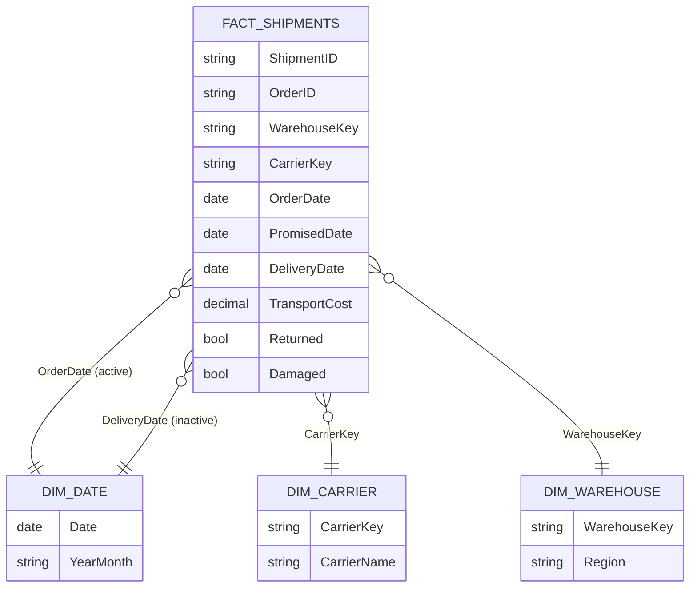

# Microsoft Power BI para Business Intelligence e Data Science

## Dashboard para Recursos Humanos

- **Recursos Humanos**
    - gerenciar e administrar as atividades relacionadas ao pessoal de uma empresa
        - desenvolvimento e satisfação dos funcionários
        - recrutamento e seleção
        - treinamento e desenvolvimento
        - remuneração e benefícios
        - gestão de conflitos
        - políticas e práticas de RH
        - avaliação de desempenho
- **Principais KPIs em Recursos Humanos**
    - *taxa de rotativdade* - frequência com a qual os funcionários deixam a empresa
    - *satisfação do funcionário* 
    - *tempo médio para preenchimento de vagas* - eficiência do processo de recrutamento e seleção
    - *custo de contratação* - despesas com anúncios de vagas, entrevistas, testes e treinamento
    - *participação em treinamento* - interesse dos funcionários no próprio desenvolvimento
    - *avaliação de desempenho* 
    - *nível de absenteísmo* - frequência de faltas injustificadas no trabalho
    - *nível de engajamento*

- sempre lembrar de realizar transformações nos dados para facilitar o entendimento dos usuários
- **tabela de medidas**
    - forma de organizar as medidas calculadas
    - facilita busca, customizar métricas
    - botão de inserir dados
        - botão direito -> nova medida
    - `COUNTROWS(dataset)` - contar o número de linhas para um determinado conjunto de dados
    - `CALCULATE` - permite filtrar os cálculos realizados usando filtros customizados
    - uso de medidas permite reutilizar o cálculo para outras medidas
        - pode ajudar também a melhorar o desempenho, pois deixa os resultados previamente armazenados
    - `DIVIDE` - operações de divisão havendo a possibilidade de um resultado alternativo para casos de erros
    - `AVERAGE` - outra forma de calcular a média de uma variável numérica
    - no caso de cálculos feitos pelo Power BI, os cálculos são feitos em tempo de execução (menos performático)
- **criação de colunas condicionais**
    - possibilidade de avaliar categorias de dados, linha por linha, e aplicar regras de negócio
        - como qualquer outra coluna, podem ser utilizadas para expressão DAX
    - colunas condicionais podem ser uma alternativa à substituição manual de valores
        - auxílio para engenharia de atribuitos
- medidas poem ser utilizadas em gráficos
- utilizar a guia de propriedades para personalizar a formatação dos dados

## Dashboar de Análises de Dados de Logística

- **Logística**
    - gerenciar fluxos de produtos e informações
        - transporte
        - armazenamento
        - distribuição
        - embalagem
        - gerenciamento de estoque
        - gerenciamento da cadeia de suprimentos
    - garantir mercadorias disponíveis no momento certo, lugar certo e condições adequadas
    - reduzir tempo de ciclo (do pedido até a entrega ao cliente ou destino)
        - crescente complexidade dos negócios e globalização da economia
    - coordenação com fornecedores
    - seleção da transportadora
    - diretamente ligado com satisfação do cliente, redução de custos e aumento da receita
- **Principais KPIs da Logística**
    - *tempo de ciclo* - tempo necessário para atender um pedido
    - *taxa de entrega no prazo* - porcentagem de pedidos entregues dentro do prazo acordado
    - *custo de transporte* - custo médio por unidade ou por pedido para transportar os produtos
    - *nível de estoque* - número de dias de suprimento de estoque disponível
    - *taxa de devolução* - porcentagem de pedidos devolvidos pelos clientes
    - *acurácia de estoque* - precisão do estoque registrado em relação ao real
    - *taxa da utilização do armazenamento* - porcentagem do espaço disponível que está sendo utilizado
    - *nível de serviço ao cliente* - satisfação geral do cliente com o serviço de logística
    - *taxa de ocorrência de avarias* - porcentagem de produtos que sofrem danos no serviço de logística
    - *índice retorno sobre investimento* - retorno financeiro sobre os investimentos

- análise do dashboard deve focar nos aspectos técnicos da informação
    - analisar se a informação está de acordo com os títulos
    - analisar a legibilidade
    - evitar gráficos que permitam ou demandem interpretação
    - tomar cuidado com erros relacionados às fontes de dados
- *dica para o gráfico de barras*
    - exibir valores como porcentagens dos valores totais
- *dicas para o gráfico delinhas com datas*
    saber se é necessário navegar toda a hierarquia de datas
        - conversar com audiências
- *dicas para o gráfico de categorias*
    - exibir dados para o Top N
- *dicas de medidas rápidas*
    - usar medidas rápidas constrói códigos DAX automaticamente
    - classificação por estrelas

- dentro da expressão DAX `CALCULATE`
    - podemos usar a expressão `FILTER` que permite a inclusão de expressões lógicas para filtrar os dados que serão usados para calcular as medidas

## Example Use Case

### Scenario

A distributor ships orders from three warehouses (North, South, East) through three carriers (FastTrack, SafeRoute, EconoShip). The operations team wants to know:

- how many shipments arrive on or before the promised date (on-time delivery);
- how long an order takes from order date to delivery (cycle time);
- what each shipment costs to transport;
- how often shipments are returned or arrive damaged.

The example uses an inline sample of 12 shipments dated April–June 2024. Every number below was computed by hand, so the results can be checked. The data lives only in this wiki page.

### Research context

- On-time delivery is the number of on-time deliveries divided by total deliveries, usually expressed as a percentage ([Upper Inc: on-time delivery KPI](https://www.upperinc.com/blog/on-time-delivery-kpi/), [Flow.space: on-time delivery](https://flow.space/blog/on-time-delivery)).
- A perfect order rate multiplies on-time, in-full, damage-free and documentation rates ([Upper Inc](https://www.upperinc.com/blog/on-time-delivery-kpi/)). This section shows the damage-free component only, since the sample has no in-full or documentation fields.
- Shipments carry two dates (order and delivery). Only one can be the active relationship to the date table; the other is activated in a measure with `USERELATIONSHIP` ([The Bricks: turnover rate in Power BI](https://www.thebricks.com/resources/guide-how-to-calculate-turnover-rate-in-power-bi)).
- I found no sourced formulas for cycle time, transport cost per shipment or return rate. The definitions below are standard ones.

### Metrics and equations

**On-time delivery (over delivered shipments only):**

$$
\text{OTD \%} = \frac{|\{s : \text{DeliveryDate}_s \le \text{PromisedDate}_s\}|}{|\{s : \text{DeliveryDate}_s \ne \varnothing\}|} \times 100
$$

**Cycle time per shipment, in days:**

$$
\text{Cycle Time}_s = \text{DeliveryDate}_s - \text{OrderDate}_s
$$

**Average cycle time (over delivered shipments):**

$$
\overline{\text{Cycle Time}} = \frac{1}{|\text{Delivered}|} \sum_{s \in \text{Delivered}} \text{Cycle Time}_s
$$

**Transport cost per shipment (all shipments, delivered or not):**

$$
\text{Cost per Shipment} = \frac{\sum_{s} \text{TransportCost}_s}{|\text{Shipments}|}
$$

**Return rate and damage rate (over all shipments):**

$$
\text{Return Rate \%} = \frac{|\{s : \text{Returned}_s\}|}{|\text{Shipments}|} \times 100
\qquad
\text{Damage Rate \%} = \frac{|\{s : \text{Damaged}_s\}|}{|\text{Shipments}|} \times 100
$$

> **Why exclude undelivered shipments from OTD?** A shipment still in transit is neither on time nor late. Counting it as late understates performance, and counting it as on time overstates it. Both the numerator and the denominator must leave it out.

### Data model

Star schema with one fact table and three dimensions. A shipment has two dates that point to the same date table: the order date is the active relationship, and the delivery date is inactive.



| Table | Type | Grain | Notes |
|---|---|---|---|
| `Fact_Shipments` | Fact | One shipment | Two dates, cost, return and damage flags |
| `Dim_Date` | Dimension | One day | Built with `CALENDAR` for April–June 2024, marked as a date table |
| `Dim_Carrier` | Dimension | One carrier | Carrier name |
| `Dim_Warehouse` | Dimension | One warehouse | Region |

### Sample data

**Dim_Carrier:** CR01 FastTrack, CR02 SafeRoute, CR03 EconoShip. **Dim_Warehouse:** WH01 North, WH02 South, WH03 East.

**Fact_Shipments** (`Delivery` is blank for shipments still in transit)

| ShipmentID | OrderID | Warehouse | Carrier | OrderDate | PromisedDate | DeliveryDate | TransportCost | Returned | Damaged |
|---|---|---|---|---|---|---|---|---|---|
| S01 | O101 | WH01 | CR01 | 2024-04-02 | 2024-04-05 | 2024-04-04 | 40.00 | FALSE | FALSE |
| S02 | O102 | WH01 | CR02 | 2024-04-05 | 2024-04-09 | 2024-04-11 | 25.00 | FALSE | FALSE |
| S03 | O103 | WH02 | CR03 | 2024-04-10 | 2024-04-16 | 2024-04-14 | 18.00 | FALSE | FALSE |
| S04 | O104 | WH02 | CR01 | 2024-04-12 | 2024-04-15 | 2024-04-19 | 42.00 | FALSE | TRUE |
| S05 | O105 | WH03 | CR03 | 2024-05-03 | 2024-05-08 | 2024-05-06 | 15.00 | FALSE | FALSE |
| S06 | O106 | WH03 | CR02 | 2024-05-06 | 2024-05-10 | 2024-05-10 | 30.00 | FALSE | FALSE |
| S07 | O107 | WH01 | CR01 | 2024-05-14 | 2024-05-17 | 2024-05-19 | 40.00 | TRUE | FALSE |
| S08 | O108 | WH02 | CR02 | 2024-05-20 | 2024-05-23 | 2024-05-22 | 28.00 | FALSE | FALSE |
| S09 | O109 | WH03 | CR01 | 2024-06-02 | 2024-06-05 | 2024-06-12 | 55.00 | FALSE | FALSE |
| S10 | O110 | WH01 | CR03 | 2024-06-08 | 2024-06-12 | 2024-06-11 | 16.00 | FALSE | FALSE |
| S11 | O111 | WH02 | CR03 | 2024-06-15 | 2024-06-19 | *(blank)* | 20.00 | FALSE | FALSE |
| S12 | O112 | WH03 | CR02 | 2024-06-20 | 2024-06-24 | 2024-06-24 | 35.00 | FALSE | TRUE |

### Calculated columns (DAX)

```dax
-- Fact_Shipments: on-time flag; blank when the shipment is not delivered yet
Is On Time =
IF(
    ISBLANK(Fact_Shipments[DeliveryDate]),
    BLANK(),
    Fact_Shipments[DeliveryDate] <= Fact_Shipments[PromisedDate]
)

-- Fact_Shipments: cycle time in days; blank when not delivered
Cycle Days =
IF(
    ISBLANK(Fact_Shipments[DeliveryDate]),
    BLANK(),
    DATEDIFF(Fact_Shipments[OrderDate], Fact_Shipments[DeliveryDate], DAY)
)

-- Fact_Shipments: conditional column (business rules)
Delay Band =
SWITCH(
    TRUE(),
    ISBLANK(Fact_Shipments[DeliveryDate]), "Not delivered",
    Fact_Shipments[DeliveryDate] <= Fact_Shipments[PromisedDate], "On time",
    DATEDIFF(Fact_Shipments[PromisedDate], Fact_Shipments[DeliveryDate], DAY) <= 3, "1-3 days late",
    "4+ days late"
)
```

`IF` returns `BLANK()` for undelivered shipments. Without it, a missing delivery date is treated as 0 and the comparison or `DATEDIFF` gives a wrong result.

### Measures (DAX)

```dax
Shipments = COUNTROWS(Fact_Shipments)

Delivered =
CALCULATE(
    [Shipments],
    NOT ISBLANK(Fact_Shipments[DeliveryDate])
)

On-Time Shipments =
CALCULATE(
    [Shipments],
    Fact_Shipments[Is On Time] = TRUE()
)

-- Uses FILTER explicitly; undelivered shipments are excluded before comparing dates
Late Shipments =
COUNTROWS(
    FILTER(
        Fact_Shipments,
        NOT ISBLANK(Fact_Shipments[DeliveryDate])
            && Fact_Shipments[DeliveryDate] > Fact_Shipments[PromisedDate]
    )
)

OTD % = DIVIDE([On-Time Shipments], [Delivered])

Avg Cycle Time = AVERAGE(Fact_Shipments[Cycle Days])

Transport Cost = SUM(Fact_Shipments[TransportCost])

Cost per Shipment = DIVIDE([Transport Cost], [Shipments])

Return Rate % =
DIVIDE(
    CALCULATE([Shipments], Fact_Shipments[Returned] = TRUE()),
    [Shipments]
)

Damage Rate % =
DIVIDE(
    CALCULATE([Shipments], Fact_Shipments[Damaged] = TRUE()),
    [Shipments]
)

-- Activates the inactive relationship: deliveries by delivery month
Delivered by Delivery Month =
CALCULATE(
    [Delivered],
    USERELATIONSHIP(Fact_Shipments[DeliveryDate], Dim_Date[Date])
)

OTD % by Delivery Month =
CALCULATE(
    [OTD %],
    USERELATIONSHIP(Fact_Shipments[DeliveryDate], Dim_Date[Date])
)
```

### Expected results

These values were calculated by hand from the sample. Carrier and warehouse rows use the matching slicer or row field; the total row uses no filter.

| Group | Shipments | Delivered | On time | OTD % | Avg cycle (days) | Cost per shipment | Transport cost |
|---|---|---|---|---|---|---|---|
| CR01 FastTrack | 4 | 4 | 1 | 25.00% | 6.00 | 44.25 | 177.00 |
| CR02 SafeRoute | 4 | 4 | 3 | 75.00% | 4.00 | 29.50 | 118.00 |
| CR03 EconoShip | 4 | 3 | 3 | 100.00% | 3.33 | 17.25 | 69.00 |
| WH01 North | 4 | 4 | 2 | 50.00% | 4.00 | 30.25 | 121.00 |
| WH02 South | 4 | 3 | 2 | 66.67% | 4.33 | 27.00 | 108.00 |
| WH03 East | 4 | 4 | 3 | 75.00% | 5.25 | 33.75 | 135.00 |
| **Total** | **12** | **11** | **7** | **63.64%** | **4.55** | **30.33** | **364.00** |

Supporting totals:

- **Return rate:** 1 of 12 shipments (S07) = **8.33%**.
- **Damage rate:** 2 of 12 shipments (S04, S12) = **16.67%**.
- **Delay bands:** 7 on time, 2 at 1–3 days late (S02, S07), 2 at 4+ days late (S04, S09), 1 not delivered (S11).
- **Delivered and OTD by delivery month:**

| Delivery month | Delivered | On time | OTD % |
|---|---|---|---|
| 2024-04 | 4 | 2 | 50.00% |
| 2024-05 | 4 | 3 | 75.00% |
| 2024-06 | 3 | 2 | 66.67% |

- **Shipments by order month** are 4, 4, 4. **By delivery month**, the same shipments count 4, 4, 3, because S11 has no delivery date. The role-playing date table is the reason these differ.

### Mapping to the lesson's material

- **Carrier comparison:** bar chart of OTD % by carrier, ordered by value (top-N style).
- **Warehouse performance:** matrix of cycle time, cost and OTD by warehouse.
- **Monthly trend:** line chart of OTD % by delivery month, using `USERELATIONSHIP`.
- **Delay distribution:** bar chart of the conditional `Delay Band`, shown as percentages of all shipments.
- **Dashboard review points from the lesson:** titles that match the measure, legible labels, and no chart that needs interpretation.

### Pitfalls shown in this example

- **Average of ratios.** The average of the three carrier OTD values is $(25 + 75 + 100) / 3 = 66.67\%$, but the pooled OTD is $63.64\%$. Use the ratio of sums.
- **Blank treated as zero.** A missing delivery date compared with a promised date looks like an on-time delivery in DAX unless the column returns `BLANK()`. The `Is On Time` and `Cycle Days` columns guard against this.
- **Active vs inactive date.** Filtering the visual by the order date gives 4, 4, 4 shipments per month; by the delivery date it gives 4, 4, 3. Without `USERELATIONSHIP`, a delivery-month measure silently uses the order date.
- **Shipment vs order.** One order can have several shipments. OTD here is per shipment, so the results should not be read as per-order service levels.
- **Denominators.** OTD uses delivered shipments only. Return and damage rates use all shipments, including those still in transit.
- **Cost of undelivered shipments.** S11 still carries a 20.00 transport cost. The cost per shipment includes it, because the cost was incurred.
