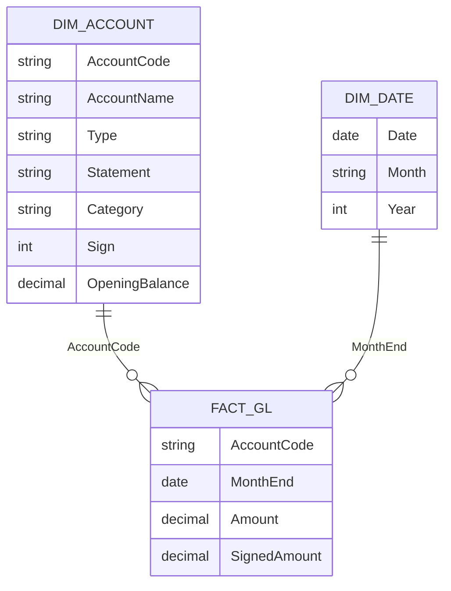

# Microsoft Power BI para Business Intelligence e Data Science

## Dashboard para Análise de Dados da Área de Finanças

- **planejamento financeiro**
    - plano financeiro e estratégico da empresa (alocação de recursos)
- **controle financeiro**
    - monitoramento do fluxo de caixa e orçamento
- **gerenciamento de riscos**
    - mercado, crédito, liquidez
- **tomada de decisão**
    - investimento, buscar financiamento
- **relacionamento com investidores**
    - divulgação de informações e construções da confiança

- **Principais KPIs da área de finanças**
    - *fluxo de caixa* - entrada e saída de capital
    - *margem de lucro* - porcentagem de lucro por venda
    - *retorno sobre o investimento (ROI)* - lucro sobre o investimento total
    - *endividamento* - dívidas sobre o patrimônio líquido
    - *faturamento* - receita do período
    - *custo de aquisição dos clientes*
    - *prazo médio de pagamento* - tempo para pagar fornecedores

- **Principais Custos da Empresa**
    - produção
    - despesas administrativas
    - vendas e marketing
    - financeiras
    - impostos e taxas
    - tecnologia
    - pesquisa e desenvolvimento

- **Principais Receitas da Empresa**
    - franquias
    - vendas de produtos ou serviços
    - investimentos
    - publicidade
    - licenciamento
    - vendas de ativos
    - consultoria e serviços profissionais

- tomar cuidado com o formato dos dados depois do carregamento
    - transposição de colunas e linhas
    - transformação por meio de códigos

- `table.unpivotothercolumns(#nome_tabela, ("colunas pivotadas"), "colunas_mantidas)`

- colunas pivotadas -> serão transformadas
- colunas mantidas -> valores serão repetidas

- atenção ao formato de data do sistema operacional
    - converter conforme localidade

`TotalReceitas = CALCULATE(SUM(DadosFinanceiros[Valor]), DadosFinanceiros[Tipo]='Receitas')`

- semelhante para o caso de despesas
- pode ser útil adicionar uma linha mostrando um resumo estatístico das variáveis
    - média, mediana, ...
- matrizes mostram hierarquias de dados, ao contrário das tabelas
- importante traduzir os requisitos do negócio em ações técnicas
    - empresas precisam de **conhecimento**
- usar principais influenciadores para realizar **segmentação**

## Dashboard para Análise Contábil

- **ciências contábeis**
    - registro, classificação e análise das transações financeiras da empresa
        - balanços, demonstrativos de resultados
        - fluxos de caixa, relatórios contábeis
        - cumprir obrigações fiscais e legais
        - suportar decisões financeiras
        - auditorias

    - **principais relatórios**
        - *balanço patrimonial* - posição financeira da empresa num determinado momento
            - ativos, passivos, patrimônio líquido
        - *demonstrativo do resultado do exercício* - resultado da operação num período de tempo
            - receita, despesas, lucro líquido (prejuízo)
        - *demonstração do fluxo de caixa* - entradas e saídas do caixa
        - *demonstrativos de lucros ou prejuízos acumulados* - mudanças e aplicações do patrimônio líquido da empresa
            - origem do recurso, averiguar gestão
            - análise de rentabilidade do investimento
        - *relatório de análise do desempenho* - análise detalhada dos resultados anteriores, comparando com períodos anteriores
        - *notas autoexplicativas* - informações adicionais das políticas contábeis da empresa
        - *balanço patrimonial*
            - posição financeira no período selecionado
            - ativos, passivos e patrimônio líquido da empresa
                - ativos = bens e direitos
                - passivos = obrigações da empresa
            - gestão financeira - capacidade da empresa de arcar com as obrigações
                - solvência ao longo do tempo
                - saúde financeira
            - pode ser construído com a visualização de matrizes no Power BI
                - atenção na formatação do visual para não comprometer o entendimento dos dados
                - drill-up - subir na hierarquia
                - drill-down - descer na hierarquia
                - setas duplas - mostra o próximo nível na hierarquia mas esconde o "pai"
                - setas bifurcadas - vai apra o próximo nível da hierarquia e exibe o "pai"
                - seta única - habilita o modo de navegação *drill-down*, dando ênfase ao item selecionado e ocultando as outras subcategorias quando uma é selecionada.
    - layout de nível é personalizável
    - opção de pivoteamento da matriz
    - **elementos da célula**
        - opção de criar visualizações dentro da matriz
            - cor do fundo
            - cor da fonte
            - barras de dados
            - criação dos ícones
            - URL
        - tudo isso baseado na formatação condicional das células.

## Example Use Case

### Scenario

A company's finance team needs a monthly view of its financial statements and liquidity for January–March 2024:

- an **income statement** with gross margin, net margin and net income;
- a **balance sheet** that always balances, with its balances taken at a point in time;
- a **cash flow** view showing how cash moved each month;
- a few **ratios** for risk and payables: debt-to-equity and days payable outstanding (DPO).

The source arrives as a **wide table**, one column per month, as finance exports often do. The example unpivots it in Power Query first. Every number was computed by hand. The data lives only in this wiki page.

### Research context

- Key finance KPIs include cash flow, profit margin, ROI, debt-to-equity, revenue, and DPO ([Jirav: custom KPIs](https://help.jirav.com/custom-kpi), [Payment Depot: financial KPIs](https://paymentdepot.com/blog/financial-kpis)).
- DPO is accounts payable ÷ cost of goods sold × 365. This section scales it to a monthly period ([Jirav: custom KPIs](https://help.jirav.com/custom-kpi)).
- Debt-to-equity is total debt ÷ shareholders' equity. Some sources use total liabilities instead, so this section defines it as debt ÷ equity and says so ([Payment Depot](https://paymentdepot.com/blog/financial-kpis), [Ajelix: CFO dashboard](https://ajelix.com/dashboards/cfo-dashboard-example/)).
- Financial models work best with a general-ledger-style fact table, an account classification table that maps accounts to statement sections, and a contiguous date table. Balance sheet measures use cumulative balances, not period sums ([ecosire: Power BI financial reporting](https://ecosire.com/blog/power-bi-financial-reporting-dashboard)).
- No source gave a net cash flow formula. The standard definition is cash inflows minus cash outflows. This section derives it from the cash account's movements.

### Metrics and equations

**Net income for a period (expenses stored as positive amounts):**

$$
\text{Net Income} = \sum_{a \in \text{Income}} \text{Amount}_a - \sum_{a \in \text{Expense}} \text{Amount}_a
$$

**Gross margin and net margin:**

$$
\text{Gross Margin \%} = \frac{\text{Revenue} - \text{COGS}}{\text{Revenue}} \times 100
\qquad
\text{Net Margin \%} = \frac{\text{Net Income}}{\text{Revenue}} \times 100
$$

**Account balance at date $t$ (opening balance plus all movements up to $t$):**

$$
\text{Balance}_a(t) = \text{Opening}_a + \sum_{m \le t} \Delta_{a,m}
$$

**Balance check (must be zero):**

$$
\text{Check}(t) = \text{Assets}(t) - \Big(\text{Liabilities}(t) + \text{Equity}_{\text{accounts}}(t) + \sum_{m \le t} \text{Net Income}_m\Big)
$$

**Net cash flow for month $m$ (change in the cash account):**

$$
\text{Net Cash Flow}_m = \Delta\text{Cash}_m = \text{Inflows}_m - \text{Outflows}_m
$$

**Days payable outstanding, monthly:**

$$
\text{DPO}_m = \frac{\text{Accounts Payable}_m}{\text{COGS}_m} \times D_m
$$

where $D_m$ is the number of days in month $m$.

**Debt-to-equity at date $t$:**

$$
\text{D/E}(t) = \frac{\text{Long-term Debt}(t)}{\text{Total Equity}(t)}
$$

> **Why cumulative balances?** A balance sheet describes a moment in time. Adding January's receivables to February's gives a number that means nothing. Balances are taken at the end of the period, and the cumulative net income is what carries profit into equity.

### Data model

A transaction-level fact table of account movements, one account dimension and one date table. The fact rows are the unpivoted monthly movements.



| Table | Type | Grain | Notes |
|---|---|---|---|
| `Fact_GL` | Fact | One account × one month | Monthly movement, in the account's natural direction |
| `Dim_Account` | Dimension | One account | Type, statement, category, sign, opening balance |
| `Dim_Date` | Dimension | One day | `CALENDAR` for January–March 2024, marked as a date table |

The `Sign` column is `+1` for income accounts, `−1` for expense accounts, and `0` for balance sheet accounts. `SignedAmount` uses it to compute net income from one column.

### Sample data

**Source: wide table, as exported** (one row per account, one column per month; movements in the account's natural direction, so a debt repayment is negative)

| AccountCode | AccountName | Type | Statement | Category | Opening Balance | Jan 2024 | Feb 2024 | Mar 2024 |
|---|---|---|---|---|---|---|---|---|
| 1000 | Cash | Asset | Balance Sheet | Cash | 100,000 | 10,000 | 20,100 | 27,200 |
| 1100 | Accounts Receivable | Asset | Balance Sheet | Receivables | 40,000 | 25,000 | 15,000 | 20,000 |
| 2000 | Accounts Payable | Liability | Balance Sheet | Payables | 20,000 | 8,000 | 5,000 | 5,000 |
| 2500 | Long-term Debt | Liability | Balance Sheet | Debt | 60,000 | -2,000 | -2,000 | -2,000 |
| 3000 | Share Capital | Equity | Balance Sheet | Equity | 50,000 | 0 | 0 | 10,000 |
| 3100 | Retained Earnings | Equity | Balance Sheet | Equity | 10,000 | 0 | 0 | 0 |
| 4000 | Sales Revenue | Income | P&L | Revenue | 0 | 60,000 | 70,000 | 80,000 |
| 5000 | Cost of Goods Sold | Expense | P&L | COGS | 0 | 20,000 | 25,000 | 30,000 |
| 6000 | Operating Expenses | Expense | P&L | Operating Expense | 0 | 10,000 | 12,000 | 15,000 |
| 7000 | Interest Expense | Expense | P&L | Interest | 0 | 1,000 | 900 | 800 |

Retained earnings has no monthly movements. Its closing amount comes from cumulative net income in DAX.

The wide table is unpivoted in Power Query. The rows then become one line per account and month, which is the shape `Fact_GL` needs.

### Power Query: unpivot the wide table

The lesson's syntax, applied to the export above:

```m
let
    Source = Excel.CurrentWorkbook(){[Name = "TrialBalanceWide"]}[Content],
    // Keep the descriptive columns; unpivot the three month columns
    Unpivoted = Table.UnpivotOtherColumns(
        Source,
        {"AccountCode", "AccountName", "Type", "Statement", "Category", "Opening Balance"},
        "MonthLabel",
        "Amount"
    ),
    // "Jan 2024" is text: convert to the last day of that month
    WithMonthEnd = Table.AddColumn(
        Unpivoted,
        "MonthEnd",
        each Date.EndOfMonth(Date.FromText("1 " & [MonthLabel], "en-US")),
        type date
    ),
    // Keep only what the model needs
    FactGL = Table.SelectColumns(WithMonthEnd, {"AccountCode", "MonthEnd", "Amount"})
in
    FactGL
```

Two things to check after loading: the month labels parse as dates in your locale, and `Amount` is numeric. Unpivoting leaves them as text otherwise.

### Calculated columns and measures (DAX)

```dax
-- Dim_Account: +1 income, -1 expense, 0 for balance sheet accounts
-- (set in Power Query or as a column; shown here as the rule)
Sign =
SWITCH(
    TRUE(),
    Dim_Account[Type] = "Income", 1,
    Dim_Account[Type] = "Expense", -1,
    0
)

-- Fact_GL: amount with the sign convention applied
Signed Amount = RELATED(Dim_Account[Sign]) * Fact_GL[Amount]

Dim_Date = CALENDAR(DATE(2024, 1, 1), DATE(2024, 3, 31))
```

```dax
-- Period P&L (monthly activity)
Revenue = CALCULATE(SUM(Fact_GL[Amount]), Dim_Account[Type] = "Income")

COGS = CALCULATE(SUM(Fact_GL[Amount]), Dim_Account[Category] = "COGS")

Expenses = CALCULATE(SUM(Fact_GL[Amount]), Dim_Account[Type] = "Expense")

-- Sign convention: one column, one filter
Net Income = CALCULATE(SUM(Fact_GL[Signed Amount]), Dim_Account[Statement] = "P&L")

Gross Margin % = DIVIDE([Revenue] - [COGS], [Revenue])

Net Margin % = DIVIDE([Net Income], [Revenue])

-- Cash account movement = net cash flow for the period
Net Cash Flow = CALCULATE(SUM(Fact_GL[Amount]), Dim_Account[AccountCode] = "1000")
```

```dax
-- Balance sheet: cumulative balance up to the last date in context
Account Balance =
VAR LastDate = MAX(Dim_Date[Date])
RETURN
    SUM(Dim_Account[OpeningBalance])
    + CALCULATE(
        SUM(Fact_GL[Amount]),
        DATESBETWEEN(Dim_Date[Date], BLANK(), LastDate)
    )

Cumulative Net Income =
CALCULATE(
    [Net Income],
    DATESBETWEEN(Dim_Date[Date], BLANK(), MAX(Dim_Date[Date]))
)

Total Assets =
SUMX(FILTER(Dim_Account, Dim_Account[Type] = "Asset"), [Account Balance])

Total Liabilities =
SUMX(FILTER(Dim_Account, Dim_Account[Type] = "Liability"), [Account Balance])

Equity Accounts =
SUMX(FILTER(Dim_Account, Dim_Account[Type] = "Equity"), [Account Balance])

Total Equity = [Equity Accounts] + [Cumulative Net Income]

Balance Check = ROUND([Total Assets] - ([Total Liabilities] + [Total Equity]), 2)

-- Ratios on balances
Long-term Debt = CALCULATE([Account Balance], Dim_Account[AccountCode] = "2500")

Accounts Payable = CALCULATE([Account Balance], Dim_Account[AccountCode] = "2000")

Debt-to-Equity = DIVIDE([Long-term Debt], [Total Equity])

-- Days in the month: DAY of the last date in context (valid for a single month)
DPO (days) =
DIVIDE([Accounts Payable], [COGS]) * DAY(MAX(Dim_Date[Date]))
```

`Account Balance` is evaluated once per account row inside `SUMX`, so the account filter and the date filter both apply. The cumulative net income is what moves profit into equity, so the balance check closes.

### Expected results

These values were calculated by hand from the sample. Monthly columns use the month slicer. The Q1 column shows the full-quarter P&L and the **end-of-quarter** balances, because balances are not summed across months.

| Measure | Jan 2024 | Feb 2024 | Mar 2024 | Q1 2024 |
|---|---|---|---|---|
| Revenue | 60,000.00 | 70,000.00 | 80,000.00 | 210,000.00 |
| COGS | 20,000.00 | 25,000.00 | 30,000.00 | 75,000.00 |
| Gross margin % | 66.67% | 64.29% | 62.50% | 64.29% |
| Operating expenses | 10,000.00 | 12,000.00 | 15,000.00 | 37,000.00 |
| Interest expense | 1,000.00 | 900.00 | 800.00 | 2,700.00 |
| **Net income** | **29,000.00** | **32,100.00** | **34,200.00** | **95,300.00** |
| Net margin % | 48.33% | 45.86% | 42.75% | 45.38% |
| Net cash flow | 10,000.00 | 20,100.00 | 27,200.00 | 57,300.00 |
| Cash (end) | 110,000.00 | 130,100.00 | 157,300.00 | 157,300.00 |
| Accounts receivable (end) | 65,000.00 | 80,000.00 | 100,000.00 | 100,000.00 |
| Total assets (end) | 175,000.00 | 210,100.00 | 257,300.00 | 257,300.00 |
| Accounts payable (end) | 28,000.00 | 33,000.00 | 38,000.00 | 38,000.00 |
| Long-term debt (end) | 58,000.00 | 56,000.00 | 54,000.00 | 54,000.00 |
| Total equity (end) | 89,000.00 | 121,100.00 | 165,300.00 | 165,300.00 |
| **Balance check** | **0.00** | **0.00** | **0.00** | **0.00** |
| Debt-to-equity | 0.65 | 0.46 | 0.33 | 0.33 |
| DPO (days) | 43.40 | 38.28 | 39.27 | – |

Working for the equity line in March: share capital 60,000 + retained earnings (10,000 + cumulative net income 95,300) = 165,300. Total liabilities are 38,000 + 54,000 = 92,000, and 92,000 + 165,300 = 257,300 = total assets.

Working for net cash flow in March: inflows are the 60,000 collected from customers and the 10,000 share issue, total 70,000. Outflows are suppliers 25,000, operating expenses 15,000, interest 800 and debt repayment 2,000, total 42,800. The net is 27,200, which equals the cash movement.

### Mapping to the lesson's material

- **Income statement:** a matrix with revenue, COGS, gross profit, expenses and net income as rows, and months as columns, with subtotals. The lesson's matrix options (drill-down, pivot) apply here.
- **Balance sheet:** a matrix grouped by type (Asset → Account) with `Account Balance` as the value, and the balance check as a card.
- **Cash flow:** a waterfall from opening cash to closing cash, with monthly net cash flow as the step.
- **Ratios:** cards for debt-to-equity and DPO, with the monthly line as context.

### Pitfalls shown in this example

- **Summing balances across months.** Adding the three months' total assets gives 642,400, which has no meaning. Balances use the end-of-period value, as the Q1 column does.
- **Sign convention.** Adding all P&L amounts as stored, with expenses positive, gives $60{,}000 + 20{,}000 + 10{,}000 + 1{,}000 = 91{,}000$ for January, not the net income of 29,000. `Signed Amount` applies the sign in one place.
- **Cash as a proxy.** Net cash flow here is the cash account's movement, which is exact for this sample. In a real ledger, cash can move through other accounts, so a proper cash flow statement needs the classification of each cash entry.
- **Equity injection.** The 10,000 share issue in March is part of net cash flow but not operating cash flow. Splitting cash flow into operating and financing needs the category of each movement.
- **Debt definition.** Debt-to-equity uses long-term debt only here. Using total liabilities would give $(38{,}000 + 54{,}000) / 165{,}300 = 0.56$ for March, not 0.33.
- **DPO per period.** The monthly DPO uses the month's COGS and the month's days. A quarterly DPO needs quarterly COGS and 90 days, not an average of monthly values.
- **Unpivot types.** After unpivoting, the month label is text. Without the date conversion, the date table cannot relate to the fact, and the balance measures return nothing.

